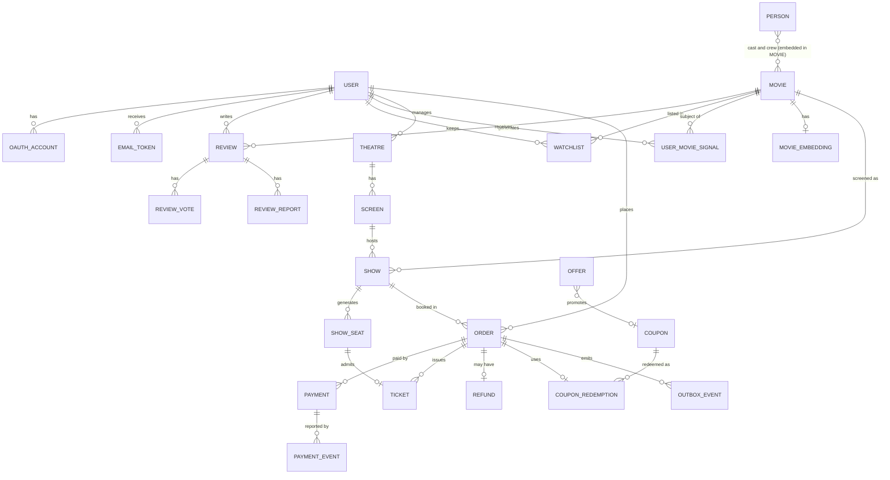

# QueueSkip: Plan v2 (full database design, with a queue)

A movie booking app. Users browse movies (cast, reviews, genres), pick a show, choose seats, pay (test mode), and get a QR ticket. The hard part is the backend: no double-booked seats, no double payments, background work that never gets lost, and a server that holds up under load.

This replaces `queueskip_plan.md` and every earlier plan. The code for everything is in **`queueskip_code_reference.md`**.

**What changed from the last plan**
- The **full database design is back** (section 5, 26 collections), because your Week 1 code uses it.
- A **queue is added**. The project now has two processes: the **API** (answers web requests) and the **worker** (sends emails, creates tickets, expires unpaid orders, processes refunds). See sections 3.1 and 4.

**Removed on purpose** (hard to explain as a beginner): test files, `.http` files, Prettier, ESLint, CI pipelines, a monorepo with a shared package, AWS, and the complicated extras (waiting room, live seat updates, AI search). **Kept:** every backend concept and the full database design.

## 1. Stack

| Part | Choice |
|---|---|
| Language | TypeScript (simple `tsconfig`, run with `tsx`) |
| Backend | Node.js, Express |
| Database | MongoDB with Mongoose, as a replica set (needed for transactions) |
| Redis | one instance: seat holds, cache, rate limiting, counters, and the storage for the queue |
| Queue | BullMQ (runs in the worker process) |
| Load balancer | nginx in front of 3 copies of the API |
| Frontend | React with Vite |
| Local services | Docker Compose: MongoDB, Redis, nginx |

**Two processes:** `npm run dev` starts the API, `npm run worker` starts the worker. You can run more than one copy of each.

**Tools you use to check your work** (no test code): Postman to send requests, `mongosh` to look at the database, `redis-cli` to look at Redis, the worker terminal to watch jobs, and `autocannon` (one terminal command, no file) to send many requests at once.

## 2. Features

**Core:** sign up and log in; movies with genres, cast and people; search; reviews and ratings; theatres, screens, shows and the seat map; seat holds; orders and payment; QR tickets by email.

**Then:** coupons and offers; genre and behaviour based recommendations; email verification and password reset; Google login; refunds and show cancellation.

**Backend concepts you will build** (section 3): caching, rate limiting, Bloom filter, write-behind caching, load balancing, atomic updates, transactions, idempotency, a queue with retries, the transactional outbox, a distributed lock, webhooks.

**Later, only if you have time:** AI search (the `MovieEmbedding` collection waits for it), a waiting room (`Show.highDemand` waits for it), live seat updates, real Razorpay, deploying to the cloud.

## 3. Backend concepts (the heart of the project)

Each row is one thing you can build, demo by hand, and explain in an interview.

| # | Concept | Where it is used | One-line explanation | Demo by hand |
|---|---|---|---|---|
| 1 | Authentication | JWT access token (15 min) plus refresh token in an httpOnly cookie, bcrypt passwords | the server never stores plain passwords; short-lived tokens limit damage if one leaks | wrong password gives 401; expired token gives 401 |
| 2 | Authorization | `requireRole` middleware (`USER`, `MANAGER`, `ADMIN`) | who you are is not the same as what you may do | a normal user on an admin route gets 403 |
| 3 | Indexes and pagination | unique email, text search on movies, `skip` and `limit` | an index lets MongoDB find a document without scanning the whole collection | `explain()` in `mongosh` shows an index scan |
| 4 | Race condition | two people taking the same seat | two requests read the same state at the same time and both act on it | the `autocannon` demo (section 9) |
| 5 | **Atomic update** | seat hold, order status, coupon use, rating totals | do check-and-change as one operation so nothing can slip in between | 50 parallel requests, exactly 1 wins |
| 6 | Redis with TTL | a seat hold lasts 5 minutes, then disappears by itself | the hold cleans itself up even if the server crashes | `redis-cli TTL` counts down |
| 7 | **Transaction** | confirm payment: sell seats, mark order paid, record payment, commit coupon, save outbox row; all or nothing | either every step happens or none does | make one step fail on purpose and see nothing saved |
| 8 | **Idempotency** | creating an order (`IdempotencyKey` collection) | repeating the same request gives the same result, not a second order | send the same request twice with the same key |
| 9 | **Caching (cache-aside)** | movie details | look in Redis first; on a miss read MongoDB and save it in Redis for 60 seconds | second request is faster; `redis-cli GET movie:<id>` |
| 10 | **Rate limiting** | login 5 per minute, holds 10 per minute, coupons 10 per minute | stop abuse and password guessing; counters live in Redis so all servers share them | `autocannon` shows 429 after the limit |
| 11 | **Bloom filter** | block random movie ids and coupon guesses before they reach MongoDB | a tiny structure that says "definitely not here" or "maybe here" | random ids never touch the database |
| 12 | **Write-behind caching** | movie view counts | add to a Redis counter now, write to MongoDB in a batch every 10 seconds | 100 views become 1 database write |
| 13 | **Load balancing** | nginx in front of 3 API copies | spread requests across servers; works because the API keeps no state in memory | kill one copy and traffic continues |
| 14 | Distributed lock | the view-count flush runs on every worker copy but must run once | `SET key NX EX`: only one copy gets the lock | only one worker prints "flushed" |
| 15 | Webhook | the payment provider tells your server "payment done" (`PaymentEvent`) | never trust the browser; verify a signature, and process each event once | send the same webhook twice, nothing changes |
| 16 | **Message queue** | emails, tickets, order expiry and refunds run in the worker, not in the web request | slow or failing work happens in the background and is retried | stop the worker, pay, start it: the tickets appear |
| 17 | **Transactional outbox** | an `OutboxEvent` row is saved in the same transaction as the order change | the follow-up job can never be lost, and never exists for a change that was rolled back | stop the worker after paying: the row waits, `published: false` |

### 3.1 How the less obvious ones work

**Atomic seat hold (Redis Lua script).** A Lua script runs as one uninterrupted step in Redis. It checks every requested seat; if all are free it holds all of them for 5 minutes, otherwise it holds none.
```lua
-- KEYS = one key per seat, ARGV[1] = the hold id, ARGV[2] = seconds
for i = 1, #KEYS do
  if redis.call('EXISTS', KEYS[i]) == 1 then return 0 end
end
for i = 1, #KEYS do
  redis.call('SET', KEYS[i], ARGV[1], 'EX', ARGV[2])
end
return 1
```
Rule: **Redis is the fast gate, MongoDB is the final judge.** Redis decides who may try to buy; MongoDB makes sure a seat is never sold twice.

**Rate limiter (fixed window).** For each user (or IP) and route:
```
key = rl:login:<userOrIp>
SET key 0 EX 60 NX      // create the counter with a 60 second life if it does not exist
count = INCR key        // atomic add
if count > limit: respond 429
```
Weakness to mention: a burst at the edge of two windows can double the limit. The upgrade is a sliding window or a token bucket. If Redis is down: login is blocked (safe), browsing is allowed.

**Bloom filter (built on Redis bits).** A row of 1,000,000 bits, all zero. To add an id, run it through 3 hash functions and switch those 3 bits on. To check an id, hash it the same way: if **any** bit is off it is **definitely not** there; if all are on it is **maybe** there. It never forgets an id (no wrong "no"), but sometimes says "maybe" for something that is not there (measured: 0.3 percent at 50,000 ids, about 2 percent at 100,000). Use: `GET /api/movies/:id` checks the filter first, and a "definitely not" returns 404 without touching MongoDB. Fill it from the database when the server starts, and add each new id **before** saving the movie. Limitation: you cannot remove an id; rebuild it now and then.

**Write-behind view counter.**
```
on every movie view:   HINCRBY views:pending <movieId> 1
every 10 seconds:      give the batch a unique id, RENAME views:pending views:flushing   (atomic)
                       insert the batch id into ProcessedBatch (a duplicate means "already written": skip)
                       bulk-update MongoDB with $inc, then delete views:flushing
```
If the server crashes you lose at most the views of the last 10 seconds, and a half-finished batch is finished exactly once on the next run. That is fine for views and **never** acceptable for seats, orders or payments, which always go straight to MongoDB.

**Load balancing.** Run three copies of the API on ports 5001, 5002, 5003. nginx listens on 8080 and spreads requests. It works because the API is **stateless**: login state is in the JWT, holds and counters are in Redis, data is in MongoDB. Any copy can serve any request. Each copy adds an `X-Served-By` header so you can see the spread. The worker process is not behind nginx (it serves no web requests); you can run two copies of it.

**Distributed lock.** `SET lock:<job> <instance> NX EX 8`: whoever gets "OK" does the work, the others skip this round.

**Idempotency.** The client sends an `Idempotency-Key` header. Before creating the order you insert `{ userId, key, endpoint, requestHash }` into `IdempotencyKey`. A unique index makes a second insert fail. Then: same key and same body and already finished: return the saved answer; same key but a different body: 422; still running: 409. The records delete themselves after 24 hours (TTL index).

**Transaction (confirm payment).** One function, `confirmPayment`, used by the fake pay button and by the real webhook. Inside `session.withTransaction(...)`:
1. mark the order `PAID`, but only if it is still `PENDING_PAYMENT` (a second identical confirmation finds nothing and stops)
2. mark the seats `SOLD`, but only the ones still `AVAILABLE`; if the number updated is wrong, someone else got a seat first, so throw and everything is undone
3. mark the payment `SUCCEEDED`
4. turn the coupon redemption from `RESERVED` into `COMMITTED`
5. add to `Show.seatCounts.sold`
6. save an `OutboxEvent` called `order.paid`

If step 2 fails, the money was taken but the seats are gone: the order becomes `REFUND_PENDING`, a `Refund` is created and a refund job is queued.

**Webhook.** The provider calls `POST /api/webhooks/payments`. Check the signature on the raw body (HMAC), then insert a `PaymentEvent` with the provider's event id. The unique index rejects a repeated event, so it is processed once. Then call `confirmPayment`. For the fake payment, the pay endpoint does the same steps itself.

**The queue and the outbox (the new part).**

The API process **never talks to the queue**. When something must happen later (send an email, create tickets, expire an order), the API saves an `OutboxEvent` row in MongoDB, in the same transaction as the change. The worker process does the rest:
```
API request ──► MongoDB transaction: order change + OutboxEvent row
                         │
Worker, every 2 s:  outbox publisher reads unpublished rows ──► BullMQ queue (stored in Redis)
                         │
Worker:             email worker / order worker take a job and do it
                         │  if it fails: retry after 2 s, 4 s, 8 s, 16 s;
                         │  after 5 tries it stays in the "failed" list so you can look at it
```
Why the API does not call the queue directly: if Redis is down, a request would hang. Writing to MongoDB cannot hang on Redis. And if the server crashed between "order paid" and "queue the ticket job", the job would be lost; with the outbox it is saved with the order or not at all.

| Outbox event | Job | What the worker does |
|---|---|---|
| `order.created` | `expireOrder`, delayed until `expiresAt` | if still `PENDING_PAYMENT`: mark `EXPIRED`, release the coupon use and the Redis hold |
| `order.paid` | `createTickets` | create one ticket per seat, mark the order `CONFIRMED`, queue the email |
| `email.send` | `sendEmail` | send it (in development it is printed in the worker terminal) |
| `refund.requested` | `processRefund` | mark the refund `PROCESSED`, the payment `REFUNDED`, the order `REFUNDED` |
| repeating, every 60 s | `sweepOrders` | expire any order whose delayed job was lost (a safety net) |

**At least once, so every job must be safe to run twice.** The outbox guarantees a job runs, not that it runs only once. So: tickets use an upsert on `(orderId, showSeatId)`; only the run that actually moved the order to `CONFIRMED` queues the email; expiry uses a conditional update; a refund only runs while its status is `PENDING`. The job id `outbox_<id>` also stops one outbox row becoming two jobs.

## 4. How a booking works

1. **Hold.** The user picks seats. The Lua script holds them in Redis for 5 minutes (one active hold per user per show).
2. **Order.** The user creates an order with an `Idempotency-Key`. Status `PENDING_PAYMENT`. The hold is extended to 10 minutes. A coupon use is `RESERVED`. An `order.created` outbox row is saved. Seats are **not** sold yet.
3. **Pay.** A `Payment` row is created. With the fake payment the pay button confirms straight away; with Razorpay test mode the provider calls your webhook, and the `PaymentEvent` row makes a repeated webhook harmless.
4. **Confirm (one transaction).** Seats `SOLD`, order `PAID`, payment `SUCCEEDED`, coupon `COMMITTED`, seat counter, `order.paid` outbox row.
5. **Worker.** Publishes the outbox row, creates the tickets, marks the order `CONFIRMED`, and the email with the ticket codes goes out.
6. **Too slow?** The Redis hold disappears by itself; the delayed `expireOrder` job marks the order `EXPIRED` and gives back the coupon.
7. **Seats taken at payment time?** The transaction rolls back, the order becomes `REFUND_PENDING`, a `Refund` is created and queued, and the worker processes it with retries.

## 5. Database design


This section is the single reference for what is stored, where, and why. Each model you write in Weeks 1 to 11 comes from here (the code is in `queueskip_code_reference.md`). Build one module at a time, but **design the indexes from the queries in 5.6**, not from the field list.

### 5.1 Principles

1. **MongoDB holds durable truth. Redis holds ephemeral state** (seat holds, rate-limit counters, Bloom filters, write-behind buffers, caches, the job queue). Seat holds in Redis are always double-checked by MongoDB before money or seats change.
2. **Design from queries.** Every index in this section is justified by an access pattern in 5.6. An index with no query is cost without benefit.
3. **Embed** when the data is read together with its parent, is small and bounded, and changes with the parent. **Reference** when it grows without bound, is queried on its own, or is updated concurrently.
4. **Snapshot** what must never change retroactively. An order keeps the movie title, theatre name, seat labels and prices as they were at purchase.
5. **Denormalize only with a named owner** of the copy (who keeps it correct, and how it is repaired).
6. **No unbounded arrays.** Every embedded array below has a stated maximum.
7. **Types:** ids are `ObjectId`; money is an integer in minor units (paise) plus `currency`; times are `Date` in UTC; enums are strings taken from `utils/constants.ts`; "no value" is an explicit `null`.
8. **Normalize before storing** anything used for uniqueness: emails lowercased and trimmed, coupon codes uppercased.
9. Every collection has `createdAt` and `updatedAt` (Mongoose `timestamps: true`) unless noted.
10. **Schema evolution:** additive changes only; `schemaVersion` on long-lived documents (`User`, `Order`); Mongoose creates the indexes when the server starts in development; in production you can turn `autoIndex` off and create them once with `Model.syncIndexes()`.
11. Typical documents stay under about 16 KB (the hard limit is 16 MB).

### 5.2 What lives where

| Data | Store | Why |
|---|---|---|
| Users, catalog, theatres, shows, orders, payments, tickets, coupons, reviews | MongoDB | durable, queryable, transactional |
| A seat that is **held** | Redis `hold:<showId>:<seatId>` (TTL) | ephemeral, atomic Lua, self-expiring. MongoDB never stores `HELD` |
| A seat that is **sold** | MongoDB `ShowSeat.status = 'SOLD'` | durable, protected by a conditional update |
| Rate-limit counters | Redis | fast, atomic |
| Idempotency | MongoDB `IdempotencyKey` (unique index, TTL 24 h) | the unique index is the lock and the record |
| Job queues | Redis, via BullMQ (only the worker process uses it) | retries, delays and repeating jobs built in |
| Outbox | MongoDB `OutboxEvent`, written **in the same transaction** as the order change | this is what makes "PAID" and "ticket job queued" consistent |
| Cached movie pages, similar lists | Redis | rebuildable |
| Bloom filters | Redis | rebuilt from MongoDB when the server starts |
| View-count buffer | Redis `views:pending`, final value in `Movie.viewCount` | write-behind |
| Embeddings | MongoDB `MovieEmbedding` (only for AI search, a later feature) | large vectors kept out of normal movie reads |
| Review aggregates | MongoDB `Movie.ratingSum`, `ratingCount`, `ratingAvg` | updated atomically, never computed per page view |
| Genre list | a constant in `utils/genres.ts` | about 20 fixed values do not need a collection |

### 5.3 Relationship diagram



### 5.4 Embedded or referenced

| Relationship | Choice | Reason | Bound |
|---|---|---|---|
| Movie to genres | embedded string array | tiny, filtered by value | at most 6 |
| Movie to cast and crew | embedded `{ personId, name, ... }` | always shown with the movie | cast at most 50, crew at most 20 |
| Movie to reviews | **referenced** (`Review`) | unbounded, paged, sorted | none |
| Movie to embedding | **referenced** (`MovieEmbedding`) | a vector of hundreds of numbers would bloat every movie read | one per movie |
| Screen to layout | embedded | read with the screen | at most 20 sections |
| Show to price tiers | embedded | read with the show | at most 6 |
| Show to seats | **referenced** (`ShowSeat`) | one document per seat, updated concurrently | about 100 to 500 per show |
| Order to items | embedded | always read with the order, written atomically with it | at most 6 |
| Order to history | embedded | bounded by the state machine | at most 20 |
| Order to payments | **referenced** | several attempts, webhooks arrive independently | few |
| Order to tickets | **referenced** | created later by a worker, scanned independently | at most 6 |
| Review to votes | **referenced**, `helpfulCount` copied onto the review | one vote per user | unbounded |
| Coupon to redemptions | **referenced**, `usedCount` copied onto the coupon | audit trail and uniqueness | unbounded |
| User to Google identities | **referenced** (`OAuthAccount`) | lookup by Google `sub` | few |

### 5.5 Collections

Notation: `Type`, `Type | null`, `[Type]` for an array. "Indexes" lists every index and the reason.

#### Identity

**User**
```
name            String  (2 to 60)
email           String  (lowercase, trimmed)
emailVerified   Boolean (default false)
passwordHash    String | null            null for Google-only accounts
role            'USER' | 'MANAGER' | 'ADMIN'      (default 'USER')
status          'ACTIVE' | 'SUSPENDED' | 'DELETED' (default 'ACTIVE')
tokenVersion    Number  (default 0)      bump to end every session
lastLoginAt     Date | null
schemaVersion   Number  (default 1)
```
Indexes: `unique(email)` (login, registration check). Never returned to clients: `passwordHash`, `tokenVersion`. A `DELETED` user is anonymized (see 5.8).

**OAuthAccount**: `userId`, `provider ('GOOGLE')`, `providerUserId` (Google `sub`), `email`. Indexes: `unique(provider, providerUserId)` (sign-in lookup), `index(userId)`.

**EmailToken**: `userId`, `type ('VERIFY' | 'RESET')`, `tokenHash` (SHA-256 hex, the raw token is never stored), `expiresAt`, `usedAt | null`. Indexes: `unique(tokenHash)`; `index(userId, type, createdAt -1)` (find the latest to invalidate older ones); **TTL on `expiresAt`** (`expireAfterSeconds: 604800`, keeps a week of history).

#### Catalog

**Movie**
```
title           String  (1 to 200)
synopsis        String  (up to 3000)
runtimeMin      Number
language        String  (ISO 639-1, for example 'hi')
releaseDate     Date
certification   String  ('U', 'UA', 'A', ...)
posterUrl       String | null
trailerUrl      String | null
status          'UPCOMING' | 'NOW_SHOWING' | 'ENDED'
genres          [String]    at most 6, values from utils/genres.ts
cast            [{ personId, name, characterName, billingOrder }]   at most 50
crew            [{ personId, name, job }]                           at most 20
ratingSum       Number (0)   ratingCount Number (0)   ratingAvg Number (0)
viewCount       Number (0)   written by the write-behind flusher
```
Indexes: `text(title:10, 'cast.name':5, synopsis:3)` (search); `(status, releaseDate -1)` (home page lists); `(genres, status, ratingAvg -1)` (genre rows); `(language, status)`; `(cast.personId)` and `(crew.personId)` (filmography).
Rating update is one atomic pipeline update, so the average always matches the totals:
```js
Movie.updateOne({ _id: movieId }, [
  { $set: { ratingSum: { $add: ['$ratingSum', delta] }, ratingCount: { $add: ['$ratingCount', countDelta] } } },
  { $set: { ratingAvg: { $cond: [{ $gt: ['$ratingCount', 0] }, { $divide: ['$ratingSum', '$ratingCount'] }, 0] } } },
]);
```
Copies: `cast.name` and `crew.name` copy `Person.name`. Owner of the copy: `PUT /movies/:id/cast` writes it, and a script `syncPersonNames` repairs it if a person is renamed.

**Person**: `name`, `bio`, `photoUrl | null`, `birthDate | null`. Indexes: `text(name)`; `index(name)` for prefix lookups.

**MovieEmbedding**: `movieId`, `vector [Number]`, `dimensions`, `model`, `modelVersion`, `sourceHash` (hash of the text that was embedded, so unchanged movies are not re-embedded). Indexes: `unique(movieId)`. Loaded in bulk by the similarity job and cached; never part of a normal movie response.

#### Engagement

**Review**
```
movieId, userId
userName        String   copy of User.name at write time; 'Deleted user' after account deletion
rating          Number   integer 1 to 10
title           String   (up to 100)
body            String   (up to 2000, plain text)
helpfulCount    Number (0)     reportCount Number (0)
verifiedViewer  Boolean (false)   computed from orders, never from the client
status          'VISIBLE' | 'HIDDEN' (default 'VISIBLE')
```
Indexes: `unique(movieId, userId)` (one review per user, upsert target); `(movieId, status, createdAt -1)` (recent); `(movieId, status, helpfulCount -1)` (helpful); `(userId, createdAt -1)` (my reviews); `partial (status, reportCount -1)` where `reportCount > 0` (moderation queue).

**ReviewVote**: `reviewId`, `userId`. Indexes: `unique(reviewId, userId)`, `index(userId)`. `helpfulCount` changes by `$inc` only when the vote insert or delete actually happened.

**ReviewReport**: `reviewId`, `userId`, `reason`, `note`, `status ('OPEN' | 'RESOLVED')`. Indexes: `unique(reviewId, userId)`, `(status, createdAt)`.

**Watchlist**: `userId`, `movieId`, `createdAt` (no `updatedAt`). Indexes: `unique(userId, movieId)` (add is an upsert; status check), `(userId, createdAt -1)` (list).

**UserMovieSignal**: `signalId` (generated by the API, makes batch inserts idempotent), `userId`, `movieId`, `type ('VIEW' | 'WATCHLIST' | 'BOOKED' | 'RATED_HIGH' | 'RATED_LOW')`, `weight`, `createdAt`. Indexes: `unique(signalId)`, `(userId, createdAt -1)` (build a taste profile), **TTL on `createdAt`** (180 days).

#### Venues and shows

**Theatre**: `managerId`, `name`, `city`, `address`, optional `location` (GeoJSON point, with a `2dsphere` index only if you add "near me"). Indexes: `(city, name)`, `(managerId)`.

**Screen**: `theatreId`, `name`, `layout { sections: [{ name, rows, seatsPerRow, tier }] }` (at most 20 sections), `totalSeats` (computed on save), `showWriteVersion` (Number, see the overlap rule below). Indexes: `unique(theatreId, name)`.

**Show**
```
movieId, screenId
theatreId       copy from Screen (owner: show creation)
startsAt, endsAt   Date   endsAt = startsAt + runtime + cleaning buffer
status          'SCHEDULED' | 'ON_SALE' | 'CANCELLED' | 'COMPLETED'
highDemand      Boolean (false)   not used until you build a waiting room (a later feature)
priceTiers      [{ tier, priceMinor }]   at most 6
currency        String ('INR')
seatCounts      { total, sold }          sold is $inc'd in the confirm-payment transaction
```
Indexes: `(movieId, status, startsAt)` (showtimes for a movie), `(theatreId, startsAt)` (theatre schedule), `(screenId, startsAt)` (overlap check).
**Overlap rule.** A unique index cannot forbid overlapping time ranges, and two managers can create overlapping shows at the same instant. Create a show inside a transaction that first does `Screen.updateOne({ _id: screenId }, { $inc: { showWriteVersion: 1 } }, { session })`. Two concurrent creators then conflict on that document, one retries, and the overlap query (`screenId`, not cancelled, `startsAt < newEnd`, `endsAt > newStart`) runs on a consistent view.

**ShowSeat**
```
showId, section, row, number
seatLabel       String   for example 'A-5' (copy for display and snapshots)
tier            String   priceMinor Number
status          'AVAILABLE' | 'SOLD'
orderId         ObjectId | null          soldAt Date | null
expireAt        Date                     show.endsAt + 90 days
```
Indexes: `unique(showId, section, row, number)` (no duplicate seats, last safety net); `(showId, status)` (seat map, availability counts); **TTL on `expireAt`** (old seats are purged; orders and tickets keep their own snapshot of the label, so nothing is lost). About 300 documents per show is normal.

#### Commerce

**Order**
```
userId, showId
snapshot        { movieId, movieTitle, theatreId, theatreName, screenName, startsAt }
items           [{ showSeatId, seatLabel, tier, priceMinor }]     at most 6
subtotalMinor, feeMinor, discountMinor, totalMinor      integers
currency        String
couponId        ObjectId | null          couponCode String | null
holdId          String                   the Redis hold this order was created from
status          'PENDING_PAYMENT' | 'PAID' | 'CONFIRMED' | 'EXPIRED' | 'CANCELLED' | 'FAILED' | 'REFUND_PENDING' | 'REFUNDED'
expiresAt       Date                     end of the payment window
paidAt, cancelledAt   Date | null
history         [{ from, to, reason, at }]                        at most 20
schemaVersion   Number (1)
```
Indexes: `(userId, createdAt -1)` (my orders); `partial (status, expiresAt)` where `status = 'PENDING_PAYMENT'` (the expiry sweeper only scans open orders); `(showId, status)` (show cancellation, sales counts); `(status, createdAt -1)` (admin views).
Invariant: `totalMinor = subtotalMinor + feeMinor - discountMinor`, `discountMinor <= subtotalMinor + feeMinor`, `totalMinor >= 0`. Computed only by `pricingService`.

**Payment**: `orderId`, `provider ('RAZORPAY' | 'FAKE')` (FAKE is your own pay button), `providerOrderId`, `providerPaymentId` (leave it unset until known: a sparse unique index skips missing fields, but would reject two `null`s), `status ('CREATED' | 'SUCCEEDED' | 'FAILED' | 'REFUNDED')`, `amountMinor`, `currency`, `failureReason | null`. Indexes: `unique(providerOrderId)` (webhook lookup), `unique sparse (providerPaymentId)`, `(orderId)`.

**PaymentEvent**: `providerEventId`, `type`, `payload` (raw body, size-limited), `status ('RECEIVED' | 'PROCESSED' | 'IGNORED' | 'FAILED')`, `receivedAt`, `processedAt | null`. Indexes: `unique(providerEventId)` (**webhook dedupe**, the insert fails on a replay); TTL on `receivedAt` (90 days).

**Refund**: `orderId`, `paymentId`, `providerRefundId | null`, `amountMinor`, `reason ('SHOW_CANCELLED' | 'USER_CANCELLED' | 'LATE_PAYMENT_SEATS_TAKEN')`, `status ('PENDING' | 'PROCESSED' | 'FAILED')`, `attempts`. Indexes: `unique(orderId)` (one refund per order), `(status, createdAt)` (retry worker).

**Ticket**
```
orderId, showId, showSeatId
seatLabel       String
ticketCode      String   short human-readable code
qrJti           String   id inside the signed QR token
usedAt          Date | null     usedByUserId ObjectId | null
cancelledAt     Date | null
```
Indexes: `unique(orderId, showSeatId)` (the ticket worker is idempotent), `unique(ticketCode)`, `(showId, usedAt)` (door statistics). Scan is one atomic statement: `findOneAndUpdate({ _id, usedAt: null, cancelledAt: null }, { $set: { usedAt: now, usedByUserId } })`.

**Coupon**
```
code               String  (uppercase)
description        String
type               'PERCENT' | 'FLAT'     value Number (1 to 100, or minor units)
maxDiscountMinor   Number | null          minOrderMinor Number (0)
validFrom, validTo Date
maxTotalUses       Number | null          null means unlimited
usedCount          Number (0)             counts RESERVED and COMMITTED redemptions
firstBookingOnly   Boolean (false)
rules              { movieIds [], theatreIds [], daysOfWeek [], tiers [] }     empty means unrestricted
ownerTheatreId     ObjectId | null
enabled            Boolean
```
Indexes: `unique(code)` (apply by code), `(enabled, validFrom, validTo)` (active offers), `(ownerTheatreId)`.
**Per-user limit is fixed at one use per user** for this project. A higher limit would need a per-user counter document, so it is listed as future work.

**CouponRedemption**: `couponId`, `userId`, `orderId`, `discountMinor`, `status ('RESERVED' | 'COMMITTED' | 'RELEASED')`, `isActive` (true for `RESERVED` and `COMMITTED`). Indexes: `unique(couponId, orderId)`; **`partial unique (couponId, userId)` where `isActive = true`** (this is what enforces one active use per user, even when two orders race); `(orderId)`.

**Offer**: `title`, `description`, `couponId | null`, `autoRule | null` (for example 20 percent on Tuesdays, for auto-applied offers), `bannerUrl | null`, `sortOrder`, `validFrom`, `validTo`, `enabled`. Indexes: `(enabled, validFrom, validTo, sortOrder)`.

**IdempotencyKey**: `userId`, `key`, `endpoint`, `requestHash`, `status ('IN_PROGRESS' | 'COMPLETED')`, `responseStatus`, `responseBody`. Indexes: `unique(userId, key, endpoint)`, **TTL on `createdAt`** (86,400 seconds).

**OutboxEvent**: `type` (for example `order.paid`), `aggregateId` (the order id), `payload`, `published` (Boolean, false), `attempts`, `publishedExpireAt | null`. Indexes: `partial (published, createdAt)` where `published = false` (the publisher polls only unpublished rows); **TTL on `publishedExpireAt`** (set to now plus 7 days when published; documents without the field are never deleted).

#### Operations

**ProcessedBatch**: `batchId`, `kind ('viewCounts')`, `appliedAt`, `expireAt`. Indexes: `unique(batchId)` (inserted first by the write-behind flusher so a retried flush is skipped), **TTL on `expireAt`** (7 days).

### 5.6 Access patterns and their indexes

| Query | Collection | Index used | Notes |
|---|---|---|---|
| Log in by email | User | `unique(email)` | |
| Find user by Google `sub` | OAuthAccount | `unique(provider, providerUserId)` | |
| Verify or reset by token | EmailToken | `unique(tokenHash)` | hash the incoming token first |
| Home page: now showing | Movie | `(status, releaseDate -1)` | paged |
| Genre row, best rated | Movie | `(genres, status, ratingAvg -1)` | paged |
| Search by text | Movie | text index | the Bloom filter and the cache help the detail page, not the search |
| Movie detail by id | Movie | `_id` | cache-aside, Bloom filter first |
| Filmography of a person | Movie | `(cast.personId)`, `(crew.personId)` | |
| Reviews of a movie, recent or helpful | Review | `(movieId, status, createdAt -1)`, `(movieId, status, helpfulCount -1)` | paged |
| Upsert my review | Review | `unique(movieId, userId)` | duplicate key means conflict |
| Moderation queue | Review | partial `(status, reportCount -1)` | |
| Is movie in my watchlist | Watchlist | `unique(userId, movieId)` | |
| My taste signals | UserMovieSignal | `(userId, createdAt -1)` | limit to recent |
| Showtimes for a movie in a city on a date | Show | `(movieId, status, startsAt)` then Theatre by id | two queries, one for shows and one `$in` for theatres |
| Overlap check on a screen | Show | `(screenId, startsAt)` | inside the transaction with the screen version bump |
| Seat map for a show | ShowSeat | `(showId, status)` | merged with Redis holds |
| Sell seats | ShowSeat | `unique(showId, section, row, number)` and `_id` | conditional update |
| My orders | Order | `(userId, createdAt -1)` | paged |
| Expire unpaid orders | Order | partial `(status, expiresAt)` | sweeper |
| Cancel a show: find paid orders | Order | `(showId, status)` | |
| Payment from webhook | Payment | `unique(providerOrderId)` | |
| Replayed webhook | PaymentEvent | `unique(providerEventId)` | insert fails on replay |
| Apply a coupon | Coupon | `unique(code)` | atomic claim, then redemption insert |
| Active offers | Offer, Coupon | `(enabled, validFrom, validTo, ...)` | cached |
| Scan a ticket | Ticket | `_id` | one atomic update |
| Publish outbox | OutboxEvent | partial `(published, createdAt)` | |
| Retry refunds | Refund | `(status, createdAt)` | |

**Rule:** before a module counts as done, run `explain('executionStats')` on its main queries and confirm an index scan (`IXSCAN`), with `totalDocsExamined` close to `nReturned`.

### 5.7 Transactions, concurrency and consistency

MongoDB transactions need the replica set. Keep them short (at most 6 seats), run them with `withTransaction` (it retries transient errors), and use `readConcern: 'snapshot'` and `writeConcern: { w: 'majority' }`. The connection string sets `retryWrites=true&w=majority`.

**The confirm-payment transaction** (called by the pay endpoint and by the payment webhook; section 3.1). Seats are **not** sold when the order is created: between order creation and payment they exist only as Redis holds. Everything below happens in one transaction:
1. `ShowSeat.updateMany({ showId, _id: { $in }, status: 'AVAILABLE' }, { $set: { status: 'SOLD', orderId, soldAt } })`. If `modifiedCount` does not equal the seat count, **abort**. The first confirmed payment wins; the other buyer goes to the refund path.
2. `Order`: `PENDING_PAYMENT` to `PAID` (conditional on the current status), with a `history` entry.
3. `Payment`: `CREATED` to `SUCCEEDED`.
4. `CouponRedemption`: `RESERVED` to `COMMITTED`, if a coupon was used.
5. `Show.seatCounts.sold` incremented.
6. `OutboxEvent` inserted (`order.paid`).

**Other transactions:** create a show (screen version bump, overlap check, show insert, seat generation in batches); apply a coupon (atomic `usedCount` claim plus the redemption insert); order expiry and cancellation (status change plus coupon release plus Redis hold release after commit).

**Invariants and how each is enforced**

| Invariant | Enforced by |
|---|---|
| A seat is sold at most once | conditional update plus the unique seat index |
| One review per user per movie | `unique(movieId, userId)` |
| One active coupon use per user | partial unique index on `CouponRedemption` |
| A coupon never exceeds `maxTotalUses` | conditional `$inc` on `usedCount` |
| A webhook is processed once | `unique(providerEventId)`, then conditional status updates |
| One ticket per seat per order | `unique(orderId, showSeatId)` |
| A ticket is admitted once | conditional update on `usedAt: null` |
| Order totals add up | only `pricingService` writes them, and the state machine re-checks them |
| Order status only moves forward | conditional update on the expected current status |
| Rating average matches the reviews | atomic pipeline update, plus a nightly recompute |

**Nightly reconciliation** (`reconciliationJob`): `Movie.ratingCount` and `ratingSum` against `Review`; `Coupon.usedCount` against active redemptions; `Show.seatCounts.sold` against `SOLD` seats; paid orders without tickets; orders stuck in `PENDING_PAYMENT` past `expiresAt`; Redis holds with no matching open order. It logs every difference and fixes the safe ones.

### 5.8 Retention, deletion and privacy

| Data | Kept | How |
|---|---|---|
| EmailToken | 7 days after expiry | TTL |
| IdempotencyKey | 24 hours | TTL |
| OutboxEvent | 7 days after publishing | TTL on `publishedExpireAt` |
| PaymentEvent | 90 days | TTL |
| ProcessedBatch | 7 days | TTL |
| UserMovieSignal | 180 days | TTL |
| ShowSeat | 90 days after the show ends | TTL on `expireAt` |
| Orders, payments, refunds, tickets | kept (financial records) | none |
| Reviews | kept, author anonymized on account deletion | update |

**Account deletion** sets `User.status = 'DELETED'`, replaces `name` and `email` with placeholders (`deleted+<id>@invalid`), clears `passwordHash`, bumps `tokenVersion`, deletes `OAuthAccount`, `EmailToken`, `Watchlist` and `UserMovieSignal` rows, and sets `Review.userName` to `'Deleted user'`. Orders stay for the financial record, with the user reference intact but no personal data left on the user.

### 5.9 Operations

- **Connections:** one pooled connection per API process (`maxPoolSize` about 20 to 50), `serverSelectionTimeoutMS` and `maxTimeMS` set so a slow database fails requests instead of piling them up.
- **Read preference:** primary for seats, orders, payments, coupons. `secondaryPreferred` is allowed for catalog reads (movies, reviews, showtimes) where a few seconds of staleness is fine. Never read seat status from a secondary.
- **Indexes:** Every index states the query it serves (5.6).
- **Seed data** (`scripts/seed.ts`): deterministic (fixed random seed): about 50 movies, 100 people, 5 theatres, 12 screens, shows for the next 14 days with their seats, 20 users (one admin, two managers), a few coupons and offers. `seed.ts --reset` wipes the database and reseeds it, so every manual test round starts from known data.
- **Backups:** Atlas continuous backup or daily snapshots. Practise a restore once before you rely on it.

### 5.10 Example documents

`Show`:
```json
{
  "_id": "665f1c2e8a1b2c3d4e5f6001",
  "movieId": "665f1c2e8a1b2c3d4e5f5001",
  "screenId": "665f1c2e8a1b2c3d4e5f4001",
  "theatreId": "665f1c2e8a1b2c3d4e5f3001",
  "startsAt": "2026-12-05T13:30:00.000Z",
  "endsAt": "2026-12-05T16:15:00.000Z",
  "status": "ON_SALE",
  "highDemand": true,
  "priceTiers": [{ "tier": "STANDARD", "priceMinor": 25000 }, { "tier": "PREMIUM", "priceMinor": 40000 }],
  "currency": "INR",
  "seatCounts": { "total": 240, "sold": 118 }
}
```

`ShowSeat`:
```json
{
  "showId": "665f1c2e8a1b2c3d4e5f6001",
  "section": "PREMIUM", "row": "C", "number": 7, "seatLabel": "C-7",
  "tier": "PREMIUM", "priceMinor": 40000,
  "status": "SOLD", "orderId": "665f1c2e8a1b2c3d4e5f7001", "soldAt": "2026-12-04T09:12:44.000Z",
  "expireAt": "2027-03-05T16:15:00.000Z"
}
```

`Order` (after payment):
```json
{
  "_id": "665f1c2e8a1b2c3d4e5f7001",
  "userId": "665f1c2e8a1b2c3d4e5f2001",
  "showId": "665f1c2e8a1b2c3d4e5f6001",
  "snapshot": { "movieTitle": "Night Signal", "theatreName": "Orion Cinemas", "screenName": "Screen 2", "startsAt": "2026-12-05T13:30:00.000Z" },
  "items": [
    { "showSeatId": "665f1c2e8a1b2c3d4e5f8001", "seatLabel": "C-7", "tier": "PREMIUM", "priceMinor": 40000 },
    { "showSeatId": "665f1c2e8a1b2c3d4e5f8002", "seatLabel": "C-8", "tier": "PREMIUM", "priceMinor": 40000 }
  ],
  "subtotalMinor": 80000, "feeMinor": 4000, "discountMinor": 8000, "totalMinor": 76000, "currency": "INR",
  "couponCode": "WEEKEND10", "holdId": "h_7f3a9c",
  "status": "PAID", "expiresAt": "2026-12-04T09:20:00.000Z", "paidAt": "2026-12-04T09:12:44.000Z",
  "history": [
    { "from": null, "to": "PENDING_PAYMENT", "reason": "order created", "at": "2026-12-04T09:10:02.000Z" },
    { "from": "PENDING_PAYMENT", "to": "PAID", "reason": "payment confirmed", "at": "2026-12-04T09:12:44.000Z" }
  ]
}
```

### 5.11 Approximate sizes (estimates, measure with `Object.bsonsize`)

| Collection | Typical document | Growth driver |
|---|---|---|
| Movie (without embedding) | 3 to 6 KB | catalog size (hundreds to thousands) |
| MovieEmbedding | 6 to 12 KB | one per movie |
| Review | about 1 KB | users times movies reviewed |
| ShowSeat | about 250 bytes | shows times seats: 300 seats, 4 shows a day, 5 screens, 30 days is about 180,000 per theatre per month, purged after 90 days |
| Order | 1.5 to 3 KB | bookings |
| Ticket | about 400 bytes | seats sold |

`ShowSeat` is the collection that grows fastest, which is why it has a TTL and the tightest indexes. If it ever outgrew one replica set, shard it by `showId` (hashed); orders would shard by `userId`. At project scale none of this is needed, but be able to say it.

### 5.12 When each collection is first used

You do not build 26 collections at once. Each week adds the ones it needs (the model code is in the code reference, section 3).

| Week | Collections |
|---|---|
| 1 | `User` |
| 2 | `Movie`, `Person` |
| 3 | `Review`, `ReviewVote`, `ReviewReport`, `Watchlist` |
| 4 | `Theatre`, `Screen`, `Show`, `ShowSeat` |
| 5 | `Order`, `IdempotencyKey`, `OutboxEvent` |
| 6 | `Payment`, `PaymentEvent`, `Ticket` |
| 7 | `Coupon`, `CouponRedemption`, `Offer`, `UserMovieSignal` |
| 9 | `EmailToken`, `OAuthAccount` |
| 10 | `ProcessedBatch` |
| 11 | `Refund` |
| later | `MovieEmbedding` (AI search) |

**Two things to know about the indexes.** (1) A unique index on a field that is `null` in many documents fails; for `Payment.providerPaymentId` the model leaves the field unset instead, so the sparse unique index works. (2) The one-active-coupon-use rule is a *partial* unique index on `CouponRedemption`; check it in `mongosh` with `db.couponredemptions.getIndexes()` in Week 7.

## 6. Folders

```
queueSkip/
├── backend/
│   ├── src/
│   │   ├── models/        26 files, one per collection (User.ts, Movie.ts, Order.ts, ...)
│   │   ├── controllers/   authController.ts, movieController.ts, personController.ts, reviewController.ts, watchlistController.ts,
│   │   │                  showController.ts, holdController.ts, orderController.ts, webhookController.ts, couponController.ts,
│   │   │                  recommendationController.ts, adminController.ts
│   │   ├── routes/        authRoutes.ts, movieRoutes.ts, personRoutes.ts, reviewRoutes.ts, watchlistRoutes.ts, showRoutes.ts,
│   │   │                  holdRoutes.ts, orderRoutes.ts, webhookRoutes.ts, offerRoutes.ts, meRoutes.ts, adminRoutes.ts
│   │   ├── services/      holdService.ts, orderService.ts, outboxService.ts, idempotencyService.ts   (plus pricing, recommendations later)
│   │   ├── middleware/    auth.ts, requireRole.ts, requireVerified.ts, rateLimiter.ts, errorHandler.ts
│   │   ├── cache/         movieCache.ts, bloomFilter.ts, viewCounter.ts
│   │   ├── queues/        queues.ts, outboxRoutes.ts                      (used only by the worker process)
│   │   ├── workers/       workerMain.ts, outboxPublisher.ts, emailWorker.ts, orderWorker.ts, flushViews.ts
│   │   ├── clients/       emailClient.ts
│   │   ├── lua/           holdSeats.lua, releaseSeats.lua, index.ts
│   │   ├── config/        env.ts, db.ts, redis.ts
│   │   ├── utils/         constants.ts, genres.ts, redisKeys.ts, tokens.ts, ticketCode.ts, lock.ts
│   │   ├── types/         express.d.ts
│   │   ├── app.ts         (the API process starts here, through server.ts)
│   │   └── server.ts
│   ├── scripts/           seed.ts
│   ├── .env               (never commit)   .env.example
│   ├── package.json
│   └── tsconfig.json
├── frontend/              pages/, components/, context/, hooks/, utils/
├── nginx/                 nginx.conf                                          (Week 12)
├── docker-compose.yml
├── .gitignore
└── README.md              setup steps and the API list
```

## 7. Code style (same as your repo)

- Files: `holdController.ts`, `holdRoutes.ts`. Models and React components are PascalCase. Everything else camelCase.
- Controllers are named exports with a verb and a noun: `holdSeats`, `createOrder`, `applyCoupon`.
- Every controller: one `try/catch`, early-return checks, `res.status(400).json({ message: '...' })`, log as `console.error('Hold seats error:', error)`, answer 500 with `'Server error'`.
- `req.userId` and `req.userRole` are set by the auth middleware.
- Return the resource directly; errors are `{ message }` plus a `code` when the frontend must react (`SEAT_UNAVAILABLE`, `EMAIL_NOT_VERIFIED`, `RATE_LIMITED`).
- One name per field, used the same in backend and frontend (for example always `inWatchlist`).
- Money is whole numbers (paise). Status words are the UPPER_SNAKE strings from `utils/constants.ts`.
- With Mongoose 9 use `{ returnDocument: 'after' }` where older code used `{ new: true }`.

## 8. Steps

### Week 0: setup (5 steps, we do these together)
1. Check Node, npm, Git, Docker. Install Postman.
2. Create the folder and the Git repo.
3. Backend: `npm init`, install the packages, add `tsconfig.json` and `.env` (code reference, section 1).
4. `docker-compose.yml` with MongoDB (replica set) and Redis (code reference, section 1).
5. Copy the starter files (code reference, sections 2, 7, 8, 9) and the `User` model (section 3); start the API and open `/health`. Every route already exists and answers `501 Not built yet`; you replace one stub at a time.

**Done when:** `/health` says `mongo: true` and `redis: true`, and `GET /api/movies` answers 501.

### Backend (one feature at a time: model, then controller, then check by hand)

| Week | Build | Concepts | Done when |
|---|---|---|---|
| 1 | `User`, register, login, refresh, logout, roles | 1, 2 | wrong password fails; a normal user gets 403 on an admin route |
| 2 | `Movie`, `Person`, genres, cast, list, detail, search, seed data | 3 | search works; invalid id gives 400; `explain()` shows an index scan |
| 3 | Reviews (votes, reports, moderation), watchlist | 5 (`$inc`) | a second review by one user updates, not duplicates; totals match |
| 4 | `Theatre`, `Screen`, `Show`, `ShowSeat`, the seat map | 3 | a show creates the right number of seats; overlapping shows are refused |
| 5 | Seat holds (Lua), orders, `IdempotencyKey`, `OutboxEvent` rows | 4, 5, 6, 8 | `autocannon` demo: exactly 1 winner; the same create-order request twice gives one order |
| 6 | `Payment`, `PaymentEvent`, `confirmPayment` transaction, **worker process**: outbox publisher, ticket worker, email worker, order expiry | 7, 15, 16, 17 | a paid order gets tickets and an email; stop the worker, pay, start it: the tickets still appear; an unpaid order expires by itself |
| 7 | Coupons (`CouponRedemption`), offers, recommendations (`UserMovieSignal`) | 5 | a coupon with 1 use works for exactly one user; expiry gives the coupon back |
| 8 | Redis caching for movie details, rate limiting | 9, 10 | second movie request is cached; login gets 429 after 5 tries |
| 9 | Email verification, password reset, Google login (`EmailToken`, `OAuthAccount`) | 1 | unverified users cannot book; emails go through the queue |
| 10 | Bloom filter, write-behind view counts (`ProcessedBatch`) | 11, 12, 14 | random ids never reach MongoDB; 100 views make 1 database write |
| 11 | Refunds and show cancellation (`Refund`), retries and failed jobs | 16 | cancelling a show refunds every order; a failing job retries and then shows as failed |
| 12 | 3 API copies and 2 workers behind nginx, optional Razorpay test webhook | 13, 15 | kill one API copy and requests still succeed; each job is processed once with 2 workers |

### Frontend (after the backend)

| Week | Build |
|---|---|
| 13 | Vite setup, `AuthContext`, login and register, home page, movie detail |
| 14 | Reviews, search, showtimes |
| 15 | Seat map, hold timer, checkout, tickets |
| 16 | Loading, empty and error states, phone layout, README, short demo video |

**If you run short on time, cut in this order:** the Razorpay part of week 12, Google login, recommendations, week 11 (keep show cancellation only), the Bloom filter.

## 9. Checking your work by hand

- **After every write, look at the database** (`mongosh`), and at Redis (`redis-cli`) for holds, counters and cache.
- **For each step, try three things:** the normal case, one wrong input, and someone else's data.
- **Race demo (50 requests at once, no files):**
```bash
npx autocannon -c 50 -a 50 -m POST \
  -H "Authorization: Bearer <token>" -H "Content-Type: application/json" \
  -b '{"showId":"<id>","seatIds":["<seatId>"]}' http://localhost:5000/api/holds
```
  One user repeating the same hold would replace their own hold, so for a fair race use a few different user tokens. Expect exactly one 2xx for the seat and the rest 409.
- **Rate limit demo:** the same command against `/api/auth/login` with `-a 10`; expect 429 after the 5th.
- **Load balancer demo:** `for i in 1 2 3 4 5 6; do curl -si localhost:8080/health | grep X-Served-By; done`.
- **Cache demo:** open the same movie twice; `redis-cli TTL movie:<id>`.
- **Queue checks:**
  - Stop the worker, pay for an order, then look: `db.orders` says `PAID`, `db.outboxevents` has a row with `published: false`, no tickets yet. Start the worker: tickets appear, the email prints in the worker terminal, the outbox row becomes `published: true`.
  - Create an order and wait for `expiresAt`: the worker marks it `EXPIRED` and the coupon use comes back.
  - Make email sending fail (put a wrong `SMTP_HOST` in `.env`): the worker terminal shows retries at growing gaps, then the job stays in the failed list.
  - Run two worker copies and pay for several orders: each order gets its tickets exactly once, and `sweepOrders` runs once a minute, not twice.

## 10. API

The full list, with who may call each route, the rate limit and the handler name, is in the code reference, **section 8**.

## 11. Interview questions this plan prepares you for

- How do you stop two people booking the same seat? (Redis Lua hold, then a conditional update in a MongoDB transaction)
- Why both Redis and MongoDB? (Redis is fast and self-expiring; MongoDB is durable and is the final judge)
- What if the payment confirmation arrives twice? (the `PaymentEvent` unique index rejects the repeat, and the order is no longer `PENDING_PAYMENT`)
- What if the user clicks "create order" twice? (unique idempotency key)
- What is the outbox pattern, and why not just add the job to the queue after the transaction? (a crash in between would lose the job; the outbox row is saved with the order)
- What does "at least once" mean for a queue, and how do you make a worker safe? (jobs can run twice, so use upserts, conditional updates and status checks)
- What happens when a job keeps failing? (retries with growing waits, then it stays in the failed list)
- Why delayed jobs for expiring orders, and why also a sweeper? (the delayed job is exact; the sweeper covers a lost job)
- Why does the API never talk to the queue? (if Redis is down a request would hang)
- How does rate limiting work across several servers? (counters live in Redis, not in server memory)
- What is a Bloom filter, and why can it say "maybe" but never a wrong "no"?
- Why is write-behind fine for view counts but not for payments?
- What happens if Redis goes down? (holds return 503 and nothing is sold without them; cache and Bloom filter are skipped; login is blocked, browsing continues)
- How does load balancing work with login tokens? (the API is stateless: the JWT carries the identity)
- Why store money as whole numbers? Why a replica set for transactions? Why an index?

## 12. Resume line

> Built QueueSkip, a movie ticket booking platform (React, TypeScript, Node.js, Express, MongoDB, Redis, BullMQ, nginx). Atomic Redis seat holds with MongoDB transactions prevent double-booking under concurrent requests; idempotent checkout and payment webhooks; a transactional outbox feeding a BullMQ worker (tickets, emails, order expiry, refunds) with retries; Redis-backed rate limiting, cache-aside caching, Bloom filter and write-behind view counters; three load-balanced API instances; Google sign-in with email verification.

## 13. Rule

Finish one feature, check it by hand, look at the database, then move on. Do not start the next thing while the current one is half done.