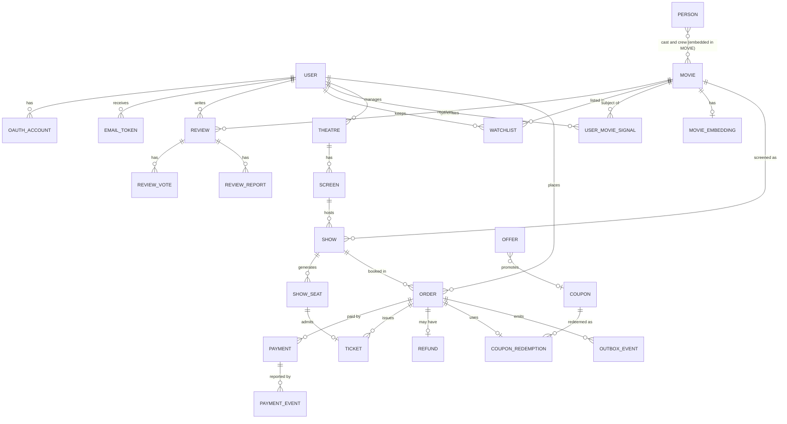

# QueueSkip: Plan v2 (full database design, with a queue)

A movie booking app. Users browse movies (cast, reviews, genres), pick a show, choose seats, pay (test mode), and get a QR ticket. The hard part is the backend: no double-booked seats, no double payments, background work that never gets lost, and a server that holds up under load.

This replaces `queueskip_plan.md` and every earlier plan. The code for everything is in **`queueskip_code_reference.md`**.

**What changed from the last plan**
- The **full database design is back** (section 5, 26 collections), because your Week 1 code uses it.
- A **queue is added**. The project now has two processes: the **API** (answers web requests) and the **worker** (sends emails, creates tickets, expires unpaid orders, processes refunds). See sections 3.1 and 4.

**Removed on purpose** (hard to explain as a beginner): test files, `.http` files, Prettier, ESLint, CI pipelines, a monorepo with a shared package, AWS, and the complicated extras (waiting room, live seat updates, AI search). **Kept:** every backend concept and the full database design.

## 1. Stack

| Part | Choice |
|---|---|
| Language | TypeScript (simple `tsconfig`, run with `tsx`) |
| Backend | Node.js, Express |
| Database | MongoDB with Mongoose, as a replica set (needed for transactions) |
| Redis | one instance: seat holds, cache, rate limiting, counters, and the storage for the queue |
| Queue | BullMQ (runs in the worker process) |
| Load balancer | nginx in front of 3 copies of the API |
| Frontend | React with Vite |
| Local services | Docker Compose: MongoDB, Redis, nginx |

**Two processes:** `npm run dev` starts the API, `npm run worker` starts the worker. You can run more than one copy of each.

**Tools you use to check your work** (no test code): Postman to send requests, `mongosh` to look at the database, `redis-cli` to look at Redis, the worker terminal to watch jobs, and `autocannon` (one terminal command, no file) to send many requests at once.

## 2. Features

**Core:** sign up and log in; movies with genres, cast and people; search; reviews and ratings; theatres, screens, shows and the seat map; seat holds; orders and payment; QR tickets by email.

**Then:** coupons and offers; genre and behaviour based recommendations; email verification and password reset; Google login; refunds and show cancellation.

**Backend concepts you will build** (section 3): caching, rate limiting, Bloom filter, write-behind caching, load balancing, atomic updates, transactions, idempotency, a queue with retries, the transactional outbox, a distributed lock, webhooks.

**Later, only if you have time:** AI search (the `MovieEmbedding` collection waits for it), a waiting room (`Show.highDemand` waits for it), live seat updates, real Razorpay, deploying to the cloud.

## 3. Backend concepts (the heart of the project)

Each row is one thing you can build, demo by hand, and explain in an interview.

| # | Concept | Where it is used | One-line explanation | Demo by hand |
|---|---|---|---|---|
| 1 | Authentication | JWT access token (15 min) plus refresh token in an httpOnly cookie, bcrypt passwords | the server never stores plain passwords; short-lived tokens limit damage if one leaks | wrong password gives 401; expired token gives 401 |
| 2 | Authorization | `requireRole` middleware (`USER`, `MANAGER`, `ADMIN`) | who you are is not the same as what you may do | a normal user on an admin route gets 403 |
| 3 | Indexes and pagination | unique email, text search on movies, `skip` and `limit` | an index lets MongoDB find a document without scanning the whole collection | `explain()` in `mongosh` shows an index scan |
| 4 | Race condition | two people taking the same seat | two requests read the same state at the same time and both act on it | the `autocannon` demo (section 9) |
| 5 | **Atomic update** | seat hold, order status, coupon use, rating totals | do check-and-change as one operation so nothing can slip in between | 50 parallel requests, exactly 1 wins |
| 6 | Redis with TTL | a seat hold lasts 5 minutes, then disappears by itself | the hold cleans itself up even if the server crashes | `redis-cli TTL` counts down |
| 7 | **Transaction** | confirm payment: sell seats, mark order paid, record payment, commit coupon, save outbox row; all or nothing | either every step happens or none does | make one step fail on purpose and see nothing saved |
| 8 | **Idempotency** | creating an order (`IdempotencyKey` collection) | repeating the same request gives the same result, not a second order | send the same request twice with the same key |
| 9 | **Caching (cache-aside)** | movie details | look in Redis first; on a miss read MongoDB and save it in Redis for 60 seconds | second request is faster; `redis-cli GET movie:<id>` |
| 10 | **Rate limiting** | login 5 per minute, holds 10 per minute, coupons 10 per minute | stop abuse and password guessing; counters live in Redis so all servers share them | `autocannon` shows 429 after the limit |
| 11 | **Bloom filter** | block random movie ids and coupon guesses before they reach MongoDB | a tiny structure that says "definitely not here" or "maybe here" | random ids never touch the database |
| 12 | **Write-behind caching** | movie view counts | add to a Redis counter now, write to MongoDB in a batch every 10 seconds | 100 views become 1 database write |
| 13 | **Load balancing** | nginx in front of 3 API copies | spread requests across servers; works because the API keeps no state in memory | kill one copy and traffic continues |
| 14 | Distributed lock | the view-count flush runs on every worker copy but must run once | `SET key NX EX`: only one copy gets the lock | only one worker prints "flushed" |
| 15 | Webhook | the payment provider tells your server "payment done" (`PaymentEvent`) | never trust the browser; verify a signature, and process each event once | send the same webhook twice, nothing changes |
| 16 | **Message queue** | emails, tickets, order expiry and refunds run in the worker, not in the web request | slow or failing work happens in the background and is retried | stop the worker, pay, start it: the tickets appear |
| 17 | **Transactional outbox** | an `OutboxEvent` row is saved in the same transaction as the order change | the follow-up job can never be lost, and never exists for a change that was rolled back | stop the worker after paying: the row waits, `published: false` |

### 3.1 How the less obvious ones work

**Atomic seat hold (Redis Lua script).** A Lua script runs as one uninterrupted step in Redis. It checks every requested seat; if all are free it holds all of them for 5 minutes, otherwise it holds none.
```lua
-- KEYS = one key per seat, ARGV[1] = the hold id, ARGV[2] = seconds
for i = 1, #KEYS do
  if redis.call('EXISTS', KEYS[i]) == 1 then return 0 end
end
for i = 1, #KEYS do
  redis.call('SET', KEYS[i], ARGV[1], 'EX', ARGV[2])
end
return 1
```
Rule: **Redis is the fast gate, MongoDB is the final judge.** Redis decides who may try to buy; MongoDB makes sure a seat is never sold twice.

**Rate limiter (fixed window).** For each user (or IP) and route:
```
key = rl:login:<userOrIp>
SET key 0 EX 60 NX      // create the counter with a 60 second life if it does not exist
count = INCR key        // atomic add
if count > limit: respond 429
```
Weakness to mention: a burst at the edge of two windows can double the limit. The upgrade is a sliding window or a token bucket. If Redis is down: login is blocked (safe), browsing is allowed.

**Bloom filter (built on Redis bits).** A row of 1,000,000 bits, all zero. To add an id, run it through 3 hash functions and switch those 3 bits on. To check an id, hash it the same way: if **any** bit is off it is **definitely not** there; if all are on it is **maybe** there. It never forgets an id (no wrong "no"), but sometimes says "maybe" for something that is not there (measured: 0.3 percent at 50,000 ids, about 2 percent at 100,000). Use: `GET /api/movies/:id` checks the filter first, and a "definitely not" returns 404 without touching MongoDB. Fill it from the database when the server starts, and add each new id **before** saving the movie. Limitation: you cannot remove an id; rebuild it now and then. If Redis is wiped or restarted the filter is empty, so it keeps a "ready" marker: until the marker exists every check answers "maybe", and real movies never turn into 404s.

**Write-behind view counter.**
```
on every movie view:   HINCRBY views:pending <movieId> 1
every 10 seconds:      give the batch a unique id, RENAME views:pending views:flushing   (atomic)
                       insert the batch id into ProcessedBatch (a duplicate means "already written": skip)
                       bulk-update MongoDB with $inc, then delete views:flushing
```
If the server crashes you lose at most the views of the last 10 seconds, and a half-finished batch is finished exactly once on the next run. That is fine for views and **never** acceptable for seats, orders or payments, which always go straight to MongoDB.

**Load balancing.** Run three copies of the API on ports 5001, 5002, 5003. nginx listens on 8080 and spreads requests. It works because the API is **stateless**: login state is in the JWT, holds and counters are in Redis, data is in MongoDB. Any copy can serve any request. Each copy adds an `X-Served-By` header so you can see the spread. The worker process is not behind nginx (it serves no web requests); you can run two copies of it.

**Distributed lock.** `SET lock:<job> <instance> NX EX 8`: whoever gets "OK" does the work, the others skip this round.

**Idempotency.** The client sends an `Idempotency-Key` header. Before creating the order you insert `{ userId, key, endpoint, requestHash }` into `IdempotencyKey`. A unique index makes a second insert fail. Then: same key and same body and already finished: return the saved answer; same key but a different body: 422; still running: 409. The records delete themselves after 24 hours (TTL index).

**Transaction (confirm payment).** One function, `confirmPayment`, used by the fake pay button and by the real webhook. Inside `session.withTransaction(...)`:
1. mark the order `PAID`, but only if it is still `PENDING_PAYMENT` (a second identical confirmation finds nothing and stops)
2. mark the seats `SOLD`, but only the ones still `AVAILABLE`; if the number updated is wrong, someone else got a seat first, so throw and everything is undone
3. mark the payment `SUCCEEDED`
4. turn the coupon redemption from `RESERVED` into `COMMITTED`
5. add to `Show.seatCounts.sold`
6. save an `OutboxEvent` called `order.paid`

If step 2 fails, the money was taken but the seats are gone: the order becomes `REFUND_PENDING`, a `Refund` is created and a refund job is queued.

**Webhook.** The provider calls `POST /api/webhooks/payments`. Check the signature on the raw body (HMAC), then insert a `PaymentEvent` with the provider's event id. The unique index rejects a repeated event, so it is processed once. Then call `confirmPayment`. For the fake payment, the pay endpoint does the same steps itself.

**The queue and the outbox (the new part).**

The API process **never talks to the queue**. When something must happen later (send an email, create tickets, expire an order), the API saves an `OutboxEvent` row in MongoDB, in the same transaction as the change. The worker process does the rest:
```
API request ──► MongoDB transaction: order change + OutboxEvent row
                         │
Worker, every 2 s:  outbox publisher reads unpublished rows ──► BullMQ queue (stored in Redis)
                         │
Worker:             email worker / order worker take a job and do it
                         │  if it fails: retry after 2 s, 4 s, 8 s, 16 s;
                         │  after 5 tries it stays in the "failed" list so you can look at it
```
Why the API does not call the queue directly: if Redis is down, a request would hang. Writing to MongoDB cannot hang on Redis. And if the server crashed between "order paid" and "queue the ticket job", the job would be lost; with the outbox it is saved with the order or not at all.

| Outbox event | Job | What the worker does |
|---|---|---|
| `order.created` | `expireOrder`, delayed until `expiresAt` | if still `PENDING_PAYMENT`: mark `EXPIRED`, release the coupon use and the Redis hold |
| `order.paid` | `createTickets` | create one ticket per seat, mark the order `CONFIRMED`, queue the email |
| `email.send` | `sendEmail` | send it (in development it is printed in the worker terminal) |
| `refund.requested` | `processRefund` | mark the refund `PROCESSED`, the payment `REFUNDED`, the order `REFUNDED` |
| repeating, every 60 s | `sweepOrders` | expire any order whose delayed job was lost (a safety net) |

**At least once, so every job must be safe to run twice.** The outbox guarantees a job runs, not that it runs only once. So: tickets use an upsert on `(orderId, showSeatId)`; only the run that actually moved the order to `CONFIRMED` queues the email; expiry uses a conditional update; a refund only runs while its status is `PENDING`. The job id `outbox_<id>` also stops one outbox row becoming two jobs.

## 4. How a booking works

1. **Hold.** The user picks seats. The Lua script holds them in Redis for 5 minutes (one active hold per user per show).
2. **Order.** The user creates an order with an `Idempotency-Key`. Status `PENDING_PAYMENT`. The hold is extended to 10 minutes. A coupon use is `RESERVED`. An `order.created` outbox row is saved. Seats are **not** sold yet.
3. **Pay.** A `Payment` row is created. With the fake payment the pay button confirms straight away; with Razorpay test mode the provider calls your webhook, and the `PaymentEvent` row makes a repeated webhook harmless.
4. **Confirm (one transaction).** Seats `SOLD`, order `PAID`, payment `SUCCEEDED`, coupon `COMMITTED`, seat counter, `order.paid` outbox row.
5. **Worker.** Publishes the outbox row, creates the tickets, marks the order `CONFIRMED`, and the email with the ticket codes goes out.
6. **Too slow?** The Redis hold disappears by itself; the delayed `expireOrder` job marks the order `EXPIRED` and gives back the coupon.
7. **Seats taken at payment time?** The transaction rolls back, the order becomes `REFUND_PENDING`, a `Refund` is created and queued, and the worker processes it with retries.

## 5. Database design


This section is the single reference for what is stored, where, and why. Each model you write in Weeks 1 to 11 comes from here (the code is in `queueskip_code_reference.md`). Build one module at a time, but **design the indexes from the queries in 5.6**, not from the field list.

### 5.1 Principles

1. **MongoDB holds durable truth. Redis holds ephemeral state** (seat holds, rate-limit counters, Bloom filters, write-behind buffers, caches, the job queue). Seat holds in Redis are always double-checked by MongoDB before money or seats change.
2. **Design from queries.** Every index in this section is justified by an access pattern in 5.6. An index with no query is cost without benefit.
3. **Embed** when the data is read together with its parent, is small and bounded, and changes with the parent. **Reference** when it grows without bound, is queried on its own, or is updated concurrently.
4. **Snapshot** what must never change retroactively. An order keeps the movie title, theatre name, seat labels and prices as they were at purchase.
5. **Denormalize only with a named owner** of the copy (who keeps it correct, and how it is repaired).
6. **No unbounded arrays.** Every embedded array below has a stated maximum.
7. **Types:** ids are `ObjectId`; money is an integer in minor units (paise) plus `currency`; times are `Date` in UTC; enums are strings taken from `utils/constants.ts`; "no value" is an explicit `null`.
8. **Normalize before storing** anything used for uniqueness: emails lowercased and trimmed, coupon codes uppercased.
9. Every collection has `createdAt` and `updatedAt` (Mongoose `timestamps: true`) unless noted.
10. **Schema evolution:** additive changes only; `schemaVersion` on long-lived documents (`User`, `Order`); Mongoose creates the indexes when the server starts in development; in production you can turn `autoIndex` off and create them once with `Model.syncIndexes()`.
11. Typical documents stay under about 16 KB (the hard limit is 16 MB).

### 5.2 What lives where

| Data | Store | Why |
|---|---|---|
| Users, catalog, theatres, shows, orders, payments, tickets, coupons, reviews | MongoDB | durable, queryable, transactional |
| A seat that is **held** | Redis `hold:<showId>:<seatId>` (TTL) | ephemeral, atomic Lua, self-expiring. MongoDB never stores `HELD` |
| A seat that is **sold** | MongoDB `ShowSeat.status = 'SOLD'` | durable, protected by a conditional update |
| Rate-limit counters | Redis | fast, atomic |
| Idempotency | MongoDB `IdempotencyKey` (unique index, TTL 24 h) | the unique index is the lock and the record |
| Job queues | Redis, via BullMQ (only the worker process uses it) | retries, delays and repeating jobs built in |
| Outbox | MongoDB `OutboxEvent`, written **in the same transaction** as the order change | this is what makes "PAID" and "ticket job queued" consistent |
| Cached movie pages, similar lists | Redis | rebuildable |
| Bloom filters | Redis | rebuilt from MongoDB when the server starts |
| View-count buffer | Redis `views:pending`, final value in `Movie.viewCount` | write-behind |
| Embeddings | MongoDB `MovieEmbedding` (only for AI search, a later feature) | large vectors kept out of normal movie reads |
| Review aggregates | MongoDB `Movie.ratingSum`, `ratingCount`, `ratingAvg` | updated atomically, never computed per page view |
| Genre list | a constant in `utils/genres.ts` | about 20 fixed values do not need a collection |

### 5.3 Relationship diagram



### 5.4 Embedded or referenced

| Relationship | Choice | Reason | Bound |
|---|---|---|---|
| Movie to genres | embedded string array | tiny, filtered by value | at most 6 |
| Movie to cast and crew | embedded `{ personId, name, ... }` | always shown with the movie | cast at most 50, crew at most 20 |
| Movie to reviews | **referenced** (`Review`) | unbounded, paged, sorted | none |
| Movie to embedding | **referenced** (`MovieEmbedding`) | a vector of hundreds of numbers would bloat every movie read | one per movie |
| Screen to layout | embedded | read with the screen | at most 20 sections |
| Show to price tiers | embedded | read with the show | at most 6 |
| Show to seats | **referenced** (`ShowSeat`) | one document per seat, updated concurrently | about 100 to 500 per show |
| Order to items | embedded | always read with the order, written atomically with it | at most 6 |
| Order to history | embedded | bounded by the state machine | at most 20 |
| Order to payments | **referenced** | several attempts, webhooks arrive independently | few |
| Order to tickets | **referenced** | created later by a worker, scanned independently | at most 6 |
| Review to votes | **referenced**, `helpfulCount` copied onto the review | one vote per user | unbounded |
| Coupon to redemptions | **referenced**, `usedCount` copied onto the coupon | audit trail and uniqueness | unbounded |
| User to Google identities | **referenced** (`OAuthAccount`) | lookup by Google `sub` | few |

### 5.5 Collections

Notation: `Type`, `Type | null`, `[Type]` for an array. "Indexes" lists every index and the reason.

#### Identity

**User**
```
name            String  (2 to 60)
email           String  (lowercase, trimmed)
emailVerified   Boolean (default false)
passwordHash    String | null            null for Google-only accounts
role            'USER' | 'MANAGER' | 'ADMIN'      (default 'USER')
status          'ACTIVE' | 'SUSPENDED' | 'DELETED' (default 'ACTIVE')
tokenVersion    Number  (default 0)      bump to end every session
lastLoginAt     Date | null
schemaVersion   Number  (default 1)
```
Indexes: `unique(email)` (login, registration check). Never returned to clients: `passwordHash`, `tokenVersion`. A `DELETED` user is anonymized (see 5.8).

**OAuthAccount**: `userId`, `provider ('GOOGLE')`, `providerUserId` (Google `sub`), `email`. Indexes: `unique(provider, providerUserId)` (sign-in lookup), `index(userId)`.

**EmailToken**: `userId`, `type ('VERIFY' | 'RESET')`, `tokenHash` (SHA-256 hex, the raw token is never stored), `expiresAt`, `usedAt | null`. Indexes: `unique(tokenHash)`; `index(userId, type, createdAt -1)` (find the latest to invalidate older ones); **TTL on `expiresAt`** (`expireAfterSeconds: 604800`, keeps a week of history).

#### Catalog

**Movie**
```
title           String  (1 to 200)
synopsis        String  (up to 3000)
runtimeMin      Number
language        String  (ISO 639-1, for example 'hi')
releaseDate     Date
certification   String  ('U', 'UA', 'A', ...)
posterUrl       String | null
trailerUrl      String | null
status          'UPCOMING' | 'NOW_SHOWING' | 'ENDED'
genres          [String]    at most 6, values from utils/genres.ts
cast            [{ personId, name, characterName, billingOrder }]   at most 50
crew            [{ personId, name, job }]                           at most 20
ratingSum       Number (0)   ratingCount Number (0)   ratingAvg Number (0)
viewCount       Number (0)   written by the write-behind flusher
```
Indexes: `text(title:10, 'cast.name':5, synopsis:3)` (search); `(status, releaseDate -1)` (home page lists); `(genres, status, ratingAvg -1)` (genre rows); `(language, status)`; `(cast.personId)` and `(crew.personId)` (filmography).
Rating update is one atomic pipeline update, so the average always matches the totals:
```js
Movie.updateOne({ _id: movieId }, [
  { $set: { ratingSum: { $add: ['$ratingSum', delta] }, ratingCount: { $add: ['$ratingCount', countDelta] } } },
  { $set: { ratingAvg: { $cond: [{ $gt: ['$ratingCount', 0] }, { $divide: ['$ratingSum', '$ratingCount'] }, 0] } } },
]);
```
Copies: `cast.name` and `crew.name` copy `Person.name`. Owner of the copy: `PUT /movies/:id/cast` writes it, and a script `syncPersonNames` repairs it if a person is renamed.

**Person**: `name`, `bio`, `photoUrl | null`, `birthDate | null`. Indexes: `text(name)`; `index(name)` for prefix lookups.

**MovieEmbedding**: `movieId`, `vector [Number]`, `dimensions`, `model`, `modelVersion`, `sourceHash` (hash of the text that was embedded, so unchanged movies are not re-embedded). Indexes: `unique(movieId)`. Loaded in bulk by the similarity job and cached; never part of a normal movie response.

#### Engagement

**Review**
```
movieId, userId
userName        String   copy of User.name at write time; 'Deleted user' after account deletion
rating          Number   integer 1 to 10
title           String   (up to 100)
body            String   (up to 2000, plain text)
helpfulCount    Number (0)     reportCount Number (0)
verifiedViewer  Boolean (false)   computed from orders, never from the client
status          'VISIBLE' | 'HIDDEN' (default 'VISIBLE')
```
Indexes: `unique(movieId, userId)` (one review per user, upsert target); `(movieId, status, createdAt -1)` (recent); `(movieId, status, helpfulCount -1)` (helpful); `(userId, createdAt -1)` (my reviews); `partial (status, reportCount -1)` where `reportCount > 0` (moderation queue).

**ReviewVote**: `reviewId`, `userId`. Indexes: `unique(reviewId, userId)`, `index(userId)`. `helpfulCount` changes by `$inc` only when the vote insert or delete actually happened.

**ReviewReport**: `reviewId`, `userId`, `reason`, `note`, `status ('OPEN' | 'RESOLVED')`. Indexes: `unique(reviewId, userId)`, `(status, createdAt)`.

**Watchlist**: `userId`, `movieId`, `createdAt` (no `updatedAt`). Indexes: `unique(userId, movieId)` (add is an upsert; status check), `(userId, createdAt -1)` (list).

**UserMovieSignal**: `signalId` (generated by the API, makes batch inserts idempotent), `userId`, `movieId`, `type ('VIEW' | 'WATCHLIST' | 'BOOKED' | 'RATED_HIGH' | 'RATED_LOW')`, `weight`, `createdAt`. Indexes: `unique(signalId)`, `(userId, createdAt -1)` (build a taste profile), **TTL on `createdAt`** (180 days).

#### Venues and shows

**Theatre**: `managerId`, `name`, `city`, `address`, optional `location` (GeoJSON point, with a `2dsphere` index only if you add "near me"). Indexes: `(city, name)`, `(managerId)`.

**Screen**: `theatreId`, `name`, `layout { sections: [{ name, rows, seatsPerRow, tier }] }` (at most 20 sections), `totalSeats` (computed on save), `showWriteVersion` (Number, see the overlap rule below). Indexes: `unique(theatreId, name)`.

**Show**
```
movieId, screenId
theatreId       copy from Screen (owner: show creation)
startsAt, endsAt   Date   endsAt = startsAt + runtime + cleaning buffer
status          'SCHEDULED' | 'ON_SALE' | 'CANCELLED' | 'COMPLETED'
highDemand      Boolean (false)   not used until you build a waiting room (a later feature)
priceTiers      [{ tier, priceMinor }]   at most 6
currency        String ('INR')
seatCounts      { total, sold }          sold is $inc'd in the confirm-payment transaction
```
Indexes: `(movieId, status, startsAt)` (showtimes for a movie), `(theatreId, startsAt)` (theatre schedule), `(screenId, startsAt)` (overlap check).
**Overlap rule.** A unique index cannot forbid overlapping time ranges, and two managers can create overlapping shows at the same instant. Create a show inside a transaction that first does `Screen.updateOne({ _id: screenId }, { $inc: { showWriteVersion: 1 } }, { session })`. Two concurrent creators then conflict on that document, one retries, and the overlap query (`screenId`, not cancelled, `startsAt < newEnd`, `endsAt > newStart`) runs on a consistent view.

**ShowSeat**
```
showId, section, row, number
seatLabel       String   for example 'A-5' (copy for display and snapshots)
tier            String   priceMinor Number
status          'AVAILABLE' | 'SOLD'
orderId         ObjectId | null          soldAt Date | null
expireAt        Date                     show.endsAt + 90 days
```
Indexes: `unique(showId, section, row, number)` (no duplicate seats, last safety net); `(showId, status)` (seat map, availability counts); **TTL on `expireAt`** (old seats are purged; orders and tickets keep their own snapshot of the label, so nothing is lost). About 300 documents per show is normal.

#### Commerce

**Order**
```
userId, showId
snapshot        { movieId, movieTitle, theatreId, theatreName, screenName, startsAt }
items           [{ showSeatId, seatLabel, tier, priceMinor }]     at most 6
subtotalMinor, feeMinor, discountMinor, totalMinor      integers
currency        String
couponId        ObjectId | null          couponCode String | null
holdId          String                   the Redis hold this order was created from
status          'PENDING_PAYMENT' | 'PAID' | 'CONFIRMED' | 'EXPIRED' | 'CANCELLED' | 'FAILED' | 'REFUND_PENDING' | 'REFUNDED'
expiresAt       Date                     end of the payment window
paidAt, cancelledAt   Date | null
history         [{ from, to, reason, at }]                        at most 20
schemaVersion   Number (1)
```
Indexes: `(userId, createdAt -1)` (my orders); `partial (status, expiresAt)` where `status = 'PENDING_PAYMENT'` (the expiry sweeper only scans open orders); `(showId, status)` (show cancellation, sales counts); `(status, createdAt -1)` (admin views).
Invariant: `totalMinor = subtotalMinor + feeMinor - discountMinor`, `discountMinor <= subtotalMinor + feeMinor`, `totalMinor >= 0`. Computed only by `pricingService`.

**Payment**: `orderId`, `provider ('RAZORPAY' | 'FAKE')` (FAKE is your own pay button), `providerOrderId`, `providerPaymentId` (leave it unset until known: a sparse unique index skips missing fields, but would reject two `null`s), `status ('CREATED' | 'SUCCEEDED' | 'FAILED' | 'REFUNDED')`, `amountMinor`, `currency`, `failureReason | null`. Indexes: `unique(providerOrderId)` (webhook lookup), `unique sparse (providerPaymentId)`, `(orderId)`.

**PaymentEvent**: `providerEventId`, `type`, `payload` (raw body, size-limited), `status ('RECEIVED' | 'PROCESSED' | 'IGNORED' | 'FAILED')`, `receivedAt`, `processedAt | null`. Indexes: `unique(providerEventId)` (**webhook dedupe**, the insert fails on a replay); TTL on `receivedAt` (90 days).

**Refund**: `orderId`, `paymentId`, `providerRefundId | null`, `amountMinor`, `reason ('SHOW_CANCELLED' | 'USER_CANCELLED' | 'LATE_PAYMENT_SEATS_TAKEN')`, `status ('PENDING' | 'PROCESSED' | 'FAILED')`, `attempts`. Indexes: `unique(orderId)` (one refund per order), `(status, createdAt)` (retry worker).

**Ticket**
```
orderId, showId, showSeatId
seatLabel       String
ticketCode      String   short human-readable code
qrJti           String   id inside the signed QR token
usedAt          Date | null     usedByUserId ObjectId | null
cancelledAt     Date | null
```
Indexes: `unique(orderId, showSeatId)` (the ticket worker is idempotent), `unique(ticketCode)`, `(showId, usedAt)` (door statistics). Scan is one atomic statement: `findOneAndUpdate({ _id, usedAt: null, cancelledAt: null }, { $set: { usedAt: now, usedByUserId } })`.

**Coupon**
```
code               String  (uppercase)
description        String
type               'PERCENT' | 'FLAT'     value Number (1 to 100, or minor units)
maxDiscountMinor   Number | null          minOrderMinor Number (0)
validFrom, validTo Date
maxTotalUses       Number | null          null means unlimited
usedCount          Number (0)             counts RESERVED and COMMITTED redemptions
firstBookingOnly   Boolean (false)
rules              { movieIds [], theatreIds [], daysOfWeek [], tiers [] }     empty means unrestricted
ownerTheatreId     ObjectId | null
enabled            Boolean
```
Indexes: `unique(code)` (apply by code), `(enabled, validFrom, validTo)` (active offers), `(ownerTheatreId)`.
**Per-user limit is fixed at one use per user** for this project. A higher limit would need a per-user counter document, so it is listed as future work.

**CouponRedemption**: `couponId`, `userId`, `orderId`, `discountMinor`, `status ('RESERVED' | 'COMMITTED' | 'RELEASED')`, `isActive` (true for `RESERVED` and `COMMITTED`). Indexes: `unique(couponId, orderId)`; **`partial unique (couponId, userId)` where `isActive = true`** (this is what enforces one active use per user, even when two orders race); `(orderId)`.

**Offer**: `title`, `description`, `couponId | null`, `autoRule | null` (for example 20 percent on Tuesdays, for auto-applied offers), `bannerUrl | null`, `sortOrder`, `validFrom`, `validTo`, `enabled`. Indexes: `(enabled, validFrom, validTo, sortOrder)`.

**IdempotencyKey**: `userId`, `key`, `endpoint`, `requestHash`, `status ('IN_PROGRESS' | 'COMPLETED')`, `responseStatus`, `responseBody`. Indexes: `unique(userId, key, endpoint)`, **TTL on `createdAt`** (86,400 seconds).

**OutboxEvent**: `type` (for example `order.paid`), `aggregateId` (the order id), `payload`, `published` (Boolean, false), `attempts`, `publishedExpireAt | null`. Indexes: `partial (published, createdAt)` where `published = false` (the publisher polls only unpublished rows); **TTL on `publishedExpireAt`** (set to now plus 7 days when published; documents without the field are never deleted).

#### Operations

**ProcessedBatch**: `batchId`, `kind ('viewCounts')`, `appliedAt`, `expireAt`. Indexes: `unique(batchId)` (inserted first by the write-behind flusher so a retried flush is skipped), **TTL on `expireAt`** (7 days).

### 5.6 Access patterns and their indexes

| Query | Collection | Index used | Notes |
|---|---|---|---|
| Log in by email | User | `unique(email)` | |
| Find user by Google `sub` | OAuthAccount | `unique(provider, providerUserId)` | |
| Verify or reset by token | EmailToken | `unique(tokenHash)` | hash the incoming token first |
| Home page: now showing | Movie | `(status, releaseDate -1)` | paged |
| Genre row, best rated | Movie | `(genres, status, ratingAvg -1)` | paged |
| Search by text | Movie | text index | the Bloom filter and the cache help the detail page, not the search |
| Movie detail by id | Movie | `_id` | cache-aside, Bloom filter first |
| Filmography of a person | Movie | `(cast.personId)`, `(crew.personId)` | |
| Reviews of a movie, recent or helpful | Review | `(movieId, status, createdAt -1)`, `(movieId, status, helpfulCount -1)` | paged |
| Upsert my review | Review | `unique(movieId, userId)` | duplicate key means conflict |
| Moderation queue | Review | partial `(status, reportCount -1)` | |
| Is movie in my watchlist | Watchlist | `unique(userId, movieId)` | |
| My taste signals | UserMovieSignal | `(userId, createdAt -1)` | limit to recent |
| Showtimes for a movie in a city on a date | Show | `(movieId, status, startsAt)` then Theatre by id | two queries, one for shows and one `$in` for theatres |
| Overlap check on a screen | Show | `(screenId, startsAt)` | inside the transaction with the screen version bump |
| Seat map for a show | ShowSeat | `(showId, status)` | merged with Redis holds |
| Sell seats | ShowSeat | `unique(showId, section, row, number)` and `_id` | conditional update |
| My orders | Order | `(userId, createdAt -1)` | paged |
| Expire unpaid orders | Order | partial `(status, expiresAt)` | sweeper |
| Cancel a show: find paid orders | Order | `(showId, status)` | |
| Payment from webhook | Payment | `unique(providerOrderId)` | |
| Replayed webhook | PaymentEvent | `unique(providerEventId)` | insert fails on replay |
| Apply a coupon | Coupon | `unique(code)` | atomic claim, then redemption insert |
| Active offers | Offer, Coupon | `(enabled, validFrom, validTo, ...)` | cached |
| Scan a ticket | Ticket | `_id` | one atomic update |
| Publish outbox | OutboxEvent | partial `(published, createdAt)` | |
| Retry refunds | Refund | `(status, createdAt)` | |

**Rule:** before a module counts as done, run `explain('executionStats')` on its main queries and confirm an index scan (`IXSCAN`), with `totalDocsExamined` close to `nReturned`.

### 5.7 Transactions, concurrency and consistency

MongoDB transactions need the replica set. Keep them short (at most 6 seats), run them with `withTransaction` (it retries transient errors), and use `readConcern: 'snapshot'` and `writeConcern: { w: 'majority' }`. The connection string sets `retryWrites=true&w=majority`.

**The confirm-payment transaction** (called by the pay endpoint and by the payment webhook; section 3.1). Seats are **not** sold when the order is created: between order creation and payment they exist only as Redis holds. Everything below happens in one transaction:
1. `ShowSeat.updateMany({ showId, _id: { $in }, status: 'AVAILABLE' }, { $set: { status: 'SOLD', orderId, soldAt } })`. If `modifiedCount` does not equal the seat count, **abort**. The first confirmed payment wins; the other buyer goes to the refund path.
2. `Order`: `PENDING_PAYMENT` to `PAID` (conditional on the current status), with a `history` entry.
3. `Payment`: `CREATED` to `SUCCEEDED`.
4. `CouponRedemption`: `RESERVED` to `COMMITTED`, if a coupon was used.
5. `Show.seatCounts.sold` incremented.
6. `OutboxEvent` inserted (`order.paid`).

**Other transactions:** create a show (screen version bump, overlap check, show insert, seat generation in batches); apply a coupon (atomic `usedCount` claim plus the redemption insert); order expiry and cancellation (status change plus coupon release plus Redis hold release after commit).

**Invariants and how each is enforced**

| Invariant | Enforced by |
|---|---|
| A seat is sold at most once | conditional update plus the unique seat index |
| One review per user per movie | `unique(movieId, userId)` |
| One active coupon use per user | partial unique index on `CouponRedemption` |
| A coupon never exceeds `maxTotalUses` | conditional `$inc` on `usedCount` |
| A webhook is processed once | `unique(providerEventId)`, then conditional status updates |
| One ticket per seat per order | `unique(orderId, showSeatId)` |
| A ticket is admitted once | conditional update on `usedAt: null` |
| Order totals add up | only `pricingService` writes them, and the state machine re-checks them |
| Order status only moves forward | conditional update on the expected current status |
| Rating average matches the reviews | atomic pipeline update, plus a nightly recompute |

**Nightly reconciliation** (`reconciliationJob`): `Movie.ratingCount` and `ratingSum` against `Review`; `Coupon.usedCount` against active redemptions; `Show.seatCounts.sold` against `SOLD` seats; paid orders without tickets; orders stuck in `PENDING_PAYMENT` past `expiresAt`; Redis holds with no matching open order. It logs every difference and fixes the safe ones.

### 5.8 Retention, deletion and privacy

| Data | Kept | How |
|---|---|---|
| EmailToken | 7 days after expiry | TTL |
| IdempotencyKey | 24 hours | TTL |
| OutboxEvent | 7 days after publishing | TTL on `publishedExpireAt` |
| PaymentEvent | 90 days | TTL |
| ProcessedBatch | 7 days | TTL |
| UserMovieSignal | 180 days | TTL |
| ShowSeat | 90 days after the show ends | TTL on `expireAt` |
| Orders, payments, refunds, tickets | kept (financial records) | none |
| Reviews | kept, author anonymized on account deletion | update |

**Account deletion** sets `User.status = 'DELETED'`, replaces `name` and `email` with placeholders (`deleted+<id>@invalid`), clears `passwordHash`, bumps `tokenVersion`, deletes `OAuthAccount`, `EmailToken`, `Watchlist` and `UserMovieSignal` rows, and sets `Review.userName` to `'Deleted user'`. Orders stay for the financial record, with the user reference intact but no personal data left on the user.

### 5.9 Operations

- **Connections:** one pooled connection per API process (`maxPoolSize` about 20 to 50), `serverSelectionTimeoutMS` and `maxTimeMS` set so a slow database fails requests instead of piling them up.
- **Read preference:** primary for seats, orders, payments, coupons. `secondaryPreferred` is allowed for catalog reads (movies, reviews, showtimes) where a few seconds of staleness is fine. Never read seat status from a secondary.
- **Indexes:** Every index states the query it serves (5.6).
- **Seed data** (`scripts/seed.ts`): deterministic (fixed random seed): about 50 movies, 100 people, 5 theatres, 12 screens, shows for the next 14 days with their seats, 20 users (one admin, two managers), a few coupons and offers. `seed.ts --reset` wipes the database and reseeds it, so every manual test round starts from known data.
- **Backups:** Atlas continuous backup or daily snapshots. Practise a restore once before you rely on it.

### 5.10 Example documents

`Show`:
```json
{
  "_id": "665f1c2e8a1b2c3d4e5f6001",
  "movieId": "665f1c2e8a1b2c3d4e5f5001",
  "screenId": "665f1c2e8a1b2c3d4e5f4001",
  "theatreId": "665f1c2e8a1b2c3d4e5f3001",
  "startsAt": "2026-12-05T13:30:00.000Z",
  "endsAt": "2026-12-05T16:15:00.000Z",
  "status": "ON_SALE",
  "highDemand": true,
  "priceTiers": [{ "tier": "STANDARD", "priceMinor": 25000 }, { "tier": "PREMIUM", "priceMinor": 40000 }],
  "currency": "INR",
  "seatCounts": { "total": 240, "sold": 118 }
}
```

`ShowSeat`:
```json
{
  "showId": "665f1c2e8a1b2c3d4e5f6001",
  "section": "PREMIUM", "row": "C", "number": 7, "seatLabel": "C-7",
  "tier": "PREMIUM", "priceMinor": 40000,
  "status": "SOLD", "orderId": "665f1c2e8a1b2c3d4e5f7001", "soldAt": "2026-12-04T09:12:44.000Z",
  "expireAt": "2027-03-05T16:15:00.000Z"
}
```

`Order` (after payment):
```json
{
  "_id": "665f1c2e8a1b2c3d4e5f7001",
  "userId": "665f1c2e8a1b2c3d4e5f2001",
  "showId": "665f1c2e8a1b2c3d4e5f6001",
  "snapshot": { "movieTitle": "Night Signal", "theatreName": "Orion Cinemas", "screenName": "Screen 2", "startsAt": "2026-12-05T13:30:00.000Z" },
  "items": [
    { "showSeatId": "665f1c2e8a1b2c3d4e5f8001", "seatLabel": "C-7", "tier": "PREMIUM", "priceMinor": 40000 },
    { "showSeatId": "665f1c2e8a1b2c3d4e5f8002", "seatLabel": "C-8", "tier": "PREMIUM", "priceMinor": 40000 }
  ],
  "subtotalMinor": 80000, "feeMinor": 4000, "discountMinor": 8000, "totalMinor": 76000, "currency": "INR",
  "couponCode": "WEEKEND10", "holdId": "h_7f3a9c",
  "status": "PAID", "expiresAt": "2026-12-04T09:20:00.000Z", "paidAt": "2026-12-04T09:12:44.000Z",
  "history": [
    { "from": null, "to": "PENDING_PAYMENT", "reason": "order created", "at": "2026-12-04T09:10:02.000Z" },
    { "from": "PENDING_PAYMENT", "to": "PAID", "reason": "payment confirmed", "at": "2026-12-04T09:12:44.000Z" }
  ]
}
```

### 5.11 Approximate sizes (estimates, measure with `Object.bsonsize`)

| Collection | Typical document | Growth driver |
|---|---|---|
| Movie (without embedding) | 3 to 6 KB | catalog size (hundreds to thousands) |
| MovieEmbedding | 6 to 12 KB | one per movie |
| Review | about 1 KB | users times movies reviewed |
| ShowSeat | about 250 bytes | shows times seats: 300 seats, 4 shows a day, 5 screens, 30 days is about 180,000 per theatre per month, purged after 90 days |
| Order | 1.5 to 3 KB | bookings |
| Ticket | about 400 bytes | seats sold |

`ShowSeat` is the collection that grows fastest, which is why it has a TTL and the tightest indexes. If it ever outgrew one replica set, shard it by `showId` (hashed); orders would shard by `userId`. At project scale none of this is needed, but be able to say it.

### 5.12 When each collection is first used

You do not build 26 collections at once. Each week adds the ones it needs (the model code is in the code reference, section 3).

| Week | Collections |
|---|---|
| 1 | `User` |
| 2 | `Movie`, `Person` |
| 3 | `Review`, `ReviewVote`, `ReviewReport`, `Watchlist` |
| 4 | `Theatre`, `Screen`, `Show`, `ShowSeat` |
| 5 | `Order`, `IdempotencyKey`, `OutboxEvent` |
| 6 | `Payment`, `PaymentEvent`, `Ticket` |
| 7 | `Coupon`, `CouponRedemption`, `Offer`, `UserMovieSignal` |
| 9 | `EmailToken`, `OAuthAccount` |
| 10 | `ProcessedBatch` |
| 11 | `Refund` |
| later | `MovieEmbedding` (AI search) |

**Two things to know about the indexes.** (1) A unique index on a field that is `null` in many documents fails; for `Payment.providerPaymentId` the model leaves the field unset instead, so the sparse unique index works. (2) The one-active-coupon-use rule is a *partial* unique index on `CouponRedemption`; check it in `mongosh` with `db.couponredemptions.getIndexes()` in Week 7.

## 6. Folders

```
queueSkip/
├── backend/
│   ├── src/
│   │   ├── models/        26 files, one per collection (User.ts, Movie.ts, Order.ts, ...)
│   │   ├── controllers/   authController.ts, meController.ts, movieController.ts, personController.ts, reviewController.ts,
│   │   │                  watchlistController.ts, showController.ts, holdController.ts, orderController.ts, webhookController.ts,
│   │   │                  couponController.ts, recommendationController.ts,
│   │   │                  adminUserController.ts, adminCatalogController.ts, adminVenueController.ts,
│   │   │                  adminPromoController.ts, adminReviewController.ts, adminOrderController.ts     (85 handlers in all)
│   │   ├── routes/        authRoutes.ts, meRoutes.ts, movieRoutes.ts, personRoutes.ts, reviewRoutes.ts, watchlistRoutes.ts,
│   │   │                  showRoutes.ts, holdRoutes.ts, orderRoutes.ts, webhookRoutes.ts, offerRoutes.ts, adminRoutes.ts
│   │   ├── services/      holdService.ts, orderService.ts, outboxService.ts, idempotencyService.ts   (plus pricing, recommendations later)
│   │   ├── middleware/    auth.ts, requireRole.ts, requireVerified.ts, rateLimiter.ts, errorHandler.ts
│   │   ├── cache/         movieCache.ts, bloomFilter.ts, viewCounter.ts
│   │   ├── queues/        queues.ts, outboxRoutes.ts                      (used only by the worker process)
│   │   ├── workers/       workerMain.ts, outboxPublisher.ts, emailWorker.ts, orderWorker.ts, flushViews.ts
│   │   ├── clients/       emailClient.ts
│   │   ├── lua/           holdSeats.lua, releaseSeats.lua, index.ts
│   │   ├── config/        env.ts, db.ts, redis.ts
│   │   ├── utils/         constants.ts, genres.ts, redisKeys.ts, tokens.ts, ticketCode.ts, lock.ts
│   │   ├── types/         express.d.ts
│   │   ├── app.ts         (the API process starts here, through server.ts)
│   │   └── server.ts
│   ├── scripts/           seed.ts
│   ├── .env               (never commit)   .env.example
│   ├── package.json
│   └── tsconfig.json
├── frontend/              pages/, components/, context/, hooks/, utils/
├── nginx/                 nginx.conf                                          (Week 12)
├── docker-compose.yml
├── .gitignore
└── README.md              setup steps and the API list
```

## 7. Code style (same as your repo)

- Files: `holdController.ts`, `holdRoutes.ts`. Models and React components are PascalCase. Everything else camelCase.
- Controllers are named exports with a verb and a noun: `holdSeats`, `createOrder`, `applyCoupon`.
- Every controller: one `try/catch`, early-return checks, `res.status(400).json({ message: '...' })`, log as `console.error('Hold seats error:', error)`, answer 500 with `'Server error'`.
- `req.userId` and `req.userRole` are set by the auth middleware.
- Return the resource directly; errors are `{ message }` plus a `code` when the frontend must react (`SEAT_UNAVAILABLE`, `EMAIL_NOT_VERIFIED`, `RATE_LIMITED`).
- One name per field, used the same in backend and frontend (for example always `inWatchlist`).
- Money is whole numbers (paise). Status words are the UPPER_SNAKE strings from `utils/constants.ts`.
- With Mongoose 9 use `{ returnDocument: 'after' }` where older code used `{ new: true }`.

## 8. Steps, week by week

**How to work through every week** (same routine each time):
1. Add the week's models (code reference, section 3) and check them in `mongosh`: insert a document with a missing field, a bad enum value and a duplicate for each unique index, and confirm each is refused.
2. For each route listed, replace its stub with the real handler: guards first (section 7 pattern), then the service call, then the response.
3. Send the requests from Postman: the normal case, one wrong input, and someone else's data.
4. After every write, look at the database with `mongosh` (and at Redis with `redis-cli` when the week uses it).
5. Write one line in your notes: what you built, what broke, what you fixed.

**Test accounts.** The seed script (Week 2) creates an admin, two managers and two users, all with `emailVerified: true`. Until Week 9 builds email verification, anyone you register by hand has `emailVerified: false`; fix it in `mongosh` with `db.users.updateOne({ email: 'a@b.com' }, { $set: { emailVerified: true } })`. Make the first admin the same way (`$set: { role: 'ADMIN' }`) until the seed exists.

### Week 0: setup (5 steps, we do these together)
1. Check Node, npm, Git, Docker. Install Postman.
2. Create the folder and the Git repo.
3. Backend: `npm init`, install the packages, add `tsconfig.json` and `.env` (code reference, section 1).
4. `docker-compose.yml` with MongoDB (replica set) and Redis (code reference, section 1).
5. Copy the starter files (code reference, sections 2, 7, 8, 9) and the `User` model (section 3); start the API and open `/healthz`. Every route already exists and answers `501 Not built yet`.

**Done when:** `/healthz` says `{ status: 'ok' }`, `/readyz` reports MongoDB and Redis, and `GET /api/movies` answers 501.

## Backend

### Week 1: Accounts, login and user management

**Goal:** people can register, log in and stay logged in; an admin can manage users and make someone a manager.

**Models to add:** `User`.

**Files to write:** `models/User.ts`; `controllers/authController.ts` (5 handlers), `meController.ts` (2 of 3), `adminUserController.ts` (3); `utils/tokens.ts` is already there.

**Routes to build this week** (they already exist as stubs; replace each stub with the real handler):

| Method and path | Who | Handler | What it does |
|---|---|---|---|
| POST /api/auth/register | public | `createUser` | validate, lowercase the email, bcrypt the password, create the user (`USER`, `ACTIVE`, not verified); 409 if the email exists |
| POST /api/auth/login | public | `loginUser` | check the password (same 401 for unknown email and wrong password); suspended users get 403; set `lastLoginAt`; return the access token and set the refresh cookie |
| POST /api/auth/refresh | refresh cookie | `refresh` | new access token if the cookie is valid, the user is `ACTIVE` and `tokenVersion` matches |
| POST /api/auth/logout | logged in | `logout` | add 1 to `tokenVersion`, clear the cookie |
| GET /api/auth/me | logged in | `fetchUser` | the current user, without `passwordHash` or `tokenVersion` |
| PATCH /api/me | logged in | `updateMyProfile` | change my `name` (nothing else can be changed here) |
| POST /api/me/change-password | logged in | `changeMyPassword` | needs the current password; new password 8 to 72 characters; add 1 to `tokenVersion` and give back fresh tokens |
| GET /api/admin/users | admin | `listUsers` | search by name or email, filter by `role` and `status`, paged |
| GET /api/admin/users/:id | admin | `getUserById` | one user (no password hash) |
| PATCH /api/admin/users/:id | admin | `updateUser` | change `role` (this is how someone becomes a `MANAGER`) or `status`; suspending adds 1 to `tokenVersion`; an admin cannot change their own role or status |

**Rules to implement:**
- **Register:** name 2 to 60 characters, a valid email (lowercased and trimmed), password 8 to 72 characters. Hash with `bcryptjs`. A duplicate email gives 409 `Email already registered` (catch the MongoDB duplicate-key error, code 11000). The new user is always `USER`, `ACTIVE`, `emailVerified: false`; the role is never taken from the request.
- **Login:** same 401 message for an unknown email and a wrong password. A `SUSPENDED` user gets 403. Set `lastLoginAt`. Access token lasts 15 minutes and carries `userId`, `role` and `tokenVersion`. The refresh token (7 days) goes in an httpOnly cookie: `sameSite: 'lax'`, `secure` only in production, `path: '/api/auth'`.
- **Refresh:** the user must still exist, be `ACTIVE`, and the token's `tokenVersion` must equal the user's.
- **Logout:** add 1 to `tokenVersion` (this ends every refresh token) and clear the cookie. Say in your notes that an access token still works until it expires (at most 15 minutes).
- **`PATCH /me`:** only `name`. **Change password:** needs the current password; add 1 to `tokenVersion`; return fresh tokens.
- **Admin users:** list with a search box (name or email), filters `role` and `status`, paging (`limit` capped at 100). `PATCH` accepts only `role` and `status`. An admin cannot change their own role or status (400). Setting `SUSPENDED` also adds 1 to `tokenVersion`.
- Never return `passwordHash`, `tokenVersion` or the verify-token fields in any response.

**Check by hand:**
- Register the same email twice (second time with capital letters): 409, one document in MongoDB.
- Register with a 5-character password, a bad email, a missing name: 400 each, with a clear message.
- Login with a wrong password and with an unknown email: the same 401 message.
- Call `/auth/me` with no token, a garbage token and a good token: 401, 401, 200.
- Log out, then refresh: 401. Log in again: works.
- Suspend a user as admin: that user cannot log in; their old refresh token stops working.
- A `USER` token on `GET /admin/users`: 403. An admin changing their own role: 400.

**Concepts:** 1 (authentication), 2 (authorization)

**Done when:** you can do the whole flow from Postman, and every write is confirmed in `mongosh`.

### Week 2: Movies, people and the catalog

**Goal:** the public can browse and search movies; the admin can manage the catalog (full create, read, update, delete).

**Models to add:** `Movie`, `Person`.

**Files to write:** `models/Movie.ts`, `Person.ts`; `controllers/movieController.ts` (3 of 4), `personController.ts`, `adminCatalogController.ts` (all 8); `scripts/seed.ts` (users, people, movies).

**Routes to build this week** (they already exist as stubs; replace each stub with the real handler):

| Method and path | Who | Handler | What it does |
|---|---|---|---|
| GET /api/movies | public | `getMovieList` | filters `genre`, `language`, `status`; `sort`; `page`, `limit` |
| GET /api/movies/search?q= | public | `searchMovies` | MongoDB text search (this route is above `/:id` on purpose) |
| GET /api/movies/:id | public | `getMovie` | Bloom filter (Week 10), cache (Week 8), then MongoDB; counts a view (Week 10) |
| GET /api/people/:id | public | `getPersonById` | bio and the movies this person worked on |
| POST /api/admin/people | admin | `createPerson` | name required; bio, photo and birth date optional |
| GET /api/admin/people | admin | `listPeople` | search by name, paged |
| PATCH /api/admin/people/:id | admin | `updatePerson` | if the name changes, update the copies in `Movie.cast` and `Movie.crew` |
| DELETE /api/admin/people/:id | admin | `deletePerson` | refused (409) while the person is in any movie |
| POST /api/admin/movies | admin | `createMovie` | validate; add the id to the Bloom filter first (Week 10); then save |
| PATCH /api/admin/movies/:id | admin | `updateMovie` | change any field except ratings and `viewCount`; delete the cache entry (Week 8) |
| DELETE /api/admin/movies/:id | admin | `deleteMovie` | refused while the movie has shows: set `status: ENDED` instead; otherwise delete it with its reviews and watchlist rows |
| PUT /api/admin/movies/:id/cast | admin | `setMovieCast` | replace `cast` and `crew`; copy each person's name; at most 50 and 20 |

**Rules to implement:**
- **List movies:** filters `genre` (must be in the genre list), `language`, `status`; `sort` by `releaseDate`, `ratingAvg` or `title`; `page` at least 1, `limit` 1 to 100 (default 20). Return `{ movies, page, limit, total }`.
- **Search:** `q` required, 1 to 100 characters; MongoDB `$text`, best match first. The route is declared above `/:id`.
- **Detail:** invalid id gives 400, unknown id gives 404. Return `ratingAvg` as stored (0 when there are no ratings).
- **Create movie:** title 1 to 200, `runtimeMin` at least 1, `language`, `releaseDate` required; at most 6 genres, all from `utils/genres.ts`; ratings and `viewCount` start at 0 and cannot be set by the client.
- **Update movie:** any field except `ratingSum`, `ratingCount`, `ratingAvg`, `viewCount`.
- **Set cast (`PUT .../cast`):** replace the whole `cast` and `crew` arrays; each `personId` must exist; copy the person's `name` into the entry; at most 50 cast and 20 crew; give each cast entry a `billingOrder`.
- **Delete movie:** if it has shows, refuse with 409 and tell the admin to set `status: ENDED`. Otherwise delete the movie and its reviews and watchlist rows.
- **People:** create needs a name. List supports a name search. Update: when `name` changes, update every copy in `Movie.cast.name` and `Movie.crew.name` (`updateMany` with the positional operator). Delete is refused (409) while the person appears in any movie.
- **Person page:** the bio plus the movies found through `cast.personId` and `crew.personId`.
- **Seed:** 1 admin, 2 managers, 2 users (all verified), about 20 people, 12 movies across several genres with 4 to 6 cast each.

**Check by hand:**
- Create a movie with 7 genres, an unknown genre, a missing title: 400 each.
- Search a title word and an actor's name: both find the movie.
- `limit=1000` returns at most 100 items; `page=0` gives 400.
- In `mongosh`: `db.movies.find({ genres: "Action" }).explain("executionStats")` shows an index scan (`IXSCAN`).
- Rename a person: every movie's cast entry shows the new name.
- Delete a person who is in a movie: 409. Delete a person who is not: 200.
- A `USER` token on `POST /admin/movies`: 403.

**Concepts:** 3 (indexes and pagination)

**Done when:** a stranger can browse and search, the admin can create, edit and delete every catalog item, and the rules above hold.

### Week 3: Reviews, votes, reports and the watchlist

**Goal:** logged-in users can review movies, vote and report; the admin can moderate.

**Models to add:** `Review`, `ReviewVote`, `ReviewReport`, `Watchlist`.

**Files to write:** `models/Review.ts`, `ReviewVote.ts`, `ReviewReport.ts`, `Watchlist.ts`; `controllers/reviewController.ts` (all 5), `watchlistController.ts` (all 4), `adminReviewController.ts` (all 3).

**Routes to build this week** (they already exist as stubs; replace each stub with the real handler):

| Method and path | Who | Handler | What it does |
|---|---|---|---|
| GET /api/movies/:id/reviews | public | `listReviews` | `VISIBLE` reviews; `sort` by recent, helpful or rating; paged |
| PUT /api/movies/:id/reviews/me | verified user | `saveMyReview` | create or update my review; adjust the rating totals; `verifiedViewer` from my orders (Week 6) |
| DELETE /api/movies/:id/reviews/me | logged in | `deleteMyReview` | delete it and take it out of the totals |
| POST /api/reviews/:id/helpful | verified user | `voteReviewHelpful` | toggle my vote; `helpfulCount` changes only if the vote row changed |
| POST /api/reviews/:id/report | verified user | `reportReview` | one report per user per review; `reportCount` goes up by 1 |
| GET /api/watchlist | logged in | `getWatchlist` | my watchlist, newest first |
| POST /api/watchlist | logged in | `addToWatchlist` | body `{ movieId }`; adding twice does nothing; records a `WATCHLIST` signal (Week 7) |
| GET /api/watchlist/:movieId/status | logged in | `checkWatchlistStatus` | returns `{ inWatchlist: true or false }` |
| DELETE /api/watchlist/:movieId | logged in | `removeFromWatchlist` | 404 if it was not there |
| GET /api/admin/reviews/reported | admin | `listReportedReviews` | reviews with `reportCount` above 0, most reported first |
| PATCH /api/admin/reviews/:id | admin | `moderateReview` | set `status` to `HIDDEN` or `VISIBLE`; mark its reports `RESOLVED` |
| DELETE /api/admin/reviews/:id | admin | `deleteReview` | delete it and take it out of the rating totals |

**Rules to implement:**
- **Save my review (`PUT`):** rating is a whole number 1 to 10; `title` up to 100 and `body` up to 2000 characters, treated as plain text; `userName` is copied from the user. It is an upsert on `(movieId, userId)`.
- **Rating totals** are changed with one atomic update, never read-then-save: on a new review `$inc ratingSum` by the rating and `ratingCount` by 1; on a changed review `$inc ratingSum` by the difference. Then recompute `ratingAvg` in the same update (pipeline update, see database design 5.5). Deleting a review does the opposite.
- `verifiedViewer` stays `false` for now; Week 6 fills it in.
- **Helpful vote:** a toggle. Insert the `ReviewVote`; if it already exists, delete it. Change `helpfulCount` with `$inc` only when the vote row really changed.
- **Report:** one per user per review (the unique index gives a clear 409); `reportCount` goes up by 1. A user cannot report their own review.
- **Admin moderation:** the reported list shows reviews with `reportCount` above 0, most reported first. `PATCH` sets `HIDDEN` or `VISIBLE` and marks the open reports `RESOLVED`. A hidden review leaves the public list but still counts in the totals unless the admin deletes it. Admin `DELETE` removes it and fixes the totals.
- **Watchlist:** add is an upsert (adding twice is not an error); status returns `{ inWatchlist: true or false }` (a boolean, not an array); remove returns 404 if nothing was deleted (`deletedCount === 0`).
- `requireVerified` guards writing a review, voting and reporting (so before Week 9 use a verified test account).

**Check by hand:**
- Post a review, then post again for the same movie: updated, not duplicated; `ratingSum` and `ratingCount` correct in `mongosh`.
- Rating 0, 11 and 5.5, and a 5,000-character body: 400 each.
- Two users review at once: both counted; `ratingAvg` equals `ratingSum / ratingCount`.
- Delete a review: the totals go back.
- Vote twice: the second removes the vote; `helpfulCount` matches the number of `reviewvotes` rows.
- Report your own review: 400. Report twice: 409.
- Admin hides a review: it disappears from `GET /movies/:id/reviews`.
- Watchlist: add twice (one row), status true, remove, remove again (404), status false.

**Concepts:** 5 (atomic updates with `$inc`)

**Done when:** totals always match the reviews, one review per user per movie, and moderation works.

### Week 4: Theatres, screens, shows and the seat map

**Goal:** admins and managers can set up theatres, screens and shows (full create, read, update, delete); the public can see showtimes and a seat map.

**Models to add:** `Theatre`, `Screen`, `Show`, `ShowSeat`.

**Files to write:** `models/Theatre.ts`, `Screen.ts`, `Show.ts`, `ShowSeat.ts`; `controllers/adminVenueController.ts` (all 13), `showController.ts` (3 of 4); `services/holdService.ts` is already there (used by the seat map).

**Routes to build this week** (they already exist as stubs; replace each stub with the real handler):

| Method and path | Who | Handler | What it does |
|---|---|---|---|
| GET /api/movies/:id/shows?city=&date= | public | `listShowsForMovie` | showtimes grouped by theatre |
| GET /api/shows/:id | public | `getShow` | the show with movie, theatre and price tiers |
| GET /api/shows/:id/seats | public | `getShowSeats` | sold seats from MongoDB, held seats from Redis (`getHeldSeatIds`) |
| POST /api/admin/theatres | admin or manager | `createTheatre` | a manager can only create theatres that they manage; an admin names the manager |
| GET /api/admin/theatres | admin or manager | `listTheatres` | an admin sees all, a manager sees their own |
| GET /api/admin/theatres/:id | admin or manager | `getTheatre` | one theatre (managers: only their own) |
| PATCH /api/admin/theatres/:id | admin or manager | `updateTheatre` | name, city, address; only an admin can change `managerId` |
| DELETE /api/admin/theatres/:id | admin or manager | `deleteTheatre` | refused (409) while the theatre has any show |
| POST /api/admin/theatres/:id/screens | admin or manager | `createScreen` | 1 to 20 sections; `totalSeats` is calculated |
| GET /api/admin/theatres/:id/screens | admin or manager | `listScreens` | the screens of one theatre |
| PATCH /api/admin/screens/:id | admin or manager | `updateScreen` | the name any time; the layout only while the screen has no shows |
| DELETE /api/admin/screens/:id | admin or manager | `deleteScreen` | refused (409) while the screen has any show |
| POST /api/admin/shows | admin or manager | `createShow` | one transaction: bump the screen's `showWriteVersion`, check for overlap, create the show and one `ShowSeat` per seat |
| GET /api/admin/shows | admin or manager | `listShows` | filter by theatre, movie, date and status; managers see only their theatres |
| PATCH /api/admin/shows/:id | admin or manager | `updateShow` | price tiers and `highDemand`, only while no seat is sold |
| POST /api/admin/shows/:id/cancel | admin or manager | `cancelShow` | Week 4: only if no order is paid. Week 11: refunds every paid order |

**Rules to implement:**
- **Manager scope:** a `MANAGER` only sees and changes theatres where `managerId` is their own id; an `ADMIN` can do everything. Check this in every theatre, screen and show handler.
- **Theatre:** create (a manager is automatically the manager; an admin supplies `managerId`, who must have role `MANAGER`), list, get, update (only an admin may change `managerId`), delete (409 while the theatre has any show).
- **Screen:** 1 to 20 sections; each has `rows` 1 to 26, `seatsPerRow` 1 to 40 and a `tier`. `totalSeats` is calculated by the model. Update: the name any time, the layout only while the screen has no shows. Delete: 409 while it has shows.
- **Create show (one transaction):** (1) bump `Screen.showWriteVersion` with `$inc`, so two managers creating shows at the same moment clash; (2) check overlap: another show on the same `screenId`, not `CANCELLED`, with `startsAt < newEnd` and `endsAt > newStart` gives 409 `SHOW_OVERLAP`; (3) insert the show: `endsAt` = `startsAt` + the movie's runtime + a 15 minute cleaning buffer, `seatCounts.total` from the screen, a price for every `tier` in the layout; (4) insert one `ShowSeat` per seat: rows lettered A, B, C..., `seatLabel` like `A-5`, the tier and price of its section, `expireAt` = `endsAt` + 90 days. `startsAt` must be in the future and the movie must exist.
- **List shows (staff):** filter by theatre, movie, date and status.
- **Update show:** only `priceTiers` and `highDemand`, and only while `seatCounts.sold` is 0. Changing prices also updates the unsold `ShowSeat` prices.
- **Cancel show (Week 4 version):** allowed only if no order is paid; set `status: CANCELLED`. The refund version comes in Week 11.
- **Public:** showtimes for a movie by `city` and `date`, grouped by theatre and sorted by time, only `SCHEDULED` or `ON_SALE` shows that have not started. `GET /shows/:id` returns the show with the movie and theatre names. **Seat map:** all seats of the show from MongoDB, then mark the ones that are held in Redis using `getHeldSeatIds`; return `AVAILABLE`, `HELD` or `SOLD` per seat.

**Check by hand:**
- As a manager create a theatre, a screen and a show: the show has exactly `totalSeats` `ShowSeat` documents; the labels are unique.
- Create a second show on the same screen at an overlapping time: 409. Do it from two terminals at once: only one succeeds.
- A manager editing another manager's theatre: 403 or 404. An admin can.
- Delete a theatre that has a show: 409. Cancel a show with no paid orders: works.
- Seat map of a show: every seat `AVAILABLE`. Hold a seat in Redis by hand (`redis-cli SET hold:<showId>:<seatId> test EX 60`): it shows as `HELD`.
- Check the indexes: `db.showseats.getIndexes()`; try inserting a duplicate seat in `mongosh`: refused.

**Concepts:** 3 (indexes), 7 (transaction, first use)

**Done when:** the seed script can create theatres, screens and shows through the same code, and the seat map is correct.

### Week 5: Seat holds, orders and idempotency

**Goal:** a user can hold seats and create an order; a double click never creates two orders.

**Models to add:** `Order`, `IdempotencyKey`, `OutboxEvent`.

**Files to write:** `models/Order.ts`, `IdempotencyKey.ts`, `OutboxEvent.ts`; `controllers/holdController.ts`, `orderController.ts` (create, list, get, cancel), `adminOrderController.ts` (2 of 5); `services/holdService.ts`, `idempotencyService.ts`, `outboxService.ts` (already in the reference); a `services/pricingService.ts` you write.

**Routes to build this week** (they already exist as stubs; replace each stub with the real handler):

| Method and path | Who | Handler | What it does |
|---|---|---|---|
| POST /api/holds | verified user | `holdSeats` | body `{ showId, seatIds }`; the seats must exist, be `AVAILABLE` and belong to a show that has not started; then `tryHold` |
| DELETE /api/holds/:holdId | logged in | `releaseHold` | `releaseHoldById` for my own hold |
| POST /api/orders | verified user | `createOrder` | body `{ holdId }` plus header `Idempotency-Key`; creates `PENDING_PAYMENT`, extends the hold, saves `order.created` |
| GET /api/orders | logged in | `listMyOrders` | my orders, newest first, paged |
| GET /api/orders/:id | logged in | `getOrder` | only my own order |
| POST /api/orders/:id/cancel | logged in | `cancelOrder` | only my own `PENDING_PAYMENT` order; releases the hold and the coupon |
| GET /api/admin/orders | admin | `listOrders` | filter by status, date, user and show; paged |
| GET /api/admin/orders/:id | admin | `getOrderDetails` | the order with its history, payment, tickets and refund |

**Rules to implement:**
- **Hold seats:** `seatIds` 1 to 6, distinct, all valid ids. Load them from MongoDB: they must belong to `showId`, be `AVAILABLE`, and the show must be `SCHEDULED` or `ON_SALE` and not started (otherwise 409 `SEAT_UNAVAILABLE` or 400). Then call `tryHold`. If it returns `held: false`, answer 409 `SEAT_UNAVAILABLE`. Success: 201 `{ holdId, expiresAt }`. The user's earlier hold on the same show is replaced.
- **Release hold:** `releaseHoldById(holdId, userId)`; if it returns false answer 404.
- **Create order:** requires the `Idempotency-Key` header (8 to 64 characters). Run `startIdempotent` first (reference, section 4): a finished duplicate returns the saved response, a different body with the same key gives 422, a still-running duplicate gives 409. Then: the hold must exist (`getHold`), belong to this user, and cover the seats in the body; otherwise 410 `HOLD_EXPIRED`.
- **Pricing (`pricingService`):** read every seat's price from MongoDB (never from the client). `subtotalMinor` = sum of seat prices; `feeMinor` = `feePerSeatMinor` times the seat count; `discountMinor` = 0 (coupons come in Week 7); `totalMinor` = subtotal + fee - discount, never below 0. Copy `movieTitle`, `theatreName`, `screenName`, `startsAt` and the seat labels into the order (`snapshot` and `items`).
- **Order fields:** `status: PENDING_PAYMENT`, `expiresAt` = now + `paymentWindowSeconds`, `holdId`, a first `history` entry. Call `extendHold`. Save an `order.created` outbox row with `{ orderId, expiresAt }` (it waits in MongoDB until the worker exists in Week 6). Finish with `finishIdempotent`.
- **Cancel order:** only the owner, only while `PENDING_PAYMENT`, with a conditional update to `CANCELLED`; then `releaseHoldById`. Anything else gives 409.
- **List and get orders:** the user sees only their own (404, not 403, for someone else's id). Admin: list with filters (status, date range, user id, show id) and paging; details include the history.

**Check by hand:**
- Run the race demo (plan section 9) with several different user tokens on one seat: exactly one 201, the rest 409.
- Hold 7 seats: 400. Hold a seat that is already `SOLD` (set one by hand): 409. Hold a seat of another show: 400.
- Hold the same seats again as the same user: it replaces the old hold (one `userHold` key).
- Create an order twice with the same `Idempotency-Key`: the same order comes back; one document. Same key, different seats: 422.
- After creating an order: `redis-cli TTL hold:<show>:<seat>` is about 600; MongoDB still says the seats are `AVAILABLE`; `db.outboxevents` has an unpublished `order.created` row.
- Create an order from an expired or someone else's hold: 410 or 403. Cancel it: status `CANCELLED`, the Redis keys are gone. Cancel it again: 409.
- Check the total by hand: seat prices + fee.

**Concepts:** 4 (race condition), 5 (atomic update), 6 (Redis TTL), 8 (idempotency)

**Done when:** the race demo gives one winner every run, duplicate order requests give one order, and the numbers add up.

### Week 6: Payment, the confirm transaction, the worker, tickets and scanning

**Goal:** a paid order gets tickets and an email, even if the worker was down when the user paid.

**Models to add:** `Payment`, `PaymentEvent`, `Ticket`.

**Files to write:** `models/Payment.ts`, `PaymentEvent.ts`, `Ticket.ts`; `services/orderService.ts` (already in the reference); **the whole worker process**: `queues/queues.ts`, `queues/outboxRoutes.ts`, `workers/workerMain.ts`, `outboxPublisher.ts`, `emailWorker.ts`, `orderWorker.ts`, `clients/emailClient.ts`; `controllers/orderController.ts` (pay, tickets), `showController.ts` (scan).

**Routes to build this week** (they already exist as stubs; replace each stub with the real handler):

| Method and path | Who | Handler | What it does |
|---|---|---|---|
| POST /api/shows/:id/scan | admin or manager | `scanTicket` | one atomic update sets `usedAt` and `usedByUserId`; a second scan is refused |
| POST /api/orders/:id/pay | logged in | `payOrder` | create the `Payment`; with the fake provider call `confirmPayment` straight away |
| GET /api/orders/:id/tickets | logged in | `listOrderTickets` | tickets with a QR code made from `ticketCode` |

**Rules to implement:**
- **Pay (fake provider):** only the owner, only a `PENDING_PAYMENT` order that has not passed `expiresAt`. Create a `Payment` (`provider: FAKE`, `providerOrderId: fake_<random>`, `amountMinor` = the order total, `CREATED`). Then call `confirmPayment(orderId, providerPaymentId)`. Results: `PAID` gives 200; `ALREADY_HANDLED` gives 200 with the order as it is now; `SEATS_TAKEN` calls `refundBecauseSeatsTaken` and answers 409 `SEATS_TAKEN`.
- **`confirmPayment` is one transaction** (reference, section 4): order `PAID`, seats `SOLD`, payment `SUCCEEDED`, coupon `COMMITTED`, `seatCounts.sold`, `order.paid` outbox row. Read it line by line and be able to explain it.
- **Worker process** (`npm run worker`): the outbox publisher moves unpublished rows into BullMQ every 2 seconds; `createTickets` upserts one ticket per seat (unique `(orderId, showSeatId)`), makes the order `CONFIRMED`, and queues one email; `expireOrder` (delayed job from `order.created`) expires an unpaid order and gives back its hold; `sweepOrders` runs every 60 seconds as a safety net. Every handler must be safe to run twice.
- **Email:** with no `SMTP_HOST` the email is printed in the worker terminal (that is fine for development).
- **Tickets for the user:** `GET /orders/:id/tickets` returns each ticket with a QR image (`qrcode.toDataURL(ticketCode)`) and the seat label; only for the owner, only for `PAID` or `CONFIRMED` orders.
- **Scan (`POST /shows/:id/scan`, admin or manager):** body `{ ticketCode }`; one atomic `findOneAndUpdate({ ticketCode, showId, usedAt: null, cancelledAt: null }, { usedAt: now, usedByUserId })`. `null` means refused: say whether it was already used or unknown. A manager can only scan shows of their theatres.
- **`verifiedViewer`:** now update `saveMyReview` so it is `true` when the user has a `CONFIRMED` order for a show of that movie that has already started.

**Check by hand:**
- Create an order, pay: order `PAID` then `CONFIRMED`; `showseats` are `SOLD`; two tickets; the email is printed in the worker terminal; the outbox rows are `published: true`.
- Pay the same order twice: the second changes nothing (still one payment `SUCCEEDED`, two tickets).
- **Stop the worker**, create and pay an order: it is `PAID`, no tickets, the outbox row waits with `published: false`. Start the worker: the tickets appear.
- Let an unpaid order pass `expiresAt`: the worker expires it and the Redis keys disappear.
- Two users hold overlapping seats after the first hold expired and both pay: exactly one gets the seats; the other gets 409, and has a `REFUND_PENDING` order and a `Refund` row.
- Scan a ticket twice: the second is refused. Scan a made-up code: refused.
- Run two workers: still one set of tickets and one email per order.

**Concepts:** 5, 7 (transaction), 15 (idempotent payment), 16 (queue), 17 (outbox)

**Done when:** the booking flow works end to end from Postman, and the queue survives the worker being down.

### Week 7: Coupons, offers and recommendations

**Goal:** users can apply coupons and see offers; the admin can run coupons and offers (full CRUD); the home page can recommend movies.

**Models to add:** `Coupon`, `CouponRedemption`, `Offer`, `UserMovieSignal`.

**Files to write:** `models/Coupon.ts`, `CouponRedemption.ts`, `Offer.ts`, `UserMovieSignal.ts`; `controllers/orderController.ts` (coupon apply and remove), `couponController.ts`, `adminPromoController.ts` (all 9), `movieController.ts` (similar), `recommendationController.ts`; `services/couponService.ts`, `recommendationService.ts` you write.

**Routes to build this week** (they already exist as stubs; replace each stub with the real handler):

| Method and path | Who | Handler | What it does |
|---|---|---|---|
| GET /api/me/recommendations | logged in | `getMyRecommendations` | genres from my `UserMovieSignal` rows, weighted; falls back to top rated |
| GET /api/movies/:id/similar | public | `getSimilarMovies` | movies that share genres, best rated first |
| POST /api/orders/:id/coupon | logged in | `applyCoupon` | atomic claim of one use, a `RESERVED` redemption, recalculate the total |
| DELETE /api/orders/:id/coupon | logged in | `removeCoupon` | release the redemption and give the use back |
| GET /api/offers | public | `listOffers` | enabled offers in their date range, with the coupon code |
| POST /api/admin/coupons | admin | `createCoupon` | validate dates and value; add the code to the Bloom filter first (Week 10) |
| GET /api/admin/coupons | admin | `listCoupons` | filter by `enabled`, paged |
| GET /api/admin/coupons/:id | admin | `getCoupon` | one coupon with `usedCount` |
| PATCH /api/admin/coupons/:id | admin | `updateCoupon` | enable or disable, change dates, limits and rules; the `code` cannot change |
| DELETE /api/admin/coupons/:id | admin | `deleteCoupon` | refused (409) if it was ever redeemed: disable it instead |
| POST /api/admin/offers | admin | `createOffer` | title, dates, optional coupon |
| GET /api/admin/offers | admin | `listAllOffers` | all offers, including disabled ones |
| PATCH /api/admin/offers/:id | admin | `updateOffer` | change or disable it |
| DELETE /api/admin/offers/:id | admin | `deleteOffer` | delete it |

**Rules to implement:**
- **Coupon fields on create:** `code` (uppercased, 1 to 30 characters), `type` `PERCENT` (value 1 to 100) or `FLAT` (value in paise), `validFrom` before `validTo`, `maxTotalUses` (or none), optional `maxDiscountMinor`, `minOrderMinor`, `firstBookingOnly` and `rules` (movies, theatres, days of the week, tiers). The `code` cannot change later.
- **Apply coupon** (only to your own `PENDING_PAYMENT` order, one coupon per order): the coupon exists and is `enabled`; today is inside the dates; the order subtotal is at least `minOrderMinor`; the movie, theatre, day and tier rules match; if `firstBookingOnly`, the user has no `CONFIRMED` order. Unknown, disabled, expired and wrong-rule coupons all give the same 422 `COUPON_INVALID` message (so nobody can probe for codes).
- **Atomic claim:** `findOneAndUpdate` on the coupon with `enabled: true` and `$expr: { $lt: ['$usedCount', '$maxTotalUses'] }` (skip this condition when there is no limit) and `$inc: { usedCount: 1 }`. A `null` result means no uses are left. Then insert the `CouponRedemption` (`RESERVED`, `isActive: true`); a duplicate-key error means this user already has an active use: undo the `$inc` and answer 422.
- **Discount:** `PERCENT`: subtotal times value / 100, capped by `maxDiscountMinor`; `FLAT`: the value. Never more than subtotal + fee. Save `discountMinor`, `couponId`, `couponCode` and the new `totalMinor` on the order. Applying a second coupon replaces the first (release the old one).
- **Remove coupon, cancel and expiry:** set the redemption `RELEASED` with `isActive: false` and `$inc usedCount: -1`. Pay already commits it (inside `confirmPayment`).
- **Admin coupons:** list (filter `enabled`, paged), get (shows `usedCount`), update (enable or disable, dates, limits, rules), delete (409 if it was ever redeemed: disable it instead). **Offers:** create, list all (admin), list active (public, with the coupon code), update, delete.
- **Signals:** write a `UserMovieSignal` (unique `signalId`, so repeats are harmless) for `VIEW` (weight 1), `WATCHLIST` (3), `BOOKED` (5, when an order is confirmed), `RATED_HIGH` (4, rating 8 to 10) and `RATED_LOW` (-3, rating 1 to 4). Write them without making the request wait on them (ignore failures).
- **Similar movies:** movies sharing at least one genre, scored by the number of shared genres then `ratingAvg`, excluding the movie itself, top 10.
- **Recommendations:** add up the weights of the user's signals from the last 180 days per genre; take the best 3 genres; return the best-rated movies in those genres that the user has not booked; if the user has no signals, return top rated overall.

**Check by hand:**
- Apply a valid coupon: discount and total correct by hand; `usedCount` is 1; redemption `RESERVED`.
- Apply an unknown code, a disabled one, an expired one, one below the minimum order: the same 422 message every time.
- Apply, then remove: `usedCount` back to 0, redemption `RELEASED`. Apply two different coupons: only the second is active.
- Pay: redemption `COMMITTED`. Let another order with a coupon expire: the use comes back.
- The same user applies the same coupon on a second order while the first is active: 422.
- A coupon with `maxTotalUses: 1`: run the apply request from two users at once (two terminals or `autocannon` with two tokens): exactly one succeeds.
- `db.couponredemptions.getIndexes()` shows the partial unique index; inserting two active redemptions for one user and coupon by hand is refused.
- Delete a coupon that was used: 409. Recommendations change after you book or rate movies of one genre.

**Concepts:** 5 (atomic coupon claim)

**Done when:** a coupon with 1 use works for exactly one user, expiry gives it back, and the admin can fully manage coupons and offers.

### Week 8: Caching, rate limiting and the dashboard numbers

**Goal:** the site is faster for repeated reads and protected from abuse.

**Models to add:** none.

**Files to write:** `cache/movieCache.ts` (already there); changes to `movieController.ts`, `adminCatalogController.ts`; `adminOrderController.ts` (`getStats`).

**Routes to build this week** (they already exist as stubs; replace each stub with the real handler):

| Method and path | Who | Handler | What it does |
|---|---|---|---|
| GET /api/admin/stats | admin | `getStats` | counts of users, movies, shows today, orders by status, and revenue; cached for 60 seconds |

**Rules to implement:**
- **Cache-aside on `GET /movies/:id`:** call `getCachedMovie`; on a miss read MongoDB, build the response and `setCachedMovie` (60 seconds). `updateMovie`, `setMovieCast`, `deleteMovie` and a new review call `deleteCachedMovie`. View counts may be up to 60 seconds old; say so in your notes. Cache the `similar` list for 1 hour.
- **Rate limits:** they are already attached in the route files (section 10 shows each). This week you check that each one works, that the numbers are sensible, and that the `fail closed` routes (login, register, password, coupons) answer 503 when Redis is down while browsing keeps working.
- **`GET /admin/stats`:** one response with the number of users by role, movies, shows today, orders by status, and revenue (sum of `totalMinor` for `PAID` and `CONFIRMED` orders) for today and for the last 7 days. Use `Order.aggregate` with `$match` and `$group`. Cache the result in Redis for 60 seconds.

**Check by hand:**
- Open the same movie twice: the second is served from Redis (`redis-cli GET movie:<id>`, `TTL`); the response is faster.
- Edit the movie as admin, open it again: the new data (the cache entry was deleted).
- Login 6 times in a minute: the 6th is 429 with `Retry-After`; wait and it works again. Use `autocannon` with `-a 10`.
- Stop Redis (`docker compose stop redis`): login answers 503 quickly, movie pages still load from MongoDB; start Redis and everything recovers.
- The stats numbers match `mongosh` counts. Call stats twice: the second is cached.

**Concepts:** 9 (caching), 10 (rate limiting)

**Done when:** repeated movie reads hit Redis, the rate limits trigger, and Redis going down does not break browsing.

### Week 9: Email verification, password reset and Google login

**Goal:** new accounts must prove their email; users can reset a forgotten password; people can sign in with Google.

**Models to add:** `EmailToken`, `OAuthAccount`.

**Files to write:** `models/EmailToken.ts`, `OAuthAccount.ts`; `controllers/authController.ts` (the five remaining handlers); `utils/tokens.ts` has `randomToken` and `hashToken`; `clients/googleClient.ts` you write.

**Routes to build this week** (they already exist as stubs; replace each stub with the real handler):

| Method and path | Who | Handler | What it does |
|---|---|---|---|
| POST /api/auth/verify-email | public | `verifyEmail` | hash the token, find it, check expiry and `usedAt`, mark the user verified |
| POST /api/auth/resend-verification | public | `resendVerification` | same answer whether or not the email exists |
| POST /api/auth/forgot-password | public | `forgotPassword` | create a `RESET` token and queue the email; same answer either way |
| POST /api/auth/reset-password | public | `resetPassword` | check the token, set the new hash, add 1 to `tokenVersion` |
| POST /api/auth/google | public | `googleLogin` | check the Google ID token; find the user by Google `sub` in `OAuthAccount`, or link or create one |

**Rules to implement:**
- **Verification email:** register creates a `VERIFY` token: 32 random bytes, only the SHA-256 hash is saved, expires in 24 hours. Save an `email.send` outbox row with the link `CLIENT_URL/verify-email?token=...`; the worker sends it (printed in the worker terminal in development). Invalidate older unused `VERIFY` tokens when a new one is issued.
- **Verify:** the frontend page calls `POST /verify-email` with the token (a link that changes data on GET can be triggered by mail scanners). Hash it, find it, check not expired and `usedAt` is null; set `usedAt` and `emailVerified: true`. Used or expired: 400 with a clear message.
- **Resend and forgot password** always return the same message whether or not the email exists (no account enumeration), and are rate limited.
- **Reset:** a `RESET` token that expires in 30 minutes; `POST /reset-password` checks it, sets the new password (8 to 72 characters), marks the token used and adds 1 to `tokenVersion` (this logs the user out everywhere).
- **Google login:** the frontend gets a Google ID token and sends it to `POST /auth/google`. Verify it with `google-auth-library` (`verifyIdToken` with `GOOGLE_CLIENT_ID`); require `email_verified: true`. Find the user by `OAuthAccount` (`provider: GOOGLE`, `providerUserId` = the Google `sub`), never by email alone. If none: if a **verified** local user has that email, link to it; if an **unverified** local user has that email, link to it **and clear its password hash and add 1 to `tokenVersion`** (this stops an attacker who registered with a victim's email first); otherwise create a new user with `emailVerified: true` and no password. Then issue the normal tokens.

**Check by hand:**
- An unverified user trying to hold seats, create an order or review: 403 `EMAIL_NOT_VERIFIED`.
- Register, copy the link from the worker terminal, call verify: `emailVerified` is true in `mongosh`. Use the same link again: refused. Edit `expiresAt` to the past: refused.
- Resend for a real and a made-up email: the same response; a 4th request in an hour: 429.
- Forgot then reset: the old password stops working, the old tokens stop working (`tokenVersion` increased).
- Google: first sign-in creates a user and an `OAuthAccount`; a second sign-in creates nothing new; a tampered or expired Google token: 401.
- Pre-hijack case: register `a@b.com` by password (unverified), then Google-sign-in as `a@b.com`: one user, the password hash is gone.

**Concepts:** 1 (authentication), 16 (queue for email)

**Done when:** unverified users cannot book, emails travel through the queue, and Google sign-in links accounts safely.

### Week 10: Bloom filter and write-behind view counts

**Goal:** random ids never reach MongoDB, and views are counted without a database write per view.

**Models to add:** `ProcessedBatch`.

**Files to write:** `models/ProcessedBatch.ts`; `cache/bloomFilter.ts`, `viewCounter.ts` and `workers/flushViews.ts` (already in the reference); changes to `server.ts`, `movieController.ts`, `adminCatalogController.ts`, `adminPromoController.ts`, `orderController.ts`.

**Rules to implement:**
- **Bloom filter at start-up:** in `server.ts`, after Redis is ready, load every movie id and every coupon code from MongoDB with `bloomAddMany` (`bloom:movies`, `bloom:coupons`). It also sets a "ready" marker. Until that marker exists (a fresh or wiped Redis), every check answers "maybe", so real movies never turn into 404s.
- **Add before you save:** `createMovie` and `createCoupon` call `bloomAdd` first, then save. If the save fails, the extra entry is harmless.
- **Use it:** `getMovie` asks `bloomMightContain` first and answers 404 straight away on "definitely not", before the cache or MongoDB. `applyCoupon` does the same with the code (and still gives the same generic 422). A "maybe" always continues to the real check.
- **Views:** `getMovie` calls `countView(id)` (without waiting on it). The worker's `startViewFlusher` writes the totals to MongoDB every 10 seconds under a Redis lock. The code is in the reference; make sure `workerMain.ts` starts it.
- Write in your notes what the batch id and the `ProcessedBatch` insert protect against (a batch written twice after a crash).

**Check by hand:**
- Request 1,000 random 24-character ids: all 404 and the MongoDB query count stays flat (use `db.setProfilingLevel(2)` or look at the server log).
- Request every real movie id: all found (no false 404). Create a movie and open it straight away: found.
- Delete the filter (`redis-cli DEL bloom:movies bloom:movies:ready`): movies still load (an unready filter answers "maybe"). Restart the API to rebuild it.
- View a movie 100 times: `redis-cli HGET views:pending <id>` rises; after up to 10 seconds `viewCount` in MongoDB rose by exactly 100.
- Run two workers: only one prints "flushed" per 10 seconds (the lock).
- Kill the worker in the middle of a flush and start it again: the final count equals the views sent (no loss, no double count).

**Concepts:** 11 (Bloom filter), 12 (write-behind), 14 (distributed lock)

**Done when:** random ids never touch MongoDB and 100 views become one database write.

### Week 11: Refunds, show cancellation and account deletion

**Goal:** cancelling a show refunds every paying customer reliably; failed refunds can be retried; users can delete their account.

**Models to add:** `Refund`.

**Files to write:** `models/Refund.ts`; `adminVenueController.ts` (`cancelShow`, full version); `adminOrderController.ts` (`listRefunds`, `retryRefund`); `meController.ts` (`deleteMyAccount`); the `processRefund` job is already in `orderWorker.ts`.

**Routes to build this week** (they already exist as stubs; replace each stub with the real handler):

| Method and path | Who | Handler | What it does |
|---|---|---|---|
| DELETE /api/me | logged in | `deleteMyAccount` | anonymise: placeholder name and email, clear the password, `status: DELETED`, delete watchlist, signals and OAuth rows; orders stay |
| GET /api/admin/refunds | admin | `listRefunds` | filter by status (look for `FAILED`) |
| POST /api/admin/refunds/:id/retry | admin | `retryRefund` | put a `FAILED` refund back to `PENDING` and queue it again |

**Rules to implement:**
- **Cancel show (full version):** set the show `CANCELLED`. For every `PAID` or `CONFIRMED` order of the show: conditional update to `REFUND_PENDING`, set the tickets `cancelledAt`, create a `Refund` (`reason: SHOW_CANCELLED`, unique per order) and a `refund.requested` outbox row. For every `PENDING_PAYMENT` order: expire it (release the hold and the coupon). Do the order updates in batches, not one giant transaction.
- **Refund job:** `processRefund` (in the reference) is idempotent. With the fake provider it always succeeds. To practise failures, temporarily make it throw for one chosen refund, watch the retries in the worker terminal, and see the refund become `FAILED` after the last try.
- **Admin refunds:** list with a status filter; `retry` only works on a `FAILED` refund: set it back to `PENDING`, reset `attempts`, save a new outbox row.
- **User cancel after payment:** not allowed in this project (say so in the README); only a cancelled show refunds.
- **Delete my account:** set `status: DELETED`, replace `name` with `Deleted user` and `email` with `deleted+<id>@invalid`, clear the password hash, add 1 to `tokenVersion`; delete the user's `OAuthAccount`, `EmailToken`, `Watchlist` and `UserMovieSignal` rows; set `Review.userName` to `Deleted user`. Orders and tickets stay (financial records).

**Check by hand:**
- Book tickets for two shows with two users, cancel one show as admin: its orders become `REFUND_PENDING`, then `REFUNDED`; the other show is untouched; payments `REFUNDED`; tickets cancelled; scanning a cancelled ticket is refused.
- Stop the worker before cancelling: the refunds wait; start it: all processed once.
- Force a failing refund: retries at growing gaps in the worker terminal, then `FAILED`; retry it as admin after removing the failure: `PROCESSED`.
- Delete an account: the user cannot log in, reviews show `Deleted user`, the orders are still in `mongosh`.

**Concepts:** 16 (queue retries), 17 (outbox)

**Done when:** cancelling a show refunds everyone exactly once, even with workers stopping and restarting.

### Week 12: Load balancing, the payment webhook and the final demos

**Goal:** three API copies and two workers run together; the real payment webhook is safe against repeats.

**Models to add:** none.

**Files to write:** `nginx/nginx.conf` and the `nginx` block in `docker-compose.yml` (code reference, section 1); `controllers/webhookController.ts`.

**Routes to build this week** (they already exist as stubs; replace each stub with the real handler):

| Method and path | Who | Handler | What it does |
|---|---|---|---|
| POST /api/webhooks/payments | payment provider | `handlePaymentWebhook` | check the signature on the raw body, insert a `PaymentEvent` (a repeat is refused), call `confirmPayment` |

**Rules to implement:**
- **Webhook (`POST /api/webhooks/payments`):** the route receives the raw body (see `app.ts`). Compute an HMAC-SHA256 of the raw body with `RAZORPAY_WEBHOOK_SECRET` and compare it to the signature header (use a constant-time comparison); a wrong signature gives 400 and nothing changes. Insert a `PaymentEvent` with the provider's event id: a duplicate-key error means "already seen", so answer 200 and stop. Look up the `Payment` by `providerOrderId`, call `confirmPayment`, mark the event `PROCESSED` (or `IGNORED` if the payment is unknown). Always answer 200 quickly for events you handled, so the provider stops retrying.
- **Razorpay test mode (optional):** create a Razorpay order in `payOrder` when `provider` is `RAZORPAY`, use a tunnel (ngrok or cloudflared) so the provider can reach your laptop, and add the webhook URL in its dashboard. Without Razorpay, send a hand-made webhook with the correct HMAC from a small shell command; the fake pay button remains.
- **Load balancer:** start nginx in Docker, three API copies (ports 5001 to 5003, `TRUST_PROXY=1`) and two workers; call `http://localhost:8080`.

**Check by hand:**
- Send the same webhook 20 times (`autocannon -a 20`): exactly one `PAID` transition, one `PaymentEvent`, one set of tickets.
- Send a webhook with a wrong signature: 400, nothing changes.
- `for i in 1 2 3 4 5 6; do curl -si localhost:8080/healthz | grep X-Served-By; done` shows all three copies.
- Kill one API copy while `autocannon` runs against nginx: a few failures at most, then traffic continues.
- Run the seat race through nginx with the three copies: still exactly one winner (Redis is shared).
- The login rate limit is shared: 3 attempts through one copy and 3 through another make the 6th attempt 429.
- With two workers running, pay for 10 orders: each order has exactly its tickets once.

**Concepts:** 13 (load balancing), 15 (webhook)

**Done when:** every demo in section 3 works, and you can explain each one.

## Frontend (after the backend is finished)

Build against the live API, using your known-good Postman requests as the reference. Every page needs a loading state, an empty state and an error state (stop the API and reload), and must work at phone width. Keep the access token in `AuthContext` memory (never `localStorage`); send `credentials: 'include'`; on a 401 call refresh once, retry, otherwise go to login (never loop).

### Week 13: Foundation, accounts, home and movie detail

- Vite + React + TypeScript project; `utils/index.ts` exports `baseURL`; `AuthContext` (token in memory, refresh on page load); `Navbar` (shows login, or the user name and logout, or admin links by role); router with the URLs in the code reference, section 12.
- `LoginPage`, `RegisterPage`, check-your-email message, `VerifyEmailPage` (reads `?token=`, calls verify), `ForgotPasswordPage`, `ResetPasswordPage`, Continue with Google (Google Identity Services button gives the ID token, send it to `/auth/google`), profile page (change name, change password, delete account).
- `HomePage`: now showing and upcoming rows, genre rows, offers banner. `MovieDetailPage` (`MovieHeader`, `MovieSections`, cast strip with links to `PersonPage`, rating summary, watchlist button using `inWatchlist`). `PersonPage`.

**Done when:** register, verify through the worker terminal link, log in, refresh the page and stay logged in, open a movie.

### Week 14: Reviews, search, watchlist and showtimes

- `ReviewList` (sort, load more), `RatingModal` (1 to 10, text), helpful vote, report; show the verified-viewer badge and a login prompt for guests; show `EMAIL_NOT_VERIFIED` with a resend button.
- `SearchPage` with filters (genre, language) and paging; `WatchlistPage`; `RecommendationRow` on the home page for logged-in users; "more like this" on the movie page.
- `ShowtimesPage`: pick a date and city, theatres with their times.

**Done when:** write a review, search by text, add to the watchlist, reach a showtime list.

### Week 15: The booking flow

- `SeatSelectionPage` with `SeatMap` (sold, held, available, selected; maximum 6; keyboard friendly; text labels, not colour alone); the hold call; a countdown from the server's `expiresAt`; on 409 clear the selection and refresh the map (poll every few seconds, or on focus).
- `CheckoutPage`: order summary from the server, `CouponInput` with the generic error, `PriceBreakdown`, a UUID `Idempotency-Key` generated once per attempt, the pay button (disabled while the request runs), result and failure screens (`HOLD_EXPIRED`, `SEATS_TAKEN`).
- `MyTicketsPage`: orders with status, tickets with the QR image and ticket code, cancel for pending orders.

**Done when:** book a ticket end to end in the browser; a double click on Pay creates one order.

### Week 16: Admin and manager pages, polish and the demo

- `AdminPage` with tabs by role: **admin**: users (search, change role and status), people, movies (with cast editor), coupons, offers, reported reviews, orders, refunds, dashboard numbers. **Manager and admin**: theatres, screens (layout form), shows (create, list, change prices, cancel), ticket scanner (type or paste the ticket code).
- Polish: loading, empty and error states everywhere, phone layout, consistent messages from `message`.
- README with setup steps and screenshots, a short demo video, the resume line.

**Done when:** a stranger could book a ticket without help, and an admin could run the whole catalog from the browser.

**If you run short on time, cut in this order:** the Razorpay part of Week 12, Google login, recommendations, the refund retry screens, the Bloom filter. Never cut holds, orders, payment confirmation, tickets, the worker or rate limiting.

## 9. Checking your work by hand

- **After every write, look at the database** (`mongosh`), and at Redis (`redis-cli`) for holds, counters and cache.
- **For each step, try three things:** the normal case, one wrong input, and someone else's data.
- **Race demo (50 requests at once, no files):**
```bash
npx autocannon -c 50 -a 50 -m POST \
  -H "Authorization: Bearer <token>" -H "Content-Type: application/json" \
  -b '{"showId":"<id>","seatIds":["<seatId>"]}' http://localhost:5000/api/holds
```
  One user repeating the same hold would replace their own hold, so for a fair race use a few different user tokens. Expect exactly one 2xx for the seat and the rest 409.
- **Rate limit demo:** the same command against `/api/auth/login` with `-a 10`; expect 429 after the 5th.
- **Load balancer demo:** `for i in 1 2 3 4 5 6; do curl -si localhost:8080/healthz | grep X-Served-By; done`.
- **Cache demo:** open the same movie twice; `redis-cli TTL movie:<id>`.
- **Queue checks:**
  - Stop the worker, pay for an order, then look: `db.orders` says `PAID`, `db.outboxevents` has a row with `published: false`, no tickets yet. Start the worker: tickets appear, the email prints in the worker terminal, the outbox row becomes `published: true`.
  - Create an order and wait for `expiresAt`: the worker marks it `EXPIRED` and the coupon use comes back.
  - Make email sending fail (put a wrong `SMTP_HOST` in `.env`): the worker terminal shows retries at growing gaps, then the job stays in the failed list.
  - Run two worker copies and pay for several orders: each order gets its tickets exactly once, and `sweepOrders` runs once a minute, not twice.

## 10. API (routes)

"fail closed" means the request is blocked if Redis is down; everything else lets the request through. "Global" means the whole `/api` area is limited to 300 requests per minute per IP (in `app.ts`). **The Week column says when you build it.**

### 10.1 Every route

**Implementation status (current baseline):**
- `/healthz` and `/readyz` are implemented.
- The auth handlers for register, login, refresh, logout and current user are mounted.
- Profile and admin-user routes for Week 1 are not mounted yet.
- Movie list/detail handlers are mounted; movie text search and the remaining catalog routes are not mounted yet.
- Existing handler names are `createUser`, `loginUser`, `refresh`, `logout`, `fetchUser`, `getMovieList` and `getMovie`.

| Week | Method and path | Who | Limit | Handler | What it does |
|---|---|---|---|---|---|
| | **Auth** | | | | |
| 1 | POST /api/auth/register | public | 5 per hour per IP, fail closed | `createUser` | validate, lowercase the email, bcrypt the password, create the user (`USER`, `ACTIVE`, not verified); 409 if the email exists |
| 1 | POST /api/auth/login | public | 5 per minute per IP, fail closed | `loginUser` | check the password (same 401 for unknown email and wrong password); suspended users get 403; set `lastLoginAt`; return the access token and set the refresh cookie |
| 1 | POST /api/auth/refresh | refresh cookie | 30 per minute per IP | `refresh` | new access token if the cookie is valid, the user is `ACTIVE` and `tokenVersion` matches |
| 1 | POST /api/auth/logout | logged in | none | `logout` | add 1 to `tokenVersion`, clear the cookie |
| 1 | GET /api/auth/me | logged in | none | `fetchUser` | the current user, without `passwordHash` or `tokenVersion` |
| 9 | POST /api/auth/verify-email | public | 10 per hour per IP | `verifyEmail` | hash the token, find it, check expiry and `usedAt`, mark the user verified |
| 9 | POST /api/auth/resend-verification | public | 3 per hour per IP, fail closed | `resendVerification` | same answer whether or not the email exists |
| 9 | POST /api/auth/forgot-password | public | 3 per hour per IP, fail closed | `forgotPassword` | create a `RESET` token and queue the email; same answer either way |
| 9 | POST /api/auth/reset-password | public | 5 per hour per IP, fail closed | `resetPassword` | check the token, set the new hash, add 1 to `tokenVersion` |
| 9 | POST /api/auth/google | public | 10 per minute per IP, fail closed | `googleLogin` | check the Google ID token; find the user by Google `sub` in `OAuthAccount`, or link or create one |
| | **My account** | | | | |
| 1 | PATCH /api/me | logged in | global | `updateMyProfile` | change my `name` (nothing else can be changed here) |
| 1 | POST /api/me/change-password | logged in | 5 per hour per user, fail closed | `changeMyPassword` | needs the current password; new password 8 to 72 characters; add 1 to `tokenVersion` and give back fresh tokens |
| 7 | GET /api/me/recommendations | logged in | global | `getMyRecommendations` | genres from my `UserMovieSignal` rows, weighted; falls back to top rated |
| 11 | DELETE /api/me | logged in | global | `deleteMyAccount` | anonymise: placeholder name and email, clear the password, `status: DELETED`, delete watchlist, signals and OAuth rows; orders stay |
| | **Admin: users** | | | | |
| 1 | GET /api/admin/users | admin | global | `listUsers` | search by name or email, filter by `role` and `status`, paged |
| 1 | GET /api/admin/users/:id | admin | global | `getUserById` | one user (no password hash) |
| 1 | PATCH /api/admin/users/:id | admin | global | `updateUser` | change `role` (this is how someone becomes a `MANAGER`) or `status`; suspending adds 1 to `tokenVersion`; an admin cannot change their own role or status |
| | **Movies** | | | | |
| 2 | GET /api/movies | public | global | `getMovieList` | filters `genre`, `language`, `status`; `sort`; `page`, `limit` |
| 2 | GET /api/movies/search?q= | public | 60 per minute per IP | `searchMovies` | MongoDB text search (this route is above `/:id` on purpose) |
| 2 | GET /api/movies/:id | public | global | `getMovie` | Bloom filter (Week 10), cache (Week 8), then MongoDB; counts a view (Week 10) |
| 7 | GET /api/movies/:id/similar | public | global | `getSimilarMovies` | movies that share genres, best rated first |
| 4 | GET /api/movies/:id/shows?city=&date= | public | global | `listShowsForMovie` | showtimes grouped by theatre |
| 3 | GET /api/movies/:id/reviews | public | global | `listReviews` | `VISIBLE` reviews; `sort` by recent, helpful or rating; paged |
| 3 | PUT /api/movies/:id/reviews/me | verified user | 10 per hour per user | `saveMyReview` | create or update my review; adjust the rating totals; `verifiedViewer` from my orders (Week 6) |
| 3 | DELETE /api/movies/:id/reviews/me | logged in | global | `deleteMyReview` | delete it and take it out of the totals |
| | **People** | | | | |
| 2 | GET /api/people/:id | public | global | `getPersonById` | bio and the movies this person worked on |
| | **Reviews** | | | | |
| 3 | POST /api/reviews/:id/helpful | verified user | 30 per hour per user | `voteReviewHelpful` | toggle my vote; `helpfulCount` changes only if the vote row changed |
| 3 | POST /api/reviews/:id/report | verified user | 10 per hour per user | `reportReview` | one report per user per review; `reportCount` goes up by 1 |
| | **Watchlist** | | | | |
| 3 | GET /api/watchlist | logged in | global | `getWatchlist` | my watchlist, newest first |
| 3 | POST /api/watchlist | logged in | global | `addToWatchlist` | body `{ movieId }`; adding twice does nothing; records a `WATCHLIST` signal (Week 7) |
| 3 | GET /api/watchlist/:movieId/status | logged in | global | `checkWatchlistStatus` | returns `{ inWatchlist: true or false }` |
| 3 | DELETE /api/watchlist/:movieId | logged in | global | `removeFromWatchlist` | 404 if it was not there |
| | **Shows** | | | | |
| 4 | GET /api/shows/:id | public | global | `getShow` | the show with movie, theatre and price tiers |
| 4 | GET /api/shows/:id/seats | public | global | `getShowSeats` | sold seats from MongoDB, held seats from Redis (`getHeldSeatIds`) |
| 6 | POST /api/shows/:id/scan | admin or manager | global | `scanTicket` | one atomic update sets `usedAt` and `usedByUserId`; a second scan is refused |
| | **Holds** | | | | |
| 5 | POST /api/holds | verified user | 10 per minute per user | `holdSeats` | body `{ showId, seatIds }`; the seats must exist, be `AVAILABLE` and belong to a show that has not started; then `tryHold` |
| 5 | DELETE /api/holds/:holdId | logged in | global | `releaseHold` | `releaseHoldById` for my own hold |
| | **Orders** | | | | |
| 5 | POST /api/orders | verified user | 10 per minute per user | `createOrder` | body `{ holdId }` plus header `Idempotency-Key`; creates `PENDING_PAYMENT`, extends the hold, saves `order.created` |
| 5 | GET /api/orders | logged in | global | `listMyOrders` | my orders, newest first, paged |
| 5 | GET /api/orders/:id | logged in | global | `getOrder` | only my own order |
| 5 | POST /api/orders/:id/cancel | logged in | global | `cancelOrder` | only my own `PENDING_PAYMENT` order; releases the hold and the coupon |
| 6 | POST /api/orders/:id/pay | logged in | global | `payOrder` | create the `Payment`; with the fake provider call `confirmPayment` straight away |
| 6 | GET /api/orders/:id/tickets | logged in | global | `listOrderTickets` | tickets with a QR code made from `ticketCode` |
| 7 | POST /api/orders/:id/coupon | logged in | 10 per minute per user, fail closed | `applyCoupon` | atomic claim of one use, a `RESERVED` redemption, recalculate the total |
| 7 | DELETE /api/orders/:id/coupon | logged in | global | `removeCoupon` | release the redemption and give the use back |
| | **Other** | | | | |
| 12 | POST /api/webhooks/payments | payment provider | none | `handlePaymentWebhook` | check the signature on the raw body, insert a `PaymentEvent` (a repeat is refused), call `confirmPayment` |
| 7 | GET /api/offers | public | global | `listOffers` | enabled offers in their date range, with the coupon code |
| 0 | GET /healthz | public | none | `(in `app.ts`)` | `{ status: 'ok' }` |
| 0 | GET /readyz | public | none | `(in `app.ts`)` | MongoDB and Redis readiness |
| | **Admin: catalog** | | | | |
| 2 | POST /api/admin/people | admin | global | `createPerson` | name required; bio, photo and birth date optional |
| 2 | GET /api/admin/people | admin | global | `listPeople` | search by name, paged |
| 2 | PATCH /api/admin/people/:id | admin | global | `updatePerson` | if the name changes, update the copies in `Movie.cast` and `Movie.crew` |
| 2 | DELETE /api/admin/people/:id | admin | global | `deletePerson` | refused (409) while the person is in any movie |
| 2 | POST /api/admin/movies | admin | global | `createMovie` | validate; add the id to the Bloom filter first (Week 10); then save |
| 2 | PATCH /api/admin/movies/:id | admin | global | `updateMovie` | change any field except ratings and `viewCount`; delete the cache entry (Week 8) |
| 2 | DELETE /api/admin/movies/:id | admin | global | `deleteMovie` | refused while the movie has shows: set `status: ENDED` instead; otherwise delete it with its reviews and watchlist rows |
| 2 | PUT /api/admin/movies/:id/cast | admin | global | `setMovieCast` | replace `cast` and `crew`; copy each person's name; at most 50 and 20 |
| | **Admin: reviews** | | | | |
| 3 | GET /api/admin/reviews/reported | admin | global | `listReportedReviews` | reviews with `reportCount` above 0, most reported first |
| 3 | PATCH /api/admin/reviews/:id | admin | global | `moderateReview` | set `status` to `HIDDEN` or `VISIBLE`; mark its reports `RESOLVED` |
| 3 | DELETE /api/admin/reviews/:id | admin | global | `deleteReview` | delete it and take it out of the rating totals |
| | **Admin or manager: venues** | | | | |
| 4 | POST /api/admin/theatres | admin or manager | global | `createTheatre` | a manager can only create theatres that they manage; an admin names the manager |
| 4 | GET /api/admin/theatres | admin or manager | global | `listTheatres` | an admin sees all, a manager sees their own |
| 4 | GET /api/admin/theatres/:id | admin or manager | global | `getTheatre` | one theatre (managers: only their own) |
| 4 | PATCH /api/admin/theatres/:id | admin or manager | global | `updateTheatre` | name, city, address; only an admin can change `managerId` |
| 4 | DELETE /api/admin/theatres/:id | admin or manager | global | `deleteTheatre` | refused (409) while the theatre has any show |
| 4 | POST /api/admin/theatres/:id/screens | admin or manager | global | `createScreen` | 1 to 20 sections; `totalSeats` is calculated |
| 4 | GET /api/admin/theatres/:id/screens | admin or manager | global | `listScreens` | the screens of one theatre |
| 4 | PATCH /api/admin/screens/:id | admin or manager | global | `updateScreen` | the name any time; the layout only while the screen has no shows |
| 4 | DELETE /api/admin/screens/:id | admin or manager | global | `deleteScreen` | refused (409) while the screen has any show |
| 4 | POST /api/admin/shows | admin or manager | global | `createShow` | one transaction: bump the screen's `showWriteVersion`, check for overlap, create the show and one `ShowSeat` per seat |
| 4 | GET /api/admin/shows | admin or manager | global | `listShows` | filter by theatre, movie, date and status; managers see only their theatres |
| 4 | PATCH /api/admin/shows/:id | admin or manager | global | `updateShow` | price tiers and `highDemand`, only while no seat is sold |
| 4 | POST /api/admin/shows/:id/cancel | admin or manager | global | `cancelShow` | Week 4: only if no order is paid. Week 11: refunds every paid order |
| | **Admin: coupons and offers** | | | | |
| 7 | POST /api/admin/coupons | admin | global | `createCoupon` | validate dates and value; add the code to the Bloom filter first (Week 10) |
| 7 | GET /api/admin/coupons | admin | global | `listCoupons` | filter by `enabled`, paged |
| 7 | GET /api/admin/coupons/:id | admin | global | `getCoupon` | one coupon with `usedCount` |
| 7 | PATCH /api/admin/coupons/:id | admin | global | `updateCoupon` | enable or disable, change dates, limits and rules; the `code` cannot change |
| 7 | DELETE /api/admin/coupons/:id | admin | global | `deleteCoupon` | refused (409) if it was ever redeemed: disable it instead |
| 7 | POST /api/admin/offers | admin | global | `createOffer` | title, dates, optional coupon |
| 7 | GET /api/admin/offers | admin | global | `listAllOffers` | all offers, including disabled ones |
| 7 | PATCH /api/admin/offers/:id | admin | global | `updateOffer` | change or disable it |
| 7 | DELETE /api/admin/offers/:id | admin | global | `deleteOffer` | delete it |
| | **Admin: orders and dashboard** | | | | |
| 5 | GET /api/admin/orders | admin | global | `listOrders` | filter by status, date, user and show; paged |
| 5 | GET /api/admin/orders/:id | admin | global | `getOrderDetails` | the order with its history, payment, tickets and refund |
| 8 | GET /api/admin/stats | admin | global | `getStats` | counts of users, movies, shows today, orders by status, and revenue; cached for 60 seconds |
| 11 | GET /api/admin/refunds | admin | global | `listRefunds` | filter by status (look for `FAILED`) |
| 11 | POST /api/admin/refunds/:id/retry | admin | global | `retryRefund` | put a `FAILED` refund back to `PENDING` and queue it again |

**Totals:** 85 API routes with a handler (41 of them admin or manager routes), plus `/healthz` and `/readyz`. The planned API route stubs remain to be built week by week.

### 10.2 Create, read, update, delete for every resource

| Resource | Create | Read | Update | Delete |
|---|---|---|---|---|
| **User** | `POST /auth/register` (public) | `GET /auth/me`; admin `GET /admin/users`, `/:id` | me: `PATCH /me` (name), `POST /me/change-password`; admin: `PATCH /admin/users/:id` (`role`, `status`) | no hard delete: `DELETE /me` anonymises the account; an admin suspends instead |
| **Person** | admin `POST /admin/people` | public `GET /people/:id`; admin `GET /admin/people` | admin `PATCH` (also fixes the name copies in movies) | admin `DELETE`, refused while the person is in a movie |
| **Movie** | admin `POST /admin/movies` | public list, search, detail, similar | admin `PATCH`; `PUT /admin/movies/:id/cast` | admin `DELETE`, refused while it has shows (set `ENDED` instead) |
| **Review** | `PUT /movies/:id/reviews/me` | public list | the same `PUT` again; admin `PATCH` hides or restores | own `DELETE`; admin `DELETE` |
| **Review vote, report** | `POST /reviews/:id/helpful`, `/report` | admin reported list | helpful is a toggle | the toggle removes the vote |
| **Watchlist** | `POST /watchlist` | `GET /watchlist`, `/:movieId/status` | none | `DELETE /watchlist/:movieId` |
| **Theatre** | admin or manager `POST /admin/theatres` | admin or manager list and get | `PATCH` (only an admin changes the manager) | `DELETE`, refused while it has shows |
| **Screen** | `POST /admin/theatres/:id/screens` | `GET /admin/theatres/:id/screens` | `PATCH` (layout locked once shows exist) | `DELETE`, refused while it has shows |
| **Show** | admin or manager `POST /admin/shows` (creates the seats) | public `GET /shows/:id`, `/seats`, `/movies/:id/shows`; staff `GET /admin/shows` | `PATCH` prices only while no seat is sold | never deleted: `POST /admin/shows/:id/cancel` |
| **Seat hold** | `POST /holds` | none (it lives in Redis) | none (creating an order extends it) | `DELETE /holds/:holdId`, or it expires |
| **Order** | `POST /orders` | `GET /orders`, `/:id`; admin `GET /admin/orders`, `/:id` | none by hand: only the state machine changes it | `POST /orders/:id/cancel` while pending; never deleted |
| **Payment, ticket** | created by the system | `GET /orders/:id/tickets` | `POST /shows/:id/scan` sets `usedAt` | none |
| **Coupon** | admin `POST /admin/coupons` | admin list and get; public through `GET /offers` | admin `PATCH` (not the code) | admin `DELETE`, refused if it was ever used (disable it) |
| **Offer** | admin `POST /admin/offers` | public `GET /offers`; admin `GET /admin/offers` | admin `PATCH` | admin `DELETE` |
| **Refund** | created by the system | admin `GET /admin/refunds` | admin `POST /admin/refunds/:id/retry` | none |

### 10.3 Who can do what

| Role | Can do |
|---|---|
| Not logged in | browse movies, people, reviews, showtimes, seat maps and offers; register, log in, verify email, reset password |
| `USER` (verified email) | everything above, plus review, vote on reviews, report, use the watchlist, hold seats, create orders, pay, apply coupons, see own tickets, edit own profile and password |
| `USER` (email not verified) | browse, watchlist, see own orders; blocked from holds, orders and reviews with `EMAIL_NOT_VERIFIED` |
| `MANAGER` | everything a user can do, plus create and edit **their own** theatres, screens and shows, cancel shows, scan tickets |
| `ADMIN` | everything, plus users, people, movies, coupons, offers, review moderation, all orders, refunds and the dashboard |

The route files that implement this are in `queueskip_code_reference.md`, section 8.

## 11. Interview questions this plan prepares you for

- How do you stop two people booking the same seat? (Redis Lua hold, then a conditional update in a MongoDB transaction)
- Why both Redis and MongoDB? (Redis is fast and self-expiring; MongoDB is durable and is the final judge)
- What if the payment confirmation arrives twice? (the `PaymentEvent` unique index rejects the repeat, and the order is no longer `PENDING_PAYMENT`)
- What if the user clicks "create order" twice? (unique idempotency key)
- What is the outbox pattern, and why not just add the job to the queue after the transaction? (a crash in between would lose the job; the outbox row is saved with the order)
- What does "at least once" mean for a queue, and how do you make a worker safe? (jobs can run twice, so use upserts, conditional updates and status checks)
- What happens when a job keeps failing? (retries with growing waits, then it stays in the failed list)
- Why delayed jobs for expiring orders, and why also a sweeper? (the delayed job is exact; the sweeper covers a lost job)
- Why does the API never talk to the queue? (if Redis is down a request would hang)
- How does rate limiting work across several servers? (counters live in Redis, not in server memory)
- What is a Bloom filter, and why can it say "maybe" but never a wrong "no"?
- Why is write-behind fine for view counts but not for payments?
- What happens if Redis goes down? (holds return 503 and nothing is sold without them; cache and Bloom filter are skipped; login is blocked, browsing continues)
- How does load balancing work with login tokens? (the API is stateless: the JWT carries the identity)
- Why store money as whole numbers? Why a replica set for transactions? Why an index?

## 12. Resume line

> Built QueueSkip, a movie ticket booking platform (React, TypeScript, Node.js, Express, MongoDB, Redis, BullMQ, nginx). Atomic Redis seat holds with MongoDB transactions prevent double-booking under concurrent requests; idempotent checkout and payment webhooks; a transactional outbox feeding a BullMQ worker (tickets, emails, order expiry, refunds) with retries; Redis-backed rate limiting, cache-aside caching, Bloom filter and write-behind view counters; three load-balanced API instances; Google sign-in with email verification.

## 13. Rule

Finish one feature, check it by hand, look at the database, then move on. Do not start the next thing while the current one is half done.