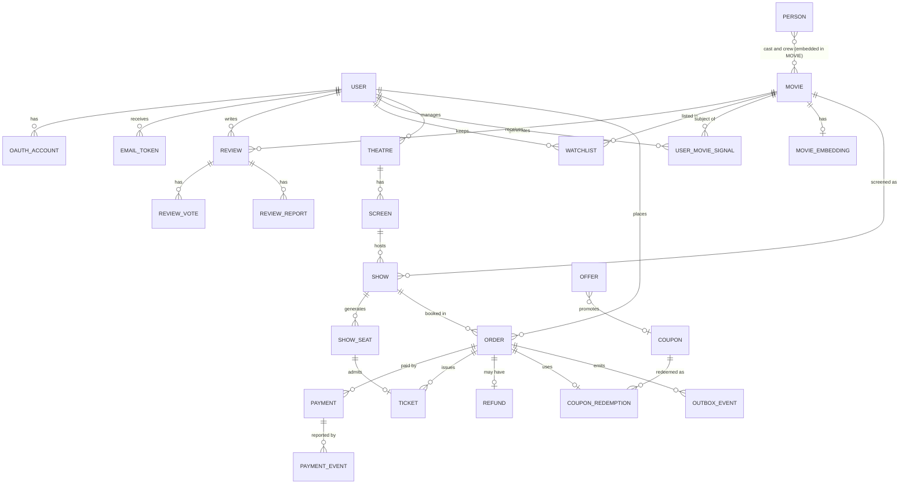

# QUEUESKIP: COMPLETE MASTER PLAN v6 (TypeScript, backend first, full database design)

A full stack movie discovery and ticket booking platform. Users sign up (email with verification, or Google), explore movies with cast, reviews and recommendations, pick a showtime and seats, apply a coupon, pay, and get a QR ticket. Hot releases are protected by a fair waiting room, hence the name.

**This file replaces v5 and every earlier plan file.** What changed in v6: **section 9 is now a full database design** (collections, fields, embedded versus referenced choices, every index with the query it serves, transactions, invariants, retention, example documents). Along the way the design fixed one inconsistency: seats are sold only when payment is confirmed, not when the order is created. TypeScript, the weekly order and everything else are unchanged.

Tags: **[DECIDED]** settled so you do not have to think about it, **[PLANNED]** not built yet. Reasons are in *italics*. Targets are goals to measure against, not results.

---

## 0. START HERE

1. Read sections 1 to 5 once (30 minutes). Do not read the rest yet.
2. Do **Week 0** (section 17): nine guided setup steps. It takes 2 to 3 days.
3. Then follow the **week-by-week plan** (section 17). **Backend first (Weeks 1 to 12), frontend after (Weeks 13 to 16).** Each week has tasks and an exit test. Do not start the next week until the exit test passes.
4. Keep this file open as the reference. Look up a section only when its week arrives.
5. After every week: update the status block (section 18), commit, and write one interview story in `docs/stories.md`.

*The most common way this kind of project fails is building features in parallel and finishing none. Finish slices in order.*

## 1. WHAT YOU ARE BUILDING

**Users**
- **Viewer:** browses movies, reads cast and reviews, gets recommendations, searches (including natural-language AI search), books seats, uses coupons, views tickets, writes reviews, keeps a watchlist.
- **Manager:** manages theatres, screens, shows and pricing, scans tickets at the door.
- **Admin:** manages the movie catalog, coupons and offers, moderates reviews.

**What makes it interview-worthy** (each one is measurable)
1. No double-booking when thousands chase the same seats (atomic updates, Redis plus MongoDB).
2. Safe payments: idempotent checkout, deduplicated webhooks, a late-payment refund path.
3. Distributed rate limiting that is exact across several API instances.
4. A load-balanced, stateless API that survives an instance being killed mid-test.
5. A fair waiting room that turns a traffic spike into a steady flow.
6. Caching done properly: cache-aside, write-behind for counters, Bloom filters against random-ID floods.
7. Real product depth: reviews, coupons, recommendations, AI search, Google sign-in, email verification.

**No real money.** Use the payment provider's **test mode** (Razorpay, since you are in India). *You get realistic webhooks and failures without legal or financial risk.*

## 2. SCOPE TIERS AND THE CUT ORDER

| Phase | Contents | Weeks |
|---|---|---|
| **Backend, booking core** | setup, auth, catalog, shows and seats, holds, orders, payments, tickets, rate limiting, load balancing, load tests | 0 to 7 |
| **Backend, product depth** | email verification, Google OAuth, password reset, reviews, coupons, offers, live seat stream, Bloom filters, write-behind | 8 to 10 |
| **Backend, smart features and release** | recommendations, AI search, waiting room, drills, API freeze, AWS deploy | 11 to 12 |
| **Frontend** | every page, built against the frozen API, then deployed | 13 to 16 |
| **Buffer** | final load tests, README, demo video, resume | 17 |

The backend alone is a complete, demoable project (with `.http` files, scripts and load tests). **If you run out of time, cut in this order:** waiting room, AI natural-language search, personal recommendations, write-behind signal stream, then in the frontend the admin, manager and scanner pages (seed shows by script). **Never cut** holds, orders, payments, tickets, rate limiting, the load-balanced seat-race test, or the core booking pages (browse, seat map, checkout, tickets).

## 3. TECH STACK [DECIDED]

| Layer | Choice | Why |
|---|---|---|
| Language | **TypeScript (strict)** with ES modules, current Node LTS | the compiler catches contract mismatches, wrong ids and missing null checks before a test does. Costs about one extra day in Week 0 |
| Dev, check, build | `tsx watch` to run in development, `tsc --noEmit` to type-check, `tsup` for the production build | no build step while developing, and a single bundled output for Docker |
| API | Express with `@types/express` | familiar, well typed |
| Database | MongoDB with Mongoose 8 (built-in types, `InferSchemaType`), run as a **replica set** | a replica set is required for transactions |
| Cache and critical state | Redis with `ioredis` (built-in types) | holds, queue, rate limits, counters, cache |
| Background jobs | BullMQ (on Redis) | one less service than SQS, retries and delayed jobs built in. SQS is an optional swap behind `queueClient.ts` at deploy time |
| Frontend | React with Vite in **TypeScript (`.tsx`)**, React Router, `fetch`, `react-hot-toast` | no extra data library: stay with `fetch`, `useState`, `useCallback` |
| Contracts | **`zod` schemas in `shared`**, types inferred with `z.infer` | the backend validates with the schema, the frontend imports the type. A renamed field is a compile error |
| Auth | JWT access token (in memory) plus httpOnly refresh cookie, `argon2` for passwords, `google-auth-library` for Google | |
| Email | `nodemailer`, Mailpit locally, SES on AWS | |
| Payments | Razorpay test mode, a tunnel (ngrok or cloudflared) for webhooks in development | webhooks need a public URL |
| QR | `qrcode` | |
| Tests | Vitest (runs TypeScript natively) and `supertest` (`*.spec.ts`); k6 for load tests (k6 scripts stay JavaScript) | |
| Quality | ESLint with `typescript-eslint`, Prettier (single quotes, semicolons, 2 spaces), `tsc --noEmit` in CI | |
| Containers | Docker and Docker Compose, nginx locally as a load balancer | |
| Cloud | AWS: ECS Fargate, ALB, ElastiCache Redis, S3, CloudFront, SES, CloudWatch, Secrets Manager. MongoDB Atlas for the database | Atlas is simpler and more compatible than DocumentDB |
| CI/CD | GitHub Actions | |
| DSA practice | Java (separate from this project) | |

## 4. CLOSED DECISIONS

| Question | Answer |
|---|---|
| REST or action routes? | REST for everything new (`POST /api/watchlist`, `DELETE /api/watchlist/:movieId`) |
| API versioning | none, paths start with `/api/` like yours |
| Success body | the resource itself; lists return `{ movies, page, limit, total }`; actions return `{ message }` |
| Error body | `{ message }`, plus `code` when the frontend must branch (`SEAT_UNAVAILABLE`, `EMAIL_NOT_VERIFIED`, `RATE_LIMITED`, `HOLD_EXPIRED`, `COUPON_INVALID`) |
| Booleans | natural names as in your code: `inWatchlist`, `userWatched`, `showRatingModal`, `loading` |
| Contract names | defined once in `shared/contracts/` and used by backend, frontend and tests |
| Folder names | lowercase package folders (`backend`, `frontend`) as in your repo |
| DB field naming | camelCase (MongoDB handles it, no mapping layer) |
| Hold length | 5 minutes to choose seats; creating an order extends it once to a 10-minute payment window |
| Coupon stacking | one coupon per order, no stacking |
| Seat status storage | only `AVAILABLE` and `SOLD` in MongoDB; `HELD` exists only in Redis with a TTL |
| Seat-map stream | public Server-Sent Events (seat status is not sensitive) |
| TypeScript strictness | `strict: true` plus `noUncheckedIndexedAccess`; no `any` (use `unknown` and narrow); no `enum` (use `as const` objects) |
| Module resolution | `"module": "ESNext"`, `"moduleResolution": "Bundler"`, so imports have no file extensions (`import { env } from '../config/env'`) |
| Where types live | request and response types come from `shared/contracts/` (zod schemas and `z.infer`); database record types come from Mongoose (`InferSchemaType`) |
| Package count | not a monorepo-heavy setup: one root `package.json` with npm workspaces (`backend`, `frontend`, `shared`) |

## 5. ARCHITECTURE

```
React (Vite) ──► nginx / ALB ──► API replicas (Express) ──► MongoDB (replica set)
                                      │   │
                                      │   └──► Redis (critical state)   Redis (cache, Bloom)
                                      │
                                      ├──► BullMQ queues ──► Workers (email, tickets, outbox,
                                      │                      sweeper, flusher, bloom rebuild)
                                      ├──► Google OIDC
                                      ├──► Razorpay (test) ──webhook──► API
                                      └──► LLM / embeddings provider (timeout + fallback)

SSE ◄── Redis pub/sub ◄── seat changes
```

**Layers (imports only go downward)**
`controllers → services → accessors / models / clients`
- **Controller:** read the request, run early-return guards, call one service, shape the response. Same `try/catch` pattern as your code.
- **Service:** the rules (pricing, state machine, limits). No `req` or `res`.
- **Model:** the Mongoose schema. Simple reads can use it directly from a service.
- **Accessor:** the only place for operations that must be **atomic** (seat sale, coupon claim, status transition, Redis scripts). Named for the outcome it guards: `sellSeatsIfAvailable`.
- **Client:** wraps an external system with timeouts, retries and error mapping.

**Two Redis roles, kept apart.** *Mixing "must not lose" data with "may be evicted" data in one Redis is a classic outage.*

| Role | Holds | Eviction |
|---|---|---|
| Critical state | seat holds, waiting room, rate limit buckets, idempotency locks, write-behind buffer, BullMQ queues | `noeviction` (fail loudly, never silently drop a hold) |
| Cache | movie pages, similar lists, trending, AI results, Bloom filters | `allkeys-lru` |

Locally, two Redis containers. On AWS, two separate setups. *Durability options differ by managed service and version, so check the current AWS documentation before depending on any persistence feature.*

## 6. REPOSITORY STRUCTURE

```
queueSkip/
├── backend/
│   ├── src/
│   │   ├── controllers/   authController.ts, movieController.ts, reviewController.ts, watchlistController.ts,
│   │   │                  showController.ts, holdController.ts, orderController.ts, couponController.ts,
│   │   │                  paymentController.ts, ticketController.ts, recommendationController.ts, adminController.ts
│   │   ├── routes/        authRoutes.ts, movieRoutes.ts, ... (one per controller)
│   │   ├── models/        User.ts, OAuthAccount.ts, EmailToken.ts, Movie.ts, Person.ts, Review.ts, Watchlist.ts,
│   │   │                  Theatre.ts, Screen.ts, Show.ts, ShowSeat.ts, Order.ts, Payment.ts, PaymentEvent.ts,
│   │   │                  Ticket.ts, Coupon.ts, CouponRedemption.ts, Offer.ts, Refund.ts, IdempotencyKey.ts,
│   │   │                  OutboxEvent.ts, UserMovieSignal.ts, ReviewReport.ts, MovieEmbedding.ts, ProcessedBatch.ts
│   │   ├── services/      authService.ts, holdService.ts, orderService.ts, orderStateMachine.ts, pricingService.ts,
│   │   │                  couponService.ts, reviewService.ts, recommendationService.ts, aiSearchService.ts
│   │   ├── accessors/     holdAccessor.ts, seatAccessor.ts, orderAccessor.ts, couponAccessor.ts, counterAccessor.ts
│   │   ├── clients/       googleOAuthClient.ts, paymentProviderClient.ts, emailClient.ts, queueClient.ts, llmClient.ts
│   │   ├── middleware/    auth.ts, requireRole.ts, requireVerifiedEmail.ts, rateLimiter.ts, idempotency.ts,
│   │   │                  requestId.ts, errorHandler.ts
│   │   ├── cache/         cacheAside.ts, writeBehindBuffer.ts, bloomFilter.ts
│   │   ├── workers/       ticketWorker.ts, emailWorker.ts, outboxPublisher.ts, holdSweeper.ts,
│   │   │                  writeBehindFlusher.ts, bloomRebuildJob.ts, reconciliationJob.ts, embeddingWorker.ts
│   │   ├── lua/           holdSeats.lua, releaseSeats.lua, tokenBucket.lua
│   │   ├── types/         express.d.ts (adds userId, userRole, requestId to Request)
│   │   ├── config/        env.ts, db.ts, redis.ts
│   │   ├── constants/     redisKeys.ts, limits.ts, statuses.ts
│   │   ├── utils/         hash.ts, pagination.ts, clock.ts
│   │   ├── app.ts         builds the Express app
│   │   ├── server.ts      starts the API
│   │   └── workerMain.ts  starts the worker process
│   ├── test/              app.spec.ts, authController.spec.ts, holdController.spec.ts,
│   │                      concurrency/ (seatRace.spec.ts, couponRace.spec.ts, webhookReplay.spec.ts), helpers/
│   ├── http/              auth.http, movies.http, holds.http, orders.http ... (request examples, one file per module)
│   ├── scripts/           seed.ts, simulateUsers.ts, signWebhook.ts (helpers you run by hand)
│   ├── .env.example
│   └── package.json
├── frontend/
│   ├── src/
│   │   ├── pages/         HomePage.tsx, MovieDetailPage.tsx, SearchPage.tsx, ShowtimesPage.tsx, SeatSelectionPage.tsx,
│   │   │                  CheckoutPage.tsx, MyTicketsPage.tsx, LoginPage.tsx, RegisterPage.tsx, VerifyEmailPage.tsx,
│   │   │                  WatchlistPage.tsx, AdminPage.tsx, ScannerPage.tsx
│   │   ├── components/    Navbar.tsx, MovieHeader.tsx, MovieSections.tsx, RatingModal.tsx, ReviewList.tsx, SeatMap.tsx,
│   │   │                  CouponInput.tsx, PriceBreakdown.tsx, RecommendationRow.tsx, AiSearchBox.tsx
│   │   ├── context/       AuthContext.tsx
│   │   ├── hooks/         useSeatStream.ts, useHoldTimer.ts, useDebounce.ts
│   │   ├── utils/         index.ts (exports baseURL), formatMoney.ts
│   │   └── App.tsx
│   └── package.json
├── shared/                contracts/ (zod schemas and inferred types), limits.ts, statuses.ts, errorCodes.ts
├── infra/                 CDK or Terraform
├── loadTests/             seatRace.js, couponRace.js, rateLimitBurst.js, bloomAttack.js, writeBehindFlood.js,
│                          failover.js, sseFanout.js, waitingRoom.js
├── docs/                  api.md (every endpoint: request, response, errors), designDocs/, decisions/, runbooks/, stories.md
├── docker-compose.yml     mongo (replica set), redisCritical, redisCache, mailpit, nginx + 3 api replicas
├── tsconfig.base.json     strict TypeScript settings shared by every package
└── package.json           workspaces: backend, frontend, shared
```

## 7. STYLE, NAMING AND TYPESCRIPT RULES [DECIDED]

1. **Files:** `<thing>Controller.ts`, `<thing>Routes.ts`, `<thing>Service.ts`, `<thing>Accessor.ts`, `<thing>Client.ts` (all `.ts` after conversion). Middleware is plain camelCase (`auth.ts`). **Mongoose models are PascalCase singular** (`Watchlist.ts`, collection becomes `watchlists`). React pages and components are PascalCase `.tsx`; hooks start with `use` and are `.ts`; other frontend files are camelCase `.ts`.
2. **Handlers:** verb plus noun, camelCase: `holdSeats`, `releaseHold`, `createOrder`, `applyCoupon`, `scanTicket`, `checkWatchlistStatus`. Controllers are typed named exports: `export const holdSeats = async (req: Request, res: Response) => { ... };`
3. **Variables, functions, constants:** camelCase (`maxSeatsPerHold`). **Types, interfaces and classes:** PascalCase with no `I` prefix (`HoldSeatsRequest`, `OrderRecord`). **Wire values** (statuses, roles, error codes) are UPPER_SNAKE strings exposed through a camelCase `as const` object: `orderStatus.pendingPayment === 'PENDING_PAYMENT'`, with a derived type `OrderStatus`.
4. **Environment variables** are UPPER_SNAKE in `.env`, validated once in `config/env.ts` with zod, and exposed as a typed camelCase object (`env.mongoUri`).
5. **Request context** from `auth.ts`: `req.userId`, `req.userRole`, `req.isEmailVerified`, `req.requestId`, declared once in `src/types/express.d.ts` (template below). They are optional on the type, so a controller that needs a user begins with a guard.
6. **Controller pattern:** one `try/catch`; guards that each return early with one message; then the service call; then the response. In `catch (error)` the error is `unknown`: log it as `console.error('Hold seats error:', error)`, answer `500` with `'Server error'`, and never return `error.message` to the client.
7. **Messages:** plain sentences, capitalised, no trailing full stop: `'Movie ID is required'`, `'Invalid movie ID format'`.
8. **Contracts are defined once, in `shared/contracts/`,** as zod schemas with inferred types. The backend parses requests with the schema; the frontend imports the same request and response types. *Your earlier watchlist bug (backend sent `isInWatchlist`, the page read `inWatchlist`) becomes a compile error.*
9. **TypeScript rules:** `strict` and `noUncheckedIndexedAccess` on; no `any` (use `unknown` and narrow it); no `enum` (use `as const` objects); `import type` for type-only imports; explicit return types on exported service and accessor functions; no non-null assertion (`!`) without a comment saying why; no `// @ts-ignore` (use `@ts-expect-error` with a reason, rarely).
10. **Formatting:** single quotes, semicolons, 2 spaces (`.prettierrc`: `{ "singleQuote": true, "semi": true, "tabWidth": 2 }`).
11. **URLs** are lowercase kebab-case; query params camelCase (`?pageSize=20`).
12. **Redis keys:** camelCase words joined by `:`, hash tag around the show id (`hold:{showId}:{seatId}`), all defined in `constants/redisKeys.ts`.

**Shared contract template (`shared/contracts/hold.ts`):**

```ts
import { z } from 'zod';
import { maxSeatsPerHold } from '../limits';

export const objectIdSchema = z.string().regex(/^[a-f\d]{24}$/i, 'Invalid ID format');

export const holdSeatsRequestSchema = z.object({
  showId: objectIdSchema,
  seatIds: z.array(objectIdSchema).min(1, 'Seat IDs are required').max(maxSeatsPerHold),
});

export type HoldSeatsRequest = z.infer<typeof holdSeatsRequestSchema>;
export type HoldSeatsResponse = { holdId: string; expiresAt: string };
export type WatchlistStatusResponse = { inWatchlist: boolean };
```

**Request context template (`backend/src/types/express.d.ts`):**

```ts
import type { UserRole } from '@queueskip/shared/statuses';

declare global {
  namespace Express {
    interface Request {
      userId?: string;
      userRole?: UserRole;
      isEmailVerified?: boolean;
      requestId?: string;
    }
  }
}

export {};
```

**Controller template (copy for every new handler):**

```ts
import type { Request, Response } from 'express';
import { holdSeatsRequestSchema } from '@queueskip/shared/contracts/hold';
import type { HoldSeatsResponse } from '@queueskip/shared/contracts/hold';
import { errorCode } from '@queueskip/shared/errorCodes';
import { holdSeatsForUser } from '../services/holdService';

export const holdSeats = async (req: Request, res: Response) => {
  try {
    const userId = req.userId;

    if (!userId) {
      return res.status(401).json({ message: 'Not authenticated' });
    }

    const parsed = holdSeatsRequestSchema.safeParse(req.body);

    if (!parsed.success) {
      return res.status(400).json({ message: parsed.error.issues[0]?.message ?? 'Invalid request' });
    }

    const { showId, seatIds } = parsed.data;
    const result = await holdSeatsForUser({ userId, showId, seatIds });

    if (!result.held) {
      return res.status(409).json({
        code: errorCode.seatUnavailable,
        message: 'One or more seats are no longer available',
      });
    }

    const body: HoldSeatsResponse = { holdId: result.holdId, expiresAt: result.expiresAt };
    res.status(201).json(body);
  } catch (error) {
    console.error('Hold seats error:', error);
    res.status(500).json({ message: 'Server error' });
  }
};
```

**Model template (`models/ShowSeat.ts`):**

```ts
import mongoose, { Schema } from 'mongoose';
import type { InferSchemaType } from 'mongoose';

const showSeatSchema = new Schema(
  {
    showId: { type: Schema.Types.ObjectId, ref: 'Show', required: true },
    section: { type: String, required: true },
    row: { type: String, required: true },
    number: { type: Number, required: true },
    tier: { type: String, required: true },
    priceMinor: { type: Number, required: true },
    status: { type: String, enum: ['AVAILABLE', 'SOLD'], default: 'AVAILABLE' },
    orderId: { type: Schema.Types.ObjectId, ref: 'Order', default: null },
  },
  { timestamps: true }
);

showSeatSchema.index({ showId: 1, section: 1, row: 1, number: 1 }, { unique: true });
showSeatSchema.index({ showId: 1, status: 1 });

export type ShowSeatRecord = InferSchemaType<typeof showSeatSchema>;
export default mongoose.model('ShowSeat', showSeatSchema);
```

**`tsconfig.base.json` essentials:** `"target": "ES2022"`, `"module": "ESNext"`, `"moduleResolution": "Bundler"`, `"strict": true`, `"noUncheckedIndexedAccess": true`, `"noImplicitOverride": true`, `"esModuleInterop": true`, `"skipLibCheck": true`, `"forceConsistentCasingInFileNames": true`, `"noEmit": true` (building is done by `tsup`, checking by `tsc`). Each package extends it.

## 8. GLOBAL CONVENTIONS

- **Status codes:** 400 validation, 401 not authenticated, 403 not allowed (including `EMAIL_NOT_VERIFIED`), 404 missing, 409 conflict (seat taken, state clash, duplicate), 410 hold expired, 422 business rule failed (coupon invalid), 429 rate limited, 503 dependency down.
- **Pagination on every list:** `?page=1&limit=20`, maximum 100. Response `{ movies, page, limit, total }` (key named after the resource).
- **Idempotency:** the `Idempotency-Key` header is required on `POST /api/orders` and `POST /api/orders/:id/pay`. Same key and same body returns the original response; same key with a different body returns 422.
- **Money:** integers in the smallest unit (`priceMinor`, paise) plus a currency code. Never floats.
- **Time:** UTC. The server decides hold and order expiry, never the client's clock.
- **Config:** `config/env.ts` validates every environment variable at startup and fails fast.
- **Request ids:** every request gets an id (`requestId.ts`), logged and returned in `X-Request-Id`.
- **Secrets:** `.env` is git-ignored; commit only `.env.example`. JWT secrets are 32+ random characters.
- **User text** (reviews, bios) is stored as plain text and rendered as text.
- **Wrong ids:** every `:id` path parameter is checked with `mongoose.Types.ObjectId.isValid` before any query.

## 9. DATABASE DESIGN

This section is the single reference for what is stored, where, and why. Each model you write in Weeks 1 to 11 comes from here. Build one module at a time, but **design the indexes from the queries in 9.6**, not from the field list.

### 9.1 Principles

1. **MongoDB holds durable truth. Redis holds ephemeral state** (seat holds, rate-limit buckets, waiting room, Bloom filters, write-behind buffers, caches). The few critical Redis structures (holds, queue) are always double-checked by MongoDB before money or seats change.
2. **Design from queries.** Every index in this section is justified by an access pattern in 9.6. An index with no query is cost without benefit.
3. **Embed** when the data is read together with its parent, is small and bounded, and changes with the parent. **Reference** when it grows without bound, is queried on its own, or is updated concurrently.
4. **Snapshot** what must never change retroactively. An order keeps the movie title, theatre name, seat labels and prices as they were at purchase.
5. **Denormalize only with a named owner** of the copy (who keeps it correct, and how it is repaired).
6. **No unbounded arrays.** Every embedded array below has a stated maximum.
7. **Types:** ids are `ObjectId`; money is an integer in minor units (paise) plus `currency`; times are `Date` in UTC; enums are strings taken from `shared/statuses`; "no value" is an explicit `null`.
8. **Normalize before storing** anything used for uniqueness: emails lowercased and trimmed, coupon codes uppercased.
9. Every collection has `createdAt` and `updatedAt` (Mongoose `timestamps: true`) unless noted.
10. **Schema evolution:** additive changes only; `schemaVersion` on long-lived documents (`User`, `Order`); indexes are created by a script in production (`autoIndex: false`), and by `syncIndexes()` in development and tests.
11. Typical documents stay under about 16 KB (the hard limit is 16 MB).

### 9.2 What lives where

| Data | Store | Why |
|---|---|---|
| Users, catalog, theatres, shows, orders, payments, tickets, coupons, reviews | MongoDB | durable, queryable, transactional |
| A seat that is **held** | Redis `hold:{showId}:{seatId}` (TTL) | ephemeral, atomic Lua, self-expiring. MongoDB never stores `HELD` |
| A seat that is **sold** | MongoDB `ShowSeat.status = 'SOLD'` | durable, protected by a conditional update |
| Rate-limit buckets, waiting room, admission tokens | Redis (critical) | fast, per-request atomic |
| Idempotency | Redis lock while in progress, MongoDB `IdempotencyKey` as the record (TTL 24 h) | lock for speed, record for correctness |
| Job queues | Redis (critical), via BullMQ | retries and delays built in |
| Outbox | MongoDB `OutboxEvent`, written **in the same transaction** as the order change | this is what makes "PAID" and "ticket job queued" consistent |
| Cached movie pages, similar lists, trending, recommendations, AI results | Redis (cache) | rebuildable |
| Bloom filters | Redis (cache) | rebuilt nightly from MongoDB |
| View-count buffer | Redis (critical) `wb:*`, final value in `Movie.viewCount` | write-behind |
| Embeddings | MongoDB `MovieEmbedding` | large vectors kept out of normal movie reads |
| Review aggregates | MongoDB `Movie.ratingSum`, `ratingCount`, `ratingAvg` | updated atomically, never computed per page view |
| Genre list | a constant in `shared/genres.ts` | about 20 fixed values do not need a collection |

### 9.3 Relationship diagram



### 9.4 Embedded or referenced

| Relationship | Choice | Reason | Bound |
|---|---|---|---|
| Movie to genres | embedded string array | tiny, filtered by value | at most 6 |
| Movie to cast and crew | embedded `{ personId, name, ... }` | always shown with the movie | cast at most 50, crew at most 20 |
| Movie to reviews | **referenced** (`Review`) | unbounded, paged, sorted | none |
| Movie to embedding | **referenced** (`MovieEmbedding`) | a vector of hundreds of numbers would bloat every movie read | one per movie |
| Screen to layout | embedded | read with the screen | at most 20 sections |
| Show to price tiers | embedded | read with the show | at most 6 |
| Show to seats | **referenced** (`ShowSeat`) | one document per seat, updated concurrently | about 100 to 500 per show |
| Order to items | embedded | always read with the order, written atomically with it | at most 6 |
| Order to history | embedded | bounded by the state machine | at most 20 |
| Order to payments | **referenced** | several attempts, webhooks arrive independently | few |
| Order to tickets | **referenced** | created later by a worker, scanned independently | at most 6 |
| Review to votes | **referenced**, `helpfulCount` copied onto the review | one vote per user | unbounded |
| Coupon to redemptions | **referenced**, `usedCount` copied onto the coupon | audit trail and uniqueness | unbounded |
| User to Google identities | **referenced** (`OAuthAccount`) | lookup by Google `sub` | few |

### 9.5 Collections

Notation: `Type`, `Type | null`, `[Type]` for an array. "Indexes" lists every index and the reason.

#### Identity

**User**
```
name            String  (2 to 60)
email           String  (lowercase, trimmed)
emailVerified   Boolean (default false)
passwordHash    String | null            null for Google-only accounts
role            'USER' | 'MANAGER' | 'ADMIN'      (default 'USER')
status          'ACTIVE' | 'SUSPENDED' | 'DELETED' (default 'ACTIVE')
tokenVersion    Number  (default 0)      bump to end every session
lastLoginAt     Date | null
schemaVersion   Number  (default 1)
```
Indexes: `unique(email)` (login, registration check). Never returned to clients: `passwordHash`, `tokenVersion`. A `DELETED` user is anonymized (see 9.8).

**OAuthAccount**: `userId`, `provider ('GOOGLE')`, `providerUserId` (Google `sub`), `email`. Indexes: `unique(provider, providerUserId)` (sign-in lookup), `index(userId)`.

**EmailToken**: `userId`, `type ('VERIFY' | 'RESET')`, `tokenHash` (SHA-256 hex, the raw token is never stored), `expiresAt`, `usedAt | null`. Indexes: `unique(tokenHash)`; `index(userId, type, createdAt -1)` (find the latest to invalidate older ones); **TTL on `expiresAt`** (`expireAfterSeconds: 604800`, keeps a week of history).

#### Catalog

**Movie**
```
title           String  (1 to 200)
synopsis        String  (up to 3000)
runtimeMin      Number
language        String  (ISO 639-1, for example 'hi')
releaseDate     Date
certification   String  ('U', 'UA', 'A', ...)
posterUrl       String | null
trailerUrl      String | null
status          'UPCOMING' | 'NOW_SHOWING' | 'ENDED'
genres          [String]    at most 6, values from shared/genres
cast            [{ personId, name, characterName, billingOrder }]   at most 50
crew            [{ personId, name, job }]                           at most 20
ratingSum       Number (0)   ratingCount Number (0)   ratingAvg Number (0)
viewCount       Number (0)   written by the write-behind flusher
```
Indexes: `text(title:10, 'cast.name':5, synopsis:3)` (search); `(status, releaseDate -1)` (home page lists); `(genres, status, ratingAvg -1)` (genre rows); `(language, status)`; `(cast.personId)` and `(crew.personId)` (filmography).
Rating update is one atomic pipeline update, so the average always matches the totals:
```js
Movie.updateOne({ _id: movieId }, [
  { $set: { ratingSum: { $add: ['$ratingSum', delta] }, ratingCount: { $add: ['$ratingCount', countDelta] } } },
  { $set: { ratingAvg: { $cond: [{ $gt: ['$ratingCount', 0] }, { $divide: ['$ratingSum', '$ratingCount'] }, 0] } } },
]);
```
Copies: `cast.name` and `crew.name` copy `Person.name`. Owner of the copy: `PUT /movies/:id/cast` writes it, and a script `syncPersonNames` repairs it if a person is renamed.

**Person**: `name`, `bio`, `photoUrl | null`, `birthDate | null`. Indexes: `text(name)`; `index(name)` for prefix lookups.

**MovieEmbedding**: `movieId`, `vector [Number]`, `dimensions`, `model`, `modelVersion`, `sourceHash` (hash of the text that was embedded, so unchanged movies are not re-embedded). Indexes: `unique(movieId)`. Loaded in bulk by the similarity job and cached; never part of a normal movie response.

#### Engagement

**Review**
```
movieId, userId
userName        String   copy of User.name at write time; 'Deleted user' after account deletion
rating          Number   integer 1 to 10
title           String   (up to 100)
body            String   (up to 2000, plain text)
helpfulCount    Number (0)     reportCount Number (0)
verifiedViewer  Boolean (false)   computed from orders, never from the client
status          'VISIBLE' | 'HIDDEN' (default 'VISIBLE')
```
Indexes: `unique(movieId, userId)` (one review per user, upsert target); `(movieId, status, createdAt -1)` (recent); `(movieId, status, helpfulCount -1)` (helpful); `(userId, createdAt -1)` (my reviews); `partial (status, reportCount -1)` where `reportCount > 0` (moderation queue).

**ReviewVote**: `reviewId`, `userId`. Indexes: `unique(reviewId, userId)`, `index(userId)`. `helpfulCount` changes by `$inc` only when the vote insert or delete actually happened.

**ReviewReport**: `reviewId`, `userId`, `reason`, `note`, `status ('OPEN' | 'RESOLVED')`. Indexes: `unique(reviewId, userId)`, `(status, createdAt)`.

**Watchlist**: `userId`, `movieId`, `createdAt` (no `updatedAt`). Indexes: `unique(userId, movieId)` (add is an upsert; status check), `(userId, createdAt -1)` (list).

**UserMovieSignal**: `signalId` (generated by the API, makes batch inserts idempotent), `userId`, `movieId`, `type ('VIEW' | 'WATCHLIST' | 'BOOKED' | 'RATED_HIGH' | 'RATED_LOW')`, `weight`, `createdAt`. Indexes: `unique(signalId)`, `(userId, createdAt -1)` (build a taste profile), **TTL on `createdAt`** (180 days).

#### Venues and shows

**Theatre**: `managerId`, `name`, `city`, `address`, optional `location` (GeoJSON point, with a `2dsphere` index only if you add "near me"). Indexes: `(city, name)`, `(managerId)`.

**Screen**: `theatreId`, `name`, `layout { sections: [{ name, rows, seatsPerRow, tier }] }` (at most 20 sections), `totalSeats` (computed on save), `showWriteVersion` (Number, see the overlap rule below). Indexes: `unique(theatreId, name)`.

**Show**
```
movieId, screenId
theatreId       copy from Screen (owner: show creation)
startsAt, endsAt   Date   endsAt = startsAt + runtime + cleaning buffer
status          'SCHEDULED' | 'ON_SALE' | 'CANCELLED' | 'COMPLETED'
highDemand      Boolean (false)   turns the waiting room on
priceTiers      [{ tier, priceMinor }]   at most 6
currency        String ('INR')
seatCounts      { total, sold }          sold is $inc'd in the confirm-payment transaction
```
Indexes: `(movieId, status, startsAt)` (showtimes for a movie), `(theatreId, startsAt)` (theatre schedule), `(screenId, startsAt)` (overlap check).
**Overlap rule.** A unique index cannot forbid overlapping time ranges, and two managers can create overlapping shows at the same instant. Create a show inside a transaction that first does `Screen.updateOne({ _id: screenId }, { $inc: { showWriteVersion: 1 } }, { session })`. Two concurrent creators then conflict on that document, one retries, and the overlap query (`screenId`, not cancelled, `startsAt < newEnd`, `endsAt > newStart`) runs on a consistent view.

**ShowSeat**
```
showId, section, row, number
seatLabel       String   for example 'A-5' (copy for display and snapshots)
tier            String   priceMinor Number
status          'AVAILABLE' | 'SOLD'
orderId         ObjectId | null          soldAt Date | null
expireAt        Date                     show.endsAt + 90 days
```
Indexes: `unique(showId, section, row, number)` (no duplicate seats, last safety net); `(showId, status)` (seat map, availability counts); **TTL on `expireAt`** (old seats are purged; orders and tickets keep their own snapshot of the label, so nothing is lost). About 300 documents per show is normal.

#### Commerce

**Order**
```
userId, showId
snapshot        { movieId, movieTitle, theatreId, theatreName, screenName, startsAt }
items           [{ showSeatId, seatLabel, tier, priceMinor }]     at most 6
subtotalMinor, feeMinor, discountMinor, totalMinor      integers
currency        String
couponId        ObjectId | null          couponCode String | null
holdId          String                   the Redis hold this order was created from
status          'PENDING_PAYMENT' | 'PAID' | 'CONFIRMED' | 'EXPIRED' | 'CANCELLED' | 'FAILED' | 'REFUND_PENDING' | 'REFUNDED'
expiresAt       Date                     end of the payment window
paidAt, cancelledAt   Date | null
history         [{ from, to, reason, at }]                        at most 20
schemaVersion   Number (1)
```
Indexes: `(userId, createdAt -1)` (my orders); `partial (status, expiresAt)` where `status = 'PENDING_PAYMENT'` (the expiry sweeper only scans open orders); `(showId, status)` (show cancellation, sales counts); `(status, createdAt -1)` (admin views).
Invariant: `totalMinor = subtotalMinor + feeMinor - discountMinor`, `discountMinor <= subtotalMinor + feeMinor`, `totalMinor >= 0`. Computed only by `pricingService`.

**Payment**: `orderId`, `provider ('RAZORPAY')`, `providerOrderId`, `providerPaymentId | null`, `status ('CREATED' | 'SUCCEEDED' | 'FAILED' | 'REFUNDED')`, `amountMinor`, `currency`, `failureReason | null`. Indexes: `unique(providerOrderId)` (webhook lookup), `unique sparse (providerPaymentId)`, `(orderId)`.

**PaymentEvent**: `providerEventId`, `type`, `payload` (raw body, size-limited), `status ('RECEIVED' | 'PROCESSED' | 'IGNORED' | 'FAILED')`, `receivedAt`, `processedAt | null`. Indexes: `unique(providerEventId)` (**webhook dedupe**, the insert fails on a replay); TTL on `receivedAt` (90 days).

**Refund**: `orderId`, `paymentId`, `providerRefundId | null`, `amountMinor`, `reason ('SHOW_CANCELLED' | 'USER_CANCELLED' | 'LATE_PAYMENT_SEATS_TAKEN')`, `status ('PENDING' | 'PROCESSED' | 'FAILED')`, `attempts`. Indexes: `unique(orderId)` (one refund per order), `(status, createdAt)` (retry worker).

**Ticket**
```
orderId, showId, showSeatId
seatLabel       String
ticketCode      String   short human-readable code
qrJti           String   id inside the signed QR token
usedAt          Date | null     usedByUserId ObjectId | null
cancelledAt     Date | null
```
Indexes: `unique(orderId, showSeatId)` (the ticket worker is idempotent), `unique(ticketCode)`, `(showId, usedAt)` (door statistics). Scan is one atomic statement: `findOneAndUpdate({ _id, usedAt: null, cancelledAt: null }, { $set: { usedAt: now, usedByUserId } })`.

**Coupon**
```
code               String  (uppercase)
description        String
type               'PERCENT' | 'FLAT'     value Number (1 to 100, or minor units)
maxDiscountMinor   Number | null          minOrderMinor Number (0)
validFrom, validTo Date
maxTotalUses       Number | null          null means unlimited
usedCount          Number (0)             counts RESERVED and COMMITTED redemptions
firstBookingOnly   Boolean (false)
rules              { movieIds [], theatreIds [], daysOfWeek [], tiers [] }     empty means unrestricted
ownerTheatreId     ObjectId | null
enabled            Boolean
```
Indexes: `unique(code)` (apply by code), `(enabled, validFrom, validTo)` (active offers), `(ownerTheatreId)`.
**Per-user limit is fixed at one use per user** for this project. A higher limit would need a per-user counter document, so it is listed as future work.

**CouponRedemption**: `couponId`, `userId`, `orderId`, `discountMinor`, `status ('RESERVED' | 'COMMITTED' | 'RELEASED')`, `isActive` (true for `RESERVED` and `COMMITTED`). Indexes: `unique(couponId, orderId)`; **`partial unique (couponId, userId)` where `isActive = true`** (this is what enforces one active use per user, even when two orders race); `(orderId)`.

**Offer**: `title`, `description`, `couponId | null`, `autoRule | null` (for example 20 percent on Tuesdays, for auto-applied offers), `bannerUrl | null`, `sortOrder`, `validFrom`, `validTo`, `enabled`. Indexes: `(enabled, validFrom, validTo, sortOrder)`.

**IdempotencyKey**: `userId`, `key`, `endpoint`, `requestHash`, `status ('IN_PROGRESS' | 'COMPLETED')`, `responseStatus`, `responseBody`. Indexes: `unique(userId, key, endpoint)`, **TTL on `createdAt`** (86,400 seconds).

**OutboxEvent**: `type` (for example `order.paid`), `aggregateId` (the order id), `payload`, `published` (Boolean, false), `attempts`, `publishedExpireAt | null`. Indexes: `partial (published, createdAt)` where `published = false` (the publisher polls only unpublished rows); **TTL on `publishedExpireAt`** (set to now plus 7 days when published; documents without the field are never deleted).

#### Operations

**ProcessedBatch**: `batchId`, `kind ('viewCounts')`, `appliedAt`, `expireAt`. Indexes: `unique(batchId)` (inserted first by the write-behind flusher so a retried flush is skipped), **TTL on `expireAt`** (7 days).

### 9.6 Access patterns and their indexes

| Query | Collection | Index used | Notes |
|---|---|---|---|
| Log in by email | User | `unique(email)` | |
| Find user by Google `sub` | OAuthAccount | `unique(provider, providerUserId)` | |
| Verify or reset by token | EmailToken | `unique(tokenHash)` | hash the incoming token first |
| Home page: now showing | Movie | `(status, releaseDate -1)` | paged |
| Genre row, best rated | Movie | `(genres, status, ratingAvg -1)` | paged |
| Search by text | Movie | text index | plus Bloom filter and cache for detail pages |
| Movie detail by id | Movie | `_id` | cache-aside, Bloom filter first |
| Filmography of a person | Movie | `(cast.personId)`, `(crew.personId)` | |
| Reviews of a movie, recent or helpful | Review | `(movieId, status, createdAt -1)`, `(movieId, status, helpfulCount -1)` | paged |
| Upsert my review | Review | `unique(movieId, userId)` | duplicate key means conflict |
| Moderation queue | Review | partial `(status, reportCount -1)` | |
| Is movie in my watchlist | Watchlist | `unique(userId, movieId)` | |
| My taste signals | UserMovieSignal | `(userId, createdAt -1)` | limit to recent |
| Showtimes for a movie in a city on a date | Show | `(movieId, status, startsAt)` then Theatre by id | two queries, one for shows and one `$in` for theatres |
| Overlap check on a screen | Show | `(screenId, startsAt)` | inside the transaction with the screen version bump |
| Seat map for a show | ShowSeat | `(showId, status)` | merged with Redis holds |
| Sell seats | ShowSeat | `unique(showId, section, row, number)` and `_id` | conditional update |
| My orders | Order | `(userId, createdAt -1)` | paged |
| Expire unpaid orders | Order | partial `(status, expiresAt)` | sweeper |
| Cancel a show: find paid orders | Order | `(showId, status)` | |
| Payment from webhook | Payment | `unique(providerOrderId)` | |
| Replayed webhook | PaymentEvent | `unique(providerEventId)` | insert fails on replay |
| Apply a coupon | Coupon | `unique(code)` | atomic claim, then redemption insert |
| Active offers | Offer, Coupon | `(enabled, validFrom, validTo, ...)` | cached |
| Scan a ticket | Ticket | `_id` | one atomic update |
| Publish outbox | OutboxEvent | partial `(published, createdAt)` | |
| Retry refunds | Refund | `(status, createdAt)` | |

**Rule:** before a module counts as done, run `explain('executionStats')` on its main queries and confirm an index scan (`IXSCAN`), with `totalDocsExamined` close to `nReturned`.

### 9.7 Transactions, concurrency and consistency

MongoDB transactions need the replica set. Keep them short (at most 6 seats), run them with `withTransaction` (it retries transient errors), and use `readConcern: 'snapshot'` and `writeConcern: { w: 'majority' }`. The connection string sets `retryWrites=true&w=majority`.

**The confirm-payment transaction** (payment webhook, section 10.8). Seats are **not** sold when the order is created: between order creation and payment they exist only as Redis holds. Everything below happens in one transaction:
1. `ShowSeat.updateMany({ showId, _id: { $in }, status: 'AVAILABLE' }, { $set: { status: 'SOLD', orderId, soldAt } })`. If `modifiedCount` does not equal the seat count, **abort**. The first confirmed payment wins; the other buyer goes to the refund path.
2. `Order`: `PENDING_PAYMENT` to `PAID` (conditional on the current status), with a `history` entry.
3. `Payment`: `CREATED` to `SUCCEEDED`.
4. `CouponRedemption`: `RESERVED` to `COMMITTED`, if a coupon was used.
5. `Show.seatCounts.sold` incremented.
6. `OutboxEvent` inserted (`order.paid`).

**Other transactions:** create a show (screen version bump, overlap check, show insert, seat generation in batches); apply a coupon (atomic `usedCount` claim plus the redemption insert); order expiry and cancellation (status change plus coupon release plus Redis hold release after commit).

**Invariants and how each is enforced**

| Invariant | Enforced by |
|---|---|
| A seat is sold at most once | conditional update plus the unique seat index |
| One review per user per movie | `unique(movieId, userId)` |
| One active coupon use per user | partial unique index on `CouponRedemption` |
| A coupon never exceeds `maxTotalUses` | conditional `$inc` on `usedCount` |
| A webhook is processed once | `unique(providerEventId)`, then conditional status updates |
| One ticket per seat per order | `unique(orderId, showSeatId)` |
| A ticket is admitted once | conditional update on `usedAt: null` |
| Order totals add up | only `pricingService` writes them, and the state machine re-checks them |
| Order status only moves forward | conditional update on the expected current status |
| Rating average matches the reviews | atomic pipeline update, plus a nightly recompute |

**Nightly reconciliation** (`reconciliationJob`): `Movie.ratingCount` and `ratingSum` against `Review`; `Coupon.usedCount` against active redemptions; `Show.seatCounts.sold` against `SOLD` seats; paid orders without tickets; orders stuck in `PENDING_PAYMENT` past `expiresAt`; Redis holds with no matching open order. It logs every difference and fixes the safe ones.

### 9.8 Retention, deletion and privacy

| Data | Kept | How |
|---|---|---|
| EmailToken | 7 days after expiry | TTL |
| IdempotencyKey | 24 hours | TTL |
| OutboxEvent | 7 days after publishing | TTL on `publishedExpireAt` |
| PaymentEvent | 90 days | TTL |
| ProcessedBatch | 7 days | TTL |
| UserMovieSignal | 180 days | TTL |
| ShowSeat | 90 days after the show ends | TTL on `expireAt` |
| Orders, payments, refunds, tickets | kept (financial records) | none |
| Reviews | kept, author anonymized on account deletion | update |

**Account deletion** sets `User.status = 'DELETED'`, replaces `name` and `email` with placeholders (`deleted+<id>@invalid`), clears `passwordHash`, bumps `tokenVersion`, deletes `OAuthAccount`, `EmailToken`, `Watchlist` and `UserMovieSignal` rows, and sets `Review.userName` to `'Deleted user'`. Orders stay for the financial record, with the user reference intact but no personal data left on the user.

### 9.9 Operations

- **Connections:** one pooled connection per API process (`maxPoolSize` about 20 to 50), `serverSelectionTimeoutMS` and `maxTimeMS` set so a slow database fails requests instead of piling them up.
- **Read preference:** primary for seats, orders, payments, coupons. `secondaryPreferred` is allowed for catalog reads (movies, reviews, showtimes) where a few seconds of staleness is fine. Never read seat status from a secondary.
- **Indexes:** `autoIndex: false` in production; `npm run db:indexes` creates them (idempotent). Every new index states the query it serves.
- **Seed data** (`backend/scripts/seed.ts`): deterministic (fixed random seed): about 50 movies, 100 people, 5 theatres, 12 screens, shows for the next 14 days with their seats, 20 users (one admin, two managers), a few coupons and offers. Factories in `test/helpers/factories.ts` build the same shapes for tests.
- **Backups:** Atlas continuous backup or daily snapshots. Practise a restore once before you rely on it.

### 9.10 Example documents

`Show`:
```json
{
  "_id": "665f1c2e8a1b2c3d4e5f6001",
  "movieId": "665f1c2e8a1b2c3d4e5f5001",
  "screenId": "665f1c2e8a1b2c3d4e5f4001",
  "theatreId": "665f1c2e8a1b2c3d4e5f3001",
  "startsAt": "2026-12-05T13:30:00.000Z",
  "endsAt": "2026-12-05T16:15:00.000Z",
  "status": "ON_SALE",
  "highDemand": true,
  "priceTiers": [{ "tier": "STANDARD", "priceMinor": 25000 }, { "tier": "PREMIUM", "priceMinor": 40000 }],
  "currency": "INR",
  "seatCounts": { "total": 240, "sold": 118 }
}
```

`ShowSeat`:
```json
{
  "showId": "665f1c2e8a1b2c3d4e5f6001",
  "section": "PREMIUM", "row": "C", "number": 7, "seatLabel": "C-7",
  "tier": "PREMIUM", "priceMinor": 40000,
  "status": "SOLD", "orderId": "665f1c2e8a1b2c3d4e5f7001", "soldAt": "2026-12-04T09:12:44.000Z",
  "expireAt": "2027-03-05T16:15:00.000Z"
}
```

`Order` (after payment):
```json
{
  "_id": "665f1c2e8a1b2c3d4e5f7001",
  "userId": "665f1c2e8a1b2c3d4e5f2001",
  "showId": "665f1c2e8a1b2c3d4e5f6001",
  "snapshot": { "movieTitle": "Night Signal", "theatreName": "Orion Cinemas", "screenName": "Screen 2", "startsAt": "2026-12-05T13:30:00.000Z" },
  "items": [
    { "showSeatId": "665f1c2e8a1b2c3d4e5f8001", "seatLabel": "C-7", "tier": "PREMIUM", "priceMinor": 40000 },
    { "showSeatId": "665f1c2e8a1b2c3d4e5f8002", "seatLabel": "C-8", "tier": "PREMIUM", "priceMinor": 40000 }
  ],
  "subtotalMinor": 80000, "feeMinor": 4000, "discountMinor": 8000, "totalMinor": 76000, "currency": "INR",
  "couponCode": "WEEKEND10", "holdId": "h_7f3a9c",
  "status": "PAID", "expiresAt": "2026-12-04T09:20:00.000Z", "paidAt": "2026-12-04T09:12:44.000Z",
  "history": [
    { "from": null, "to": "PENDING_PAYMENT", "reason": "order created", "at": "2026-12-04T09:10:02.000Z" },
    { "from": "PENDING_PAYMENT", "to": "PAID", "reason": "payment confirmed", "at": "2026-12-04T09:12:44.000Z" }
  ]
}
```

### 9.11 Approximate sizes (estimates, measure with `Object.bsonsize`)

| Collection | Typical document | Growth driver |
|---|---|---|
| Movie (without embedding) | 3 to 6 KB | catalog size (hundreds to thousands) |
| MovieEmbedding | 6 to 12 KB | one per movie |
| Review | about 1 KB | users times movies reviewed |
| ShowSeat | about 250 bytes | shows times seats: 300 seats, 4 shows a day, 5 screens, 30 days is about 180,000 per theatre per month, purged after 90 days |
| Order | 1.5 to 3 KB | bookings |
| Ticket | about 400 bytes | seats sold |

`ShowSeat` is the collection that grows fastest, which is why it has a TTL and the tightest indexes. If it ever outgrew one replica set, shard it by `showId` (hashed); orders would shard by `userId`. At project scale none of this is needed, but be able to say it.


## 10. FEATURE SPECIFICATIONS

### 10.1 Auth, email verification, Google sign-in

```
POST /api/auth/register          { name, email, password }
POST /api/auth/login             { email, password }
POST /api/auth/logout
POST /api/auth/refresh
GET  /api/auth/me
POST /api/auth/verify-email      { token }
POST /api/auth/resend-verification   { email }      generic response
POST /api/auth/forgot-password       { email }      generic response
POST /api/auth/reset-password        { token, newPassword }
GET  /api/auth/google            redirect to Google
GET  /api/auth/google/callback   Google redirects here
```

**Sessions**
- Short-lived access token (about 15 minutes) kept in memory in `AuthContext` and sent as `Authorization: Bearer`. Long-lived refresh token in an httpOnly, sameSite cookie. On page load the app calls `/api/auth/refresh` to restore the session.
- Tokens carry `tokenVersion`, checked against the database. Logout, password change and reset bump it and end every session.
- JWT verification pins `algorithms: ['HS256']`. Passwords use `argon2`. `ADMIN` and `MANAGER` can never be self-registered; the first admin comes from `ADMIN_EMAIL`.

**Email verification**
- Register creates the user with `emailVerified: false`, a random 32-byte token (only its **SHA-256 hash** stored, 24-hour expiry, single use), and enqueues an email job.
- The email link opens a frontend page that calls `POST /verify-email`. *A link that changes state on GET can be triggered by mail scanners and link previews.*
- Unverified users can browse but cannot hold seats, book, or review: `403` with `code: 'EMAIL_NOT_VERIFIED'` (the page offers "resend email").
- `resend-verification` and `forgot-password` always return the same message whether or not the email exists. *This prevents account enumeration.* Rate limit both (3 per hour per email and IP). Reset tokens expire in 30 minutes and bump `tokenVersion`.
- Email is sent by a worker, never inside the request.

**Google OAuth (OpenID Connect, authorization code flow with PKCE)**
1. `GET /auth/google`: create `state`, `nonce` and a PKCE `code_verifier`, keep them in a short-lived signed httpOnly cookie, redirect to Google with scopes `openid email profile`.
2. Callback: check `state`, exchange the `code` **on the server** with the client secret, then **validate the ID token** (signature, `iss`, `aud` equals your client id, `exp`, `nonce`).
3. Require `email_verified: true` in the token.
4. Find the person by **Google `sub`** through `OAuthAccount`, never by email alone (emails can change).
   - New identity and no account with that email: create a user with `emailVerified: true` and no password.
   - A **verified** local account has the same email: link the Google identity to it.
   - An **unverified** local account has the same email: link it, **delete its password hash and bump `tokenVersion`**. *This blocks pre-hijacking, where an attacker registers with a victim's email before the victim signs in with Google.*
5. Issue your own refresh cookie and redirect to the frontend. Redirect URIs are exact matches in the Google Cloud console; use separate OAuth clients for dev and production. Never log tokens, codes or the client secret.

### 10.2 Movie catalog, cast, search

```
GET   /api/movies?genre=&language=&status=NOW_SHOWING|UPCOMING&sort=&page=&limit=
GET   /api/movies/:id                details, top 10 cast, genres, rating summary
GET   /api/movies/:id/cast           full cast and crew
GET   /api/people/:id                bio and filmography
GET   /api/genres
GET   /api/search?q=                 titles, people, genres (MongoDB $text index)
POST  /api/movies                    ADMIN
PATCH /api/movies/:id                ADMIN
PUT   /api/movies/:id/cast           ADMIN (replace cast with billing order)
```

- **Data:** seed with fictional or sample movies. If you use a public data source, read its terms and follow its attribution rules. Use placeholder posters on any public demo. Never host copyrighted posters or trailers.
- Movie detail and list responses are cached (cache-aside, section 12.7).
- Bloom filter protects `GET /movies/:id` from random ids (section 12.5).

### 10.3 Watchlist

```
GET    /api/watchlist
POST   /api/watchlist                 { movieId }
DELETE /api/watchlist/:movieId
GET    /api/watchlist/:movieId/status   → { inWatchlist: true | false }
```

Adding is an upsert on the unique `(userId, movieId)`. Removing returns 404 when nothing was deleted (`deletedCount === 0`). Adding also records a recommendation signal.

### 10.4 Reviews and ratings

```
GET    /api/movies/:id/reviews?sort=recent|helpful|rating&page=&limit=
PUT    /api/movies/:id/reviews/me      { rating, title?, body }     create or update
DELETE /api/movies/:id/reviews/me
POST   /api/reviews/:id/helpful        toggle
POST   /api/reviews/:id/report         { reason }
```

- **One review per user per movie** (unique index); PUT is an upsert. Duplicate-key error `11000` becomes 409.
- Needs a verified email. A **"verified viewer"** badge is computed (a CONFIRMED order for a past show of that movie), never self-declared.
- **Aggregates are atomic:** `Movie.updateOne({ _id }, { $inc: { ratingSum: delta, ratingCount: n } })`, and `ratingAvg` is derived. Never read, change and save. A nightly job recomputes from the source reviews to repair drift.
- Length limits, rate limits, plain text only. Reports go to an admin queue.

### 10.5 Theatres, screens, shows, seat map

```
GET  /api/theatres?city=
POST /api/theatres                          MANAGER
POST /api/theatres/:id/screens              MANAGER   { name, layout }
POST /api/shows                             MANAGER   { movieId, screenId, startsAt, priceTiers }
GET  /api/movies/:id/shows?city=&date=      grouped by theatre
GET  /api/shows/:id
GET  /api/shows/:id/seats                   seat map with live status
GET  /api/shows/:id/stream                  SSE (section 10.9)
POST /api/shows/:id/cancel                  owner, triggers refunds
POST /api/shows/:id/scan                    MANAGER or STAFF  { qrToken }
```

- Creating a show **generates one `ShowSeat` per seat** from the screen layout, with its tier and price. Layout and prices freeze after the first order. Overlapping shows on a screen return `409`.
- `GET /seats` merges MongoDB (`SOLD`) with Redis (held) into `AVAILABLE | HELD | SOLD`. Cache the static layout, never the status.

### 10.6 Seat holds (core problem 1)

```
POST   /api/holds           { showId, seatIds }   → { holdId, expiresAt }
DELETE /api/holds/:holdId
```

**Rule: Redis is the fast gate, MongoDB is the final judge.**
- Maximum seats per hold (for example 6), maximum active holds per user, verified email required.
- One **Lua script** checks all requested seats and sets them all, or none. *A loop of `SET NX` calls from Node can leave a half-held group.*
- Keys `hold:{showId}:{seatId}` hold `holdId:userId` with a 5-minute TTL. Also `holdSet:{showId}:{holdId}` and `userHolds:{userId}`.
- Release uses compare-and-delete in Lua. *User A's expired hold must never delete user B's new hold.*
- Every change publishes to `chan:show:{showId}` for live updates.
- If Redis is down, holds are disabled (browsing still works) and the API returns 503. Seats are never sold without the database check.

### 10.7 Orders, pricing, coupons (core problem 2)

```
POST   /api/orders                  { holdId, couponCode? }    Idempotency-Key required
GET    /api/orders
GET    /api/orders/:id
POST   /api/orders/:id/coupon       { code }
DELETE /api/orders/:id/coupon
POST   /api/orders/:id/pay          Idempotency-Key required → payment session
POST   /api/orders/:id/cancel
```

**State machine**
```
PENDING_PAYMENT ──paid──► PAID ──tickets issued──► CONFIRMED
      │                    │
      ├─expired────► EXPIRED          CONFIRMED ──cancel──► REFUND_PENDING ──► REFUNDED
      ├─cancelled──► CANCELLED
      └─failed─────► FAILED (seats released)
```
- All transitions go through `orderStateMachine.ts`. Each is a conditional update (`findOneAndUpdate({ _id, status: expected }, ...)`), so two racing events cannot both win. A `null` result means someone else already moved it.
- **Price is recomputed on the server:** seat prices plus convenience fee minus coupon discount (capped, never below zero). The order stores a price snapshot. Never trust a price from the client.
- Creating an order validates the hold, extends it once to the payment window, and sets `order.expiresAt`. The order starts as `PENDING_PAYMENT`. **Seats stay held in Redis; they are sold only when payment is confirmed** (section 9.7).
- **Selling seats** happens in the confirm-payment transaction (sections 9.7 and 10.8): `ShowSeat.updateMany({ showId, _id: { $in }, status: 'AVAILABLE' }, { $set: { status: 'SOLD', orderId, soldAt } }, { session })`. If `modifiedCount` does not equal the seat count, the transaction aborts and the payment goes to the refund path.
- **Coupon rules** (checked when applied and again at order creation): exists and enabled, inside its validity window, minimum order met, movie/theatre/day rules match, per-user and global limits not exceeded, first-booking rule satisfied, one coupon per order.
- **Atomic coupon claim:**
  ```js
  Coupon.findOneAndUpdate(
    { _id: couponId, enabled: true, $expr: { $lt: ['$usedCount', '$maxTotalUses'] } },
    { $inc: { usedCount: 1 } },
    { new: true, session }
  );
  ```
  `null` means no uses left. A redemption is **RESERVED** when applied, **COMMITTED** on `PAID`, and **RELEASED** (`usedCount` decremented) on `EXPIRED`, `CANCELLED` or `FAILED`, inside the same transition function so it cannot be forgotten.
- Rate limit coupon attempts and return the same generic error for unknown and invalid codes. *Otherwise attackers can guess valid codes.*
- `GET /api/offers` returns display offers (for example "20% off Tuesday shows"). Auto-applied offers go through the same pricing function.

### 10.8 Payments, tickets, entry scanning

```
POST /api/webhooks/payments           provider to server, signature verified, no user auth
GET  /api/orders/:id/tickets
GET  /api/tickets/:id                 own ticket with QR payload
```

- Create a payment session for the order total with the order id as reference and a short expiry.
- **Verify the webhook signature** on the raw body. **Dedupe** by the provider's event id (`PaymentEvent`, unique): providers deliver at least once and out of order.
- In one **confirm-payment transaction** (section 9.7): seats `AVAILABLE → SOLD`, payment `SUCCEEDED`, order `PENDING_PAYMENT → PAID`, coupon redemption `RESERVED → COMMITTED`, `Show.seatCounts.sold` incremented, and an `OutboxEvent` inserted. **Never trust the browser redirect** as proof of payment.
- **Late payment:** the user pays after the hold expired. The confirm-payment transaction still runs its conditional seat update. If the seats are still `AVAILABLE`, the order is confirmed (the first confirmed payment wins). If someone else already bought them, the transaction aborts: **refund automatically** and notify. Write an explicit test.
- **Transactional outbox:** a publisher moves unpublished outbox rows to the BullMQ queue and marks them published. *This keeps "order is PAID" and "ticket job queued" from drifting if the process crashes between the two.*
- **Ticket worker:** consumes `order.paid`, creates one ticket per seat (unique `(orderId, showSeatId)` makes it idempotent), signs a QR token (JWT with `ticketId`, `showId`, expiry), renders the QR, sends the email.
- **Scan:** verify the signature, then `Ticket.findOneAndUpdate({ _id, usedAt: null }, { $set: { usedAt: new Date() } })`. `null` means a duplicate scan. *One atomic statement prevents two doors admitting the same ticket.*
- **Show cancellation:** all paid orders move to `REFUND_PENDING` with one refund job each, retried with backoff and a failed-jobs set.

### 10.9 Real-time seat updates

```
GET /api/shows/:id/stream      Server-Sent Events
```
- Every seat change publishes `{ seatId, status }` to Redis. Each API replica subscribes and pushes to its own connected clients. *No replica has to know about the others.*
- Batch updates and push every 100 to 250 ms. Send a heartbeat comment every 15 to 30 seconds. On reconnect the client refetches full seat status. The stream is a hint; the server stays the authority when a user tries to hold.

### 10.10 Recommendations

```
GET  /api/movies/:id/similar
GET  /api/me/recommendations
GET  /api/recommendations/trending?city=
```

- **Level 1, genre similarity:** Jaccard overlap of genres plus small bonuses for shared language, director and lead cast, then popularity. Cached per movie for hours.
- **Level 2, personal taste:** signals (booked = strong, rated high = strong, rated low = negative, watchlisted = medium, viewed = weak) with time decay build a genre affinity vector per user. Score = `0.5 * genre affinity + 0.3 * similarity to liked movies + 0.2 * popularity`. Exclude booked movies. Re-rank for diversity so the top 10 is not one genre.
- **Cold start:** new users and new movies fall back to trending and genre results. Say so in the README.
- A worker refreshes profiles and caches each user's top results in Redis.
- **Evaluate it:** hold out each seeded user's last booking and measure hit-rate@10 against a popularity baseline. Synthetic seed data limits what the result proves, so say that too.

### 10.11 AI features

*Principle: AI enhances the catalog, it never replaces it. Every result is a real movie id from your database.*

- **Embeddings:** a worker embeds each movie (title, synopsis, genres, top cast) and stores the vector in `MovieEmbedding` with the model name and version. For a catalog of a few thousand movies, compute cosine similarity in Node and cache the result; use Atlas Vector Search only if you want it.
- **Natural-language search** `POST /api/search/ai { query }`: the model returns JSON only (`genres`, `languages`, `maxRuntime`, `yearRange`, `moodText`). **Validate it with zod.** Run a MongoDB filter, then rank by vector similarity to `moodText`. Optionally return a one-line reason built from catalog fields only.
- **Fallback:** on timeout (about 3 seconds), error or invalid JSON, run normal keyword search. The feature degrades, it never breaks.
- **Controls:** cache by normalized query, rate limit per user, a daily token budget, log tokens and estimated cost. Treat the user's text as data, never as instructions. Send no personal data (names, emails) in prompts. Never execute anything the model returns.
- **"Because you watched X"** explanations are templated from signals, not generated.

### 10.12 Waiting room (core problem 3)

```
POST /api/shows/:id/queue/join
GET  /api/shows/:id/queue/status     → { position, etaSeconds, admitted }
```
- Redis sorted set `queue:{showId}` scored by join time; position is `ZRANK`. A scheduler admits a fixed number per second and issues a short-lived signed **admission token**. Only token holders may call the hold endpoint for a `highDemand` show.
- Fairness: one entry per user, rate-limited joins, drop users who stop polling. Show position and a rough ETA, never a promise. *This turns an uncontrolled spike into a steady flow, which is backpressure.*

### 10.13 Admin and manager

```
POST/PATCH /api/admin/coupons, GET /api/admin/coupons, GET /api/admin/coupons/:id/stats
GET /api/admin/reviews/reported, PATCH /api/admin/reviews/:id      (hide or restore)
GET /api/admin/stats
```
A manager UI for shows is optional: seed shows by script if time is short.

## 11. FRONTEND PLAN

**Built in Weeks 13 to 16, after the API is frozen (end of Week 12).** The frontend is thin by design: every rule already lives in the API, and `docs/api.md` plus the `.http` files are your reference. Week-by-week mapping is in section 17.

**Stack:** React, Vite and TypeScript (`.tsx`); request and response types and constants are imported from `shared`, so a field renamed in the API fails the frontend type check. **Rules:** access token only in `AuthContext` memory, never `localStorage`. Requests use `credentials: 'include'`. On 401 call refresh once, retry, otherwise go to `/login`; never loop. Show `EMAIL_NOT_VERIFIED` with a "resend email" action. Send an `Idempotency-Key` (one UUID per checkout attempt) on order and pay calls. Countdown uses the server's `expiresAt`. Seat selection is optimistic and rolls back on 409. Accessible seat map (keyboard, text labels, not colour alone). Skeletons, empty states and error states everywhere.

| Step | Pages and components |
|---|---|
| 1 | Vite setup, `AuthContext`, `Navbar`, router, `utils/index.ts` |
| 2 | `LoginPage`, `RegisterPage`, "check your email" and `VerifyEmailPage`, Continue with Google |
| 3 | `HomePage`: now showing, upcoming, offers, genre rows |
| 4 | `MovieDetailPage`: `MovieHeader`, `MovieSections`, cast strip, rating summary, watchlist button, "more like this" |
| 5 | Reviews: `ReviewList`, `RatingModal`, helpful vote, report |
| 6 | `SearchPage` with filters, `AiSearchBox` |
| 7 | `ShowtimesPage` by theatre and date |
| 8 | `SeatSelectionPage` with `SeatMap`, `useSeatStream`, waiting room screen |
| 9 | Hold flow with `useHoldTimer` |
| 10 | `CheckoutPage`: `CouponInput`, `PriceBreakdown`, payment (test mode), result and failure states |
| 11 | `MyTicketsPage` (QR), order history, `WatchlistPage`, profile |
| 12 | `AdminPage`, `ScannerPage` |

Each page is built against the real API with loading, empty and error states, readable on a phone.

## 12. SCALE CONCEPTS

### 12.1 Redis key catalog (all keys, kept in `constants/redisKeys.ts`)

| Key | Type | TTL | Purpose |
|---|---|---|---|
| `hold:{showId}:{seatId}` | string `holdId:userId` | 300 s | seat hold |
| `holdSet:{showId}:{holdId}` | set | 300 s | seats of a hold |
| `userHolds:{userId}` | set | 300 s | max active holds |
| `rl:{policy}:{identifier}` | hash | 2x refill time | token bucket |
| `queue:{showId}` | sorted set | until show end | waiting room |
| `admit:{showId}:{userId}` | string | 600 s | admission token |
| `idem:{userId}:{key}` | string | 24 h | in-flight idempotency lock |
| `movie:{id}` | JSON | 60 s | cache-aside |
| `similar:{id}` | JSON | 6 h | similar list |
| `recs:{userId}` | JSON | 1 h | personal recommendations |
| `trending:{city}` | sorted set | 10 min | most booked |
| `aiSearch:{queryHash}` | JSON | 1 h | AI search cache |
| `bloom:{name}` | bitmap | rebuilt nightly | Bloom filters |
| `wb:viewCounts:{bucket}` | hash | flushed | write-behind counters |
| `wb:signals` | stream | trimmed | write-behind signals |
| `chan:show:{showId}` | pub/sub | n/a | live seat updates |

Every key has a TTL unless it is explicitly flushed or rebuilt. Never use `KEYS *`; use `SCAN`. All keys one Lua script touches share a hash tag so they sit in one cluster slot.

### 12.2 Atomic updates

**Rule: never read a value, change it in application code, then write it back.** Push the read-modify-write into one atomic operation where the data lives.

| Operation | Mechanism | Invariant |
|---|---|---|
| Hold seats | Redis Lua, all or none | nobody holds a seat twice, no half-held group |
| Release hold | Lua compare-and-delete | an expired hold never deletes another user's hold |
| Sell seats | `updateMany` with `status: 'AVAILABLE'` in a transaction, `modifiedCount` checked | a seat is sold at most once |
| Order transition | `findOneAndUpdate({ _id, status: expected })` | racing events cannot both win |
| Claim coupon use | `findOneAndUpdate` with `$expr` on `usedCount` | the last use goes to one person |
| Rating totals | `$inc` | no lost update |
| Rate limit | Lua token bucket | exact across replicas |
| Idempotency | `SET NX EX`, then a unique index | a double click creates one order |
| Scan ticket | `findOneAndUpdate({ _id, usedAt: null })` | one admission per ticket |
| Claim a job | `findOneAndUpdate({ status: 'PENDING' }, { $set: { status: 'PROCESSING' } })` | two workers never take one job |
| Counter | `HINCRBY` | exact counts without locks |

Rules: name accessor methods for the guarded outcome; **check the result every time** (`modifiedCount`, a `null` return, a script return value); multi-document changes use one transaction; every row above gets a concurrency test (200 parallel requests, then assert the invariant).

**Lua scripts**

`lua/holdSeats.lua`:
```lua
-- KEYS: one key per seat (same hash slot). ARGV[1] = holdValue, ARGV[2] = ttlSeconds
for i = 1, #KEYS do
  if redis.call('EXISTS', KEYS[i]) == 1 then
    return { 0, i }
  end
end
for i = 1, #KEYS do
  redis.call('SET', KEYS[i], ARGV[1], 'EX', ARGV[2])
end
return { 1, 0 }
```

`lua/releaseSeats.lua`:
```lua
-- KEYS: seat keys. ARGV[1] = holdValue
local released = 0
for i = 1, #KEYS do
  if redis.call('GET', KEYS[i]) == ARGV[1] then
    redis.call('DEL', KEYS[i])
    released = released + 1
  end
end
return released
```

`lua/tokenBucket.lua`:
```lua
-- KEYS[1] = bucket key. ARGV[1] = capacity, ARGV[2] = refillPerSecond, ARGV[3] = cost
local t = redis.call('TIME')
local nowMs = t[1] * 1000 + math.floor(t[2] / 1000)
local data = redis.call('HMGET', KEYS[1], 'tokens', 'ts')
local capacity = tonumber(ARGV[1])
local refill = tonumber(ARGV[2])
local cost = tonumber(ARGV[3])
local tokens = tonumber(data[1])
local ts = tonumber(data[2])
if tokens == nil then tokens = capacity; ts = nowMs end
local elapsed = math.max(0, nowMs - ts)
tokens = math.min(capacity, tokens + (elapsed / 1000) * refill)
local allowed = 0
local retryAfterMs = 0
if tokens >= cost then
  tokens = tokens - cost
  allowed = 1
else
  retryAfterMs = math.ceil(((cost - tokens) / refill) * 1000)
end
redis.call('HSET', KEYS[1], 'tokens', tokens, 'ts', nowMs)
redis.call('PEXPIRE', KEYS[1], math.ceil((capacity / refill) * 1000) * 2)
return { allowed, math.floor(tokens), retryAfterMs }
```

### 12.3 Rate limiting

**Layers:** edge (CloudFront and AWS WAF rate rules) → load balancer (timeouts, body size) → **application (Redis token bucket, this section)** → business caps (seats per order, holds per user, coupon attempts).

**Middleware** (`middleware/rateLimiter.ts`) exports `createRateLimiter({ name, capacity, refillPerSecond, failOpen, getIdentifier })` and ready-made limiters (`loginLimiter`, `holdLimiter`, ...). It calls the Lua script once per request, sets `X-RateLimit-Limit` and `X-RateLimit-Remaining`, and on rejection sets `Retry-After` and answers `429` with `code: 'RATE_LIMITED'`. Attach limiters per route in the routes file. Identify by user id when logged in, otherwise by IP. Behind a balancer, set `app.set('trust proxy', hops)` so `req.ip` is the client.

| Endpoint group | Key | Limit | If Redis is down |
|---|---|---|---|
| Login | IP | 5 per minute | **fail closed** |
| Register | IP | 3 per hour | fail closed |
| Resend verification, forgot password | email and IP | 3 per hour | fail closed |
| Coupon apply | user and IP | 10 per minute | fail closed |
| Create hold | user | 10 per minute | fail open (low in-process cap) |
| Waiting room join | user and show | 1 per show | fail open |
| Search | IP | 60 per minute | fail open |
| AI search | user | 5 per minute plus daily token budget | **fail closed** (costs money) |
| Review write | user | 10 per hour | fail open |
| Whole API | IP | 300 per minute | fail open |

*Security and cost endpoints fail closed; browsing fails open. Be ready to defend that split.*

**Tests:** 1,000 concurrent requests against a limit of 100 allow exactly 100; refill allows the right amount after waiting; two replicas share one limit; Redis stopped, login fails closed and browsing fails open; every limited route has a test that sends limit + 1 requests and expects 429.

### 12.4 Load balancing

- **Principle:** API replicas are stateless. All state lives in MongoDB and Redis. No in-memory sessions, no local-disk uploads, no per-replica counters.
- **Local:** nginx with `least_conn` in front of 3 API containers. Add an `X-Served-By` header so you can see the spread. The seat-stream location sets `proxy_buffering off` and a long `proxy_read_timeout`. Kill one replica mid-test and show the error rate stays low. Note: the MongoDB replica set member name must be resolvable by every client; run the API on the host in early weeks, and record this in `docs/decisions/`.
- **AWS:** Application Load Balancer across at least two Availability Zones, health check on `/readyz` (database and Redis reachable), minimum 2 tasks, autoscaling on requests per target and CPU. Try round robin and **least outstanding requests**, and keep the one that measures better. No sticky sessions. Deregistration delay matches the app's graceful-shutdown time (finish in-flight requests, then exit). Raise the ALB idle timeout above the SSE heartbeat.
- **Retries:** only idempotent requests are retried. Orders and payments are safe to retry because of the `Idempotency-Key`.
- **Tests:** even spread over 3 replicas; failover with one replica killed; rolling deploy with zero dropped requests; scale-out under load; and the **5,000 users versus 200 seats** test passing through the balancer with 3 replicas.

### 12.5 Bloom filters

A Bloom filter answers "have I seen this value?" in very little memory. **"Definitely not" is always right. "Maybe" can be wrong.** *Rule: trust a "no" and skip the database; a "maybe" always falls through to the real check.*

| Use | Contains | Saves |
|---|---|---|
| Cache-penetration shield for `GET /movies/:id`, `/people/:id`, `/shows/:id` | all valid ids | random or attacker-chosen ids never reach MongoDB |
| Coupon code pre-check | all existing codes | brute-force guessing never hits the database |
| Webhook dedupe first pass | processed provider event ids | most duplicates rejected before a query (the unique index is still the truth) |

Do **not** use one for "is this email registered?" (account enumeration).

**Sizing:** `m = -(n × ln p) / (ln 2)²` bits, `k = (m / n) × ln 2` hashes. One million ids at 1% needs about 9.6 bits each, roughly 1.2 MB and 7 hashes.

**Build order:** (1) your own filter on Redis bitmaps (`SETBIT`, `GETBIT`, double hashing); (2) the RedisBloom module if you want it, but **module support differs by managed service and version, so check current AWS documentation**; (3) an in-process filter for tiny sets.

**Lifecycle rules:** no deletes (a deleted id stays "maybe" until the nightly rebuild, which is safe); rebuild nightly into a new key and swap with `RENAME`; **add to the filter before the create commits** so a new record can never get a false "no"; an empty or cold filter answers "maybe" for everything; track the real false-positive rate against your target.

**Tests:** seed 100,000 ids and probe with 1,000,000 random ones (zero false negatives, false-positive rate near target, database queries avoided); `bloomAttack.js` floods random ids and compares database query rate with and without the filter; create-then-read race never returns a false 404.

### 12.6 Write-behind caching

Write to Redis now, flush to MongoDB later in batches.

| Strategy | Use here |
|---|---|
| Cache-aside | movie detail, similar lists, trending, AI results |
| Write-through | small reference data (genres, offers) |
| **Write-behind** | view counts, click and watchlist signals, last-seen timestamps |

**Never** use write-behind for seats, orders, payments, coupons or ticket scans. Those use atomic database updates.

**Counter pattern:** the API runs `HINCRBY wb:viewCounts:{bucket} {movieId} 1`. Every few seconds the flusher does an atomic `RENAME` of a closed bucket to `wb:processing:{bucket}` (no increment is lost between read and clear), inserts a unique `batchId` marker first (so a retried flush skips batches already applied), then writes `Movie.bulkWrite([{ updateOne: { ..., update: { $inc: { viewCount: delta } } } }])`, then deletes the processing key. A leftover processing key is retried after a crash.

**Signal pattern (optional):** `XADD wb:signals` from the API; a consumer group reads batches, inserts into `UserMovieSignal` idempotently, and acknowledges. Unacknowledged entries are retried; poison entries go to a dead-letter stream. Flush on whichever comes first: N entries or T seconds.

**Trade-offs to state honestly:** if Redis loses the buffer before a flush, those counts are lost (bounded by the flush interval); the database is behind by up to one interval; only commutative operations (increments, inserts) can be batched; cap the buffer and alert if the flusher falls behind. Displayed counts are `databaseValue + pendingDelta` or a few seconds stale, whichever you document.

**Tests and metrics:** `writeBehindFlood.js` sends 20,000 views per second for 60 seconds and reports the reduction in database writes; a crash test kills the flusher mid-batch and asserts the final count equals requests sent (no loss, no double count); a Redis restart test measures the real loss window.

### 12.7 Caching summary

Cache-aside for movie list, detail, similar, trending and AI results with the TTLs in the key catalog; invalidate on admin update. Cache static seat layout for a long time; **never cache seat status** beyond a second or two. Measure hit ratio and latency before and after, and report the numbers.

## 13. SECURITY CHECKLIST

- Passwords hashed (argon2); JWT algorithm pinned; httpOnly sameSite refresh cookie; CORS allow-list; `helmet`; request size limits.
- Email and reset tokens: random, hashed at rest, expiring, single use; generic responses against enumeration.
- OAuth: `state`, `nonce`, PKCE, server-side code exchange, ID token validation, `email_verified` required, exact redirect URIs, link by `sub`, the pre-hijacking rule.
- Verify webhook signatures on the raw body. Parameterised queries only: never build a MongoDB filter from raw request objects (strip or reject `$` operators, for example with `express-mongo-sanitize` or explicit field picking).
- Authorization lives in services and is tested per role (user A cannot read, pay or cancel user B's order).
- QR tokens are signed and checked on scan. User text is rendered as text.
- No personal data in AI prompts; model output validated; budgets and timeouts.
- Never log passwords, tokens, codes, secrets or card data (you never touch card data: the provider hosts the payment page).
- Account deletion and data export for users.

## 14. TESTING STRATEGY

- **Unit:** pure logic (`orderStateMachine`, `pricingService`, coupon rules, recommendation scoring).
- **Integration:** real MongoDB replica set and Redis from Docker Compose, through `supertest`. Every write endpoint has a test that **reads the database afterwards**.
- **Concurrency** (`backend/test/concurrency/`): seat race, coupon race, webhook replay, double-click pay, scan race.
- **Contract:** frontend and backend read field names from `shared/contracts/`.
- **Without a UI (Weeks 1 to 12):** use `.http` files (VS Code REST Client or Thunder Client), supertest, and scripts in `backend/scripts/` (`seed.ts`, `simulateUsers.ts`, `signWebhook.ts`). Read emails in Mailpit. Every endpoint gets a `.http` example and an entry in `docs/api.md` before its module counts as done.
- **Load** (`loadTests/`, k6): see section 15.
- CI runs `tsc --noEmit`, ESLint, the Prettier check and the test suite on every pull request using Docker Compose. Test files are `*.spec.ts`.

## 15. LOAD TESTS (record your real numbers)

1. **Headline:** 5,000 virtual users compete for 200 seats through the balancer with 3 replicas. Each winner then pays through the signed-webhook script. Exactly 200 sold, zero double bookings, every loser gets a clean 409.
2. **Coupon race:** 1,000 users, a coupon with 50 uses, exactly 50 redemptions.
3. **Rate limit burst:** exact allow counts shared across replicas.
4. **Hold expiry:** 1,000 holds expire, seats return, the sweeper finds nothing to repair.
5. **Duplicate payments:** the same webhook replayed 50 times produces one `PAID` transition; the same `Idempotency-Key` 20 times produces one order.
6. **Bloom attack:** random-id flood with and without the filter.
7. **Write-behind flood:** database writes with and without buffering, plus the crash test.
8. **Failover:** kill a replica mid-run; rolling deploy under traffic.
9. **Redis down mid-run:** no seat sold twice, graceful degradation.
10. **SSE fan-out:** 5,000 clients on one show, measure update delay.
11. **Waiting room:** 10,000 joins, verify drain rate and fairness.
12. **AI search under load** with the model stubbed slow or failing: the fallback keeps p95 acceptable.

**Targets (goals):** p95 hold latency under 100 ms at 1,000 requests per second on a small instance; zero invariant violations in every concurrency test. For each test, write down the first bottleneck you found and what you changed.

## 16. OBSERVABILITY AND DEPLOYMENT

**Metrics:** requests per second, status counts, p50/p95/p99 per endpoint, active holds, hold conflicts, orders by status, coupon redemptions and rejections, webhook lag, queue depth, failed jobs, cache hit ratio, Bloom false-positive rate, write-behind buffer age, SSE connections, AI fallback rate and cost per request. Use `prom-client` locally and CloudWatch on AWS. **Alarms:** 5xx rate, p99 latency, failed-jobs count, webhook failures, Redis connection errors, email bounce rate.

**AWS layout**
```
Route 53 → CloudFront → S3 (React build)
                      → ALB → ECS Fargate: API (N tasks)
                              ECS Fargate: workers (email, tickets, outbox, sweeper, flusher, bloom rebuild, embeddings)
MongoDB Atlas · ElastiCache Redis (critical) · ElastiCache Redis (cache) · SES · CloudWatch · Secrets Manager
GitHub Actions: lint, test, build image, deploy
```
Set an AWS Budget alert before creating anything, and tear down costly resources when you are not demoing. SES starts in sandbox mode, so plan for the access request. Infrastructure as code (CDK or Terraform) is a strong bonus. API and worker are separate services so they scale independently.

## 17. WEEK-BY-WEEK SCHEDULE (backend first, then frontend)

**Order:** build the whole API first (Weeks 1 to 12), freeze it, then build the frontend (Weeks 13 to 16), then a buffer week (17). About 18 weeks, alongside DSA.

**Routine for every backend module (models first):**
1. Write the Mongoose **model** and its indexes (`models/<Name>.ts`) from section 9.5. Every index must serve a query in section 9.6.
2. **Model test:** required fields, enums, and each unique index rejects a duplicate.
3. **Seed data** and a factory in `test/helpers/factories.ts`.
4. **Service** (the rules).
5. **Controller** (the template from section 7).
6. **Routes**, with the rate limiter attached once Week 7 lands.
7. **Tests:** happy path, failure path, ownership, and a read of the database afterwards.
8. A **`.http` example** and an entry in **`docs/api.md`**.
9. Commit, tick the status block, add one STAR story.

*Why one module at a time rather than all models upfront: indexes depend on how queries use them, so models written early often need rework. If you prefer writing the core models first, that works; expect to adjust some indexes later.*

**Daily rhythm:** 1 to 2 LeetCode problems in Java every day, one mock interview or system design question per weekend, one story per week in `docs/stories.md`. Commit small (`feat(holds): add holdSeats Lua script`); one pull request per module.

**Testing without a UI:** `.http` files, supertest, `backend/scripts/` helpers, Mailpit for emails, a script that sends a correctly signed test webhook for payments, and a placeholder redirect for the Google callback until the frontend exists.

### Week 0: setup (guided, 9 steps)
1. Check tools (Node 20+, npm, Git, Docker). 2. Create the folder and Git repo. 3. Workspace `package.json` and `tsconfig.base.json`. 4. TypeScript tooling: `typescript`, `tsx`, `tsup`, ESLint with `typescript-eslint`, Prettier. 5. The `shared` package (statuses, error codes, limits, `objectIdSchema`). 6. The backend package (`tsconfig.json`, scripts, dependencies). 7. First backend files: `config/env.ts`, `db.ts`, `redis.ts`, `requestId`, `errorHandler`, `types/express.d.ts`, `app.ts` with `/healthz` and `/readyz`, `server.ts`. 8. Start MongoDB (replica set), two Redis instances and Mailpit with Docker Compose. 9. First test and the CI workflow (`tsc --noEmit`, lint, tests).
- Also create accounts: GitHub, Google Cloud (OAuth), Razorpay (test), AWS (set the budget alert first), MongoDB Atlas.
- **Exit:** `docker compose up` works, `npm run typecheck` and `npm test` pass, `/readyz` shows everything true, CI is green.

### Week 1: User model and auth
- **Model:** `User`. Test it (unique email, role enum).
- **Build:** register, login, refresh, logout, me; `auth.ts` middleware (`req.userId`, `req.userRole`); `tokenVersion`; first admin from `ADMIN_EMAIL`; argon2 hashing; httpOnly refresh cookie.
- **Exit:** the whole flow works from `auth.http`; tests read the database after every write; logout bumps `tokenVersion` and old tokens stop working.

### Week 2: catalog, search, watchlist
- **Models:** `Movie` (embedded genres, cast, crew), `Person`, `Watchlist`. Genres are a constant list in `shared/genres.ts`, not a collection.
- **Build:** `seed.ts` with about 50 fictional movies, list with filters and pagination, detail, cast, genres, `$text` search, admin create and edit and cast replace, watchlist REST with `{ inWatchlist }`, Redis cache-aside for list and detail.
- **Exit:** search works, a cached detail request is visibly faster, duplicate watchlist add is handled, removing a missing item returns 404.

### Week 3: theatres, shows, seat map
- **Models:** `Theatre`, `Screen`, `Show`, `ShowSeat`.
- **Build:** manager role, create theatre and screen, create show (generates one `ShowSeat` per seat), overlap check, `GET /movies/:id/shows`, `GET /shows/:id/seats` (Redis holds merged in later).
- **Exit:** a show with the right number of seats exists; overlapping shows return 409; unique seat index rejects duplicates.

### Week 4: seat holds (core problem 1)
- **Models:** none (Redis). Write `constants/redisKeys.ts` usage, `lua/holdSeats.lua`, `lua/releaseSeats.lua`.
- **Build:** `holdAccessor`, `holdService`, hold and release endpoints, per-user hold limits, `holdSweeper`, `simulateUsers.ts` (many fake users).
- **Tests:** 50 then 200 users on one seat, exactly one wins; half-held group impossible; expired hold cannot delete another user's hold.
- **Exit:** seat-race test passes; `docs/designDocs/holdSystem.md` written.

### Week 5: orders and the state machine (core problem 2)
- **Models:** `Order` (with `history`), `IdempotencyKey` (TTL index).
- **Build:** `pricingService` (server-side), `orderStateMachine`, `idempotency` middleware, create order (validates the hold, extends it once, creates the order as `PENDING_PAYMENT`; the seats stay held in Redis and are sold only at payment confirmation in Week 6), expiry job, cancel.
- **Tests:** double-click create order gives one order; two racing transitions (only one wins); a hold that expired cannot be turned into an order; Redis killed mid-checkout.
- **Exit:** a held seat becomes a `PENDING_PAYMENT` order; MongoDB still shows the seat `AVAILABLE` and Redis still holds it; an expired order releases everything. Verified by database reads.

### Week 6: payments, tickets, workers
- **Models:** `Payment`, `PaymentEvent` (unique event id), `Ticket`, `OutboxEvent`, `Refund`.
- **Build:** Razorpay test-mode session, webhook with signature check and dedupe, the confirm-payment transaction (seats sold, order paid, payment succeeded, outbox row), late-payment handling, outbox and publisher, BullMQ queues, `ticketWorker` (QR), `emailWorker` (Mailpit), scan endpoint, `signWebhook.ts`.
- **Exit:** the full booking flow works end to end from `.http` files and scripts; a replayed webhook changes nothing; a late payment is confirmed or refunded; two users confirming payment for the same seats gives exactly one sale and one automatic refund.

### Week 7: rate limiting, load balancing, first load tests
- **Models:** none.
- **Build:** `lua/tokenBucket.lua`, `rateLimiter.ts`, apply the policy table to every route with tests (limit + 1 requests gives 429); nginx plus 3 API replicas in Compose with `X-Served-By`; k6 seat race through the balancer; failover test.
- **Optional but recommended:** a half-day deploy rehearsal to AWS (API, Atlas, one Redis) so infrastructure surprises appear now, not in Week 12.
- **Exit:** 5,000 users for 200 seats through 3 replicas sells exactly 200; killing a replica barely moves the error rate.

### Week 8: email verification, password reset, Google OAuth
- **Models:** `EmailToken` (TTL), `OAuthAccount`.
- **Build:** verification and reset flows with hashed single-use tokens, generic responses, resend limits, `requireVerifiedEmail` on holds, orders and reviews; Google flow with PKCE, `state`, `nonce`, ID token checks and the three linking rules including pre-hijacking. The callback redirects to `CLIENT_URL` until the frontend exists. Read tokens from Mailpit.
- **Exit:** tests for verified and unverified access, enumeration-safe responses and the pre-hijacking scenario.

### Week 9: reviews, coupons, offers
- **Models:** `Review`, `ReviewVote`, `ReviewReport`, `Coupon`, `CouponRedemption` (with the partial unique index), `Offer`.
- **Build:** reviews (one per user, atomic aggregates, verified-viewer badge, report, admin moderation, nightly recompute); coupons (rules, atomic claim, reserve then commit then release inside the state machine, admin CRUD and stats); `GET /api/offers`.
- **Tests:** two simultaneous reviews update totals correctly; coupon race gives exactly N redemptions; expired and cancelled orders release their coupon use.
- **Exit:** all passing, documented in `docs/api.md`.

### Week 10: live seats, Bloom filters, write-behind
- **Models:** `ProcessedBatch` (write-behind idempotency marker, TTL).
- **Build:** SSE endpoint with Redis pub/sub across replicas, batching and heartbeats (test with `curl -N` in two terminals); Bloom filter on Redis bitmaps with nightly rebuild and the add-before-commit rule; write-behind view counters with the `RENAME` handoff and idempotent flush.
- **Exit:** `bloomAttack.js` shows database queries avoided; the write-behind flood shows the write reduction; the flusher crash test shows no loss and no double count.

### Week 11: recommendations and AI
- **Models:** `UserMovieSignal` (TTL), `MovieEmbedding`.
- **Build:** trending, genre similarity, signals, taste profile, evaluation script against the popularity baseline; embedding worker, similarity, natural-language search with zod validation, fallback, cache, rate limit and daily budget, cost logging.
- **Exit:** hit-rate numbers recorded; AI search degrades cleanly when the model is slow or returns invalid output.

### Week 12: waiting room, drills, API freeze, AWS deploy
- **Models:** none.
- **Build:** waiting room with admission tokens and drain rate; `reconciliationJob`; failure drills (Redis down, slow payment provider, worker crash, duplicate webhook, double-click pay) with runbooks; full review of `docs/api.md`; **freeze the API and tag `backend-v1`**; deploy the backend to AWS (ECS Fargate, ALB with `/readyz`, Atlas, ElastiCache, secrets, CloudWatch alarms, CI/CD); run the main load tests against it.
- **If short on time:** drop the waiting room first, and move deploy polish to Week 17.
- **Exit:** a public API URL, every endpoint documented, the headline load test passing on AWS.
- **After the freeze:** during the frontend weeks only bug fixes and small additions are allowed, each logged in `docs/api.md` with the date.

### Week 13: frontend foundation, auth, home, movie detail
- Vite + React + TypeScript setup, `shared` types and constants, `AuthContext` (token in memory, refresh on load), `Navbar`, router, `utils/index.ts`.
- `LoginPage`, `RegisterPage`, check-your-email and `VerifyEmailPage`, Continue with Google.
- `HomePage` (now showing, upcoming, offers, genre rows), `MovieDetailPage` (`MovieHeader`, `MovieSections`, cast, rating summary, watchlist button).
- **Exit:** register, verify through Mailpit, log in, browse and open a movie, all in the browser.

### Week 14: reviews, search, showtimes, recommendations
- `ReviewList`, `RatingModal`, helpful vote, report; `SearchPage` with filters and `AiSearchBox`; `ShowtimesPage`; `RecommendationRow` on home and detail pages.
- **Exit:** write a review, search by text and by natural language, reach a showtime list.

### Week 15: booking flow
- `SeatSelectionPage` with `SeatMap`, `useSeatStream`, `useHoldTimer`, waiting room screen; `CheckoutPage` with `CouponInput`, `PriceBreakdown`, Razorpay test checkout, result and failure states; `MyTicketsPage` with QR.
- Optimistic seat selection with rollback on 409; countdown from the server's `expiresAt`; `Idempotency-Key` on order and pay calls.
- **Exit:** book a ticket end to end in the browser, with two browsers showing each other's held seats live.

### Week 16: remaining pages, polish, frontend deploy
- `WatchlistPage`, profile, order history and cancel; `AdminPage` (coupons, review moderation); `ScannerPage`; loading, empty and error states everywhere; mobile layout; accessibility pass on the seat map.
- Deploy the frontend (S3 and CloudFront) and point it at the live API.
- **Exit:** the live site works on a phone; a stranger could book a ticket without help.

### Week 17: buffer and finish
- Re-run the whole load test list against AWS, fix the top bottleneck, tune ALB, autoscaling and cache TTLs.
- README with architecture diagram, setup steps and results; 3-minute demo video; fill in the resume line and the stories file. Tag `v1-final`.
- **Exit:** every number in section 20 is real.

**If you fall behind:** apply the cut order in section 2 and keep the cut items as "future work" in the README.

## 18. STATUS BLOCK (update after every module; tick only when its Definition of Done is met)

```
Week 0   setup (9 steps)                         ⏳    Week 9   reviews + coupons + offers        ⏳
Week 1   User model + auth                       ⏳    Week 10  live seats + Bloom + write-behind ⏳
Week 2   catalog + search + watchlist            ⏳    Week 11  recommendations + AI              ⏳
Week 3   theatres + shows + seat map             ⏳    Week 12  waiting room + freeze + AWS       ⏳
Week 4   seat holds                              ⏳    Week 13  frontend: auth + home + detail    ⏳
Week 5   orders + state machine                  ⏳    Week 14  frontend: reviews + search        ⏳
Week 6   payments + tickets + workers            ⏳    Week 15  frontend: booking flow            ⏳
Week 7   rate limiting + load balancing          ⏳    Week 16  frontend: rest + deploy           ⏳
Week 8   email verification + Google OAuth       ⏳    Week 17  buffer + finish                   ⏳
```

## 19. DEFINITION OF DONE

**Backend slice**
1. Controller follows the template: guards, one service call, `try/catch`, `'<Action> error:'` log, generic 500.
2. Pagination and indexes where it is a list.
3. Ownership and role rules tested, including "user A cannot touch user B's data".
4. At least one happy-path and one failure-path integration test, and **every write test reads the database afterwards**.
5. The result of every write is checked (`modifiedCount`, `deletedCount`, `null` from `findOneAndUpdate`) and mapped to 404 or 409.
6. Request and response types come from `shared/contracts/` (zod schema plus inferred type); the handler returns exactly that type (a boolean is a boolean, not an array).
7. State changes go through the state machine and write `history`.
8. Any read-modify-write is replaced by an atomic operation, named for the outcome it guards.
9. Any new Redis key is in `constants/redisKeys.ts` with a TTL and a purpose.
10. Any new public endpoint has a rate-limit policy with a stated fail-open or fail-closed choice, and a test.
11. New environment variables are in `config/env.ts` and `.env.example`.
12. `tsc --noEmit`, ESLint and Prettier pass in CI, with no `any` and no `@ts-ignore`.
13. Concurrency-critical slices have a parallel test (200 requests) that passes through the load balancer with several replicas.
14. A write-behind candidate states in one line why losing a few seconds of it is acceptable.
15. The module has a `.http` example file and its endpoints are documented in `docs/api.md` (request body, response, error codes, auth and rate limit).
16. The model has its own test (required fields, enums, and every unique index rejects a duplicate).
17. Every index is justified by a query in section 9.6, and `explain('executionStats')` on the module's main queries shows `IXSCAN` with `totalDocsExamined` close to `nReturned`.

**Frontend step:** works against the real API; loading, empty and error states; messages from `message`; works on a phone; one component or hook test where logic exists.

## 20. RESUME LINE AND INTERVIEW STORIES

**Resume line (fill in real numbers)**
> Built QueueSkip, a full stack movie ticketing platform (React, Node.js, Express, MongoDB, Redis, BullMQ) on AWS. Atomic Redis hold system with MongoDB transactions as the source of truth prevented double-booking with 5,000 concurrent buyers for 200 seats across 3 load-balanced replicas; idempotent checkout, deduplicated payment webhooks and a transactional outbox; atomic coupon redemption under races; distributed Lua token-bucket rate limiting; Bloom-filter shield cutting random-ID database queries by X%; write-behind counters cutting database writes by Y%; Google OIDC sign-in with email verification and pre-hijacking protection; hybrid genre and embedding recommendations with LLM search and a non-AI fallback; p95 hold latency <X> ms at <N> requests per second.

**Stories to prepare (STAR)**, mapped to Amazon's Leadership Principles:
- The double-booking bug you reproduced first and then fixed (Dive Deep, Ownership).
- Why holds live in Redis but the final decision lives in MongoDB (Are Right, A Lot; Invent and Simplify).
- The late-payment edge case and the refund fallback (Customer Obsession).
- The coupon last-use race and the conditional update (Dive Deep).
- Why you identify Google users by `sub`, and the pre-hijacking case (Insist on the Highest Standards).
- Why login fails closed on Redis loss but browsing fails open (Bias for Action, Are Right).
- Why a Bloom-filter "no" is trusted and a "maybe" is not, and the create-then-read race.
- Why write-behind is fine for view counts and forbidden for seats, orders and coupons.
- What broke when you first ran the seat race through several replicas and how you fixed it.
- How you evaluated recommendations against a baseline and what did not work (Earn Trust: honest negative results).
- The bottleneck each load test found first and how you removed it (Deliver Results).

## 21. RISKS AND SCOPE DECISIONS

- **Scope creep is the main risk.** Follow the weekly order and the cut list. A deployed, load-tested booking core beats an unfinished everything.
- **No real payments, ever.** Test mode only; say so in the README.
- **Content rights:** fictional or sample data, placeholder posters, no copyrighted images or trailers on any public demo.
- **AI cost and safety:** budgets, caching, fallbacks and output validation are required, not optional.
- **Managed-service differences:** Redis module support, persistence options and cluster behaviour differ by AWS service and version. Check the current documentation before committing.
- **Email:** SES starts in sandbox; request production access early.
- **Refunds:** keep the policy simple (full refund before a cut-off, none after) and decide whether a refunded order returns its coupon use.
- **Out of scope:** food ordering, resale, dynamic pricing, multi-currency, native mobile apps, a free-form seat map editor (generated grids only). List them as future work.
- **Do not add a concept without a number.** Each scale concept ships with a measurement: queries avoided, writes reduced, errors during failover, limit accuracy. Without the number it reads as a buzzword.
- **Be able to explain every line.** Interviewers will ask.

## 22. WORKING RULE

Finish the current vertical slice, test it, understand it, then continue. No new feature starts while the previous slice has a failing test or an unresolved item. Update the status block, commit, and write the week's story before you move on.
